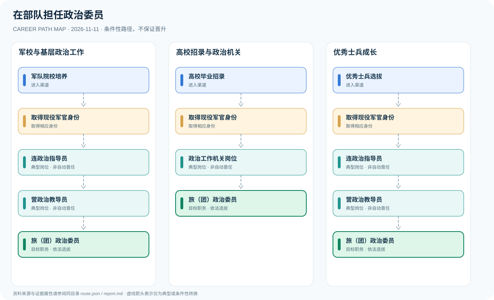

# ◈ Job Route — Evidence-Grounded Career Path Atlas

<p align="center">
  <strong>把职业发展的可能性，画成有出处、可验证、可持续扩展的知识图谱。</strong><br>
  <em>Research → Structured JSON → Schema validation → Mermaid / SVG → Markdown → GitHub Pages</em>
</p>

<p align="center">
  <a href="https://github.com/1998x-stack/job-route/actions/workflows/ci.yml"></a>
  <a href="https://1998x-stack.github.io/job-route/">Web Atlas</a> ·
  <a href="./AGENTS.md">Agent guide</a> ·
  <a href="./schema/career-route.schema.json">JSON Schema</a>
</p>

> [!IMPORTANT]
> 本项目记录**依法允许的职业入口、职位层级、典型任职经历与条件性转换**。不将一条箭头解释为必经之路，也不承诺任何人获得特定职位。各地区、军种、司法机关和不同年份的制度应分别核实。

## ✨ Explore

- **[GitHub Pages 职业图谱](https://1998x-stack.github.io/job-route/)**：按职业领域筛选、搜索、查看 SVG 与研究报告（首次启用需在 Settings → Pages 中设置 Source 为 GitHub Actions）。
- **可追溯数据**：每个职业以 `route.json` 为单一事实源，记录职位、转换、证据属性、来源、地区和核验日期。
- **自动生成可视化**：`route.mmd` 和真正的矢量 `route.svg` 由同一份 JSON 生成，CI 检查文件是否同步。
- **研究型 SKILL**：适配 Codex、Pi、OpenCode；从权威来源检索、交叉核实、编写报告、运行质量门禁。
- **无前端依赖的静态站点**：Python 构建 HTML、响应式 CSS、轻量 JS；无私有 API、无运行时服务。

## 🧭 已收录案例

| 职业 | 领域 | 研究文档 | SVG | JSON |
|:--|:--|:--|:--|:--|
| 在部队担任政治委员 | 军队与国防 | [阅读](data/military/pla-political-commissar/report.md) | [预览](data/military/pla-political-commissar/route.svg) | [数据](data/military/pla-political-commissar/route.json) |
| 成为法院司法警察领导干部 | 司法与法治 | [阅读](data/judicial/court-judicial-police/report.md) | [预览](data/judicial/court-judicial-police/route.svg) | [数据](data/judicial/court-judicial-police/route.json) |
| 从公务员走向县长 | 党政与公共管理 | [阅读](data/government/county-magistrate/report.md) | [预览](data/government/county-magistrate/route.svg) | [数据](data/government/county-magistrate/route.json) |



## 🏛️ Information architecture

```text
job-route/
├── .codex/skills/job-route/SKILL.md    # Codex entry
├── .pi/skills/job-route/SKILL.md       # Pi entry
├── .opencode/skills/job-route/SKILL.md # OpenCode entry
├── skills/job-route/                   # Canonical skill and references
│   ├── SKILL.md
│   └── references/
├── schema/career-route.schema.json     # Strict Draft 2020-12 schema
├── taxonomy/categories.json            # Nine career domains
├── data/<category>/<career-slug>/
│   ├── route.json                      # Canonical graph + evidence
│   ├── route.mmd                       # Generated Mermaid
│   ├── route.svg                       # Generated SVG
│   └── report.md                       # Human research, embeds SVG
├── scripts/{validate.py,build.py,generate.mjs,new_route.py}
├── site/assets/{style.css,app.js}
├── tests/
└── .github/workflows/pages.yml
```

Empty categories contain `README.md` placeholders, deliberately **not fake published routes**. Taxonomy: [nine categories](taxonomy/categories.json).

## ⚡ Install the SKILL

You can copy this prompt into an agent with repository access:

```text
Install the job-route SKILL from https://github.com/1998x-stack/job-route.
Read AGENTS.md and skills/job-route/SKILL.md, use the appropriate
.codex/skills/job-route, .pi/skills/job-route or .opencode/skills/job-route
entry for your agent. Do not execute arbitrary remote install scripts.
When adding a career, research current official sources, generate a
schema-valid route.json and an evidence-cited report.md, run the diagram
generator, validators and static-site build. Never fabricate citations,
regulations, promotion odds or guaranteed career outcomes.
```

> **安装安全**：仓库已经提供 SKILL 文件；可审阅后复制至代理的技能目录。此处不提供未经审核的 `curl | sh` 执行方式。

## 🚀 Contribute a career in five commands

Requires Python 3.11+ and Node.js 20+.

```bash
python -m pip install -r requirements.txt
python scripts/new_route.py --category education --slug university-professor --title "成为大学教授"
# Research and fill drafts/education/university-professor/route.json + report.md
# Move the completed, reviewed folder under data/education/university-professor/
node scripts/generate.mjs --write
python scripts/validate.py && node scripts/generate.mjs --check && python scripts/build.py
```

Open `dist/index.html` via a static HTTP server to preview (e.g., `python -m http.server 8000 -d dist`). A PR runs dedicated CI automatically; successful CI on `main` triggers the separate Pages deployment workflow. Pages must be enabled in repository Settings before the first publish.

## 🔬 Research contract

| Concept | Meaning | Governance |
|:--|:--|:--|
| `normative` | Explicit rule of law / binding regulation | Requires a matching source ID |
| `official_description` | Description published by responsible institution | Requires a matching source ID |
| `illustrative` | Example or career-history synthesis | Never present as mandatory |
| `conditional` | Transfer/appointment dependent on eligibility | Explicitly state the condition |

**All pathways are conditional unless a sourced rule says otherwise.** Check geography, institution, time, and applicability. Roles, titles, ranks, salaries, office grades and eligibility are separate dimensions. Avoid guessed promotion rates, made-up ages, unsupported timelines and identifying private employees.

## 🔁 Publication & quality gates


The build auto-discovers **all** `data/*/*/route.json` files. No manual route registry or hard-coded page menu updates are required.

For system design, evidence rules, reviewer checklist and Pages setup, see [AGENTS.md](AGENTS.md), [CONTRIBUTING](docs/CONTRIBUTING.md) and [research references](skills/job-route/references/research-method.md).

---

<sub>Job Route Atlas is an open, versioned, educational research project. Government and military career paths are described neutrally; official sources prevail over the illustrations in this repository.</sub>

## 📚 Research backlog — 200 careers

Two editable Word reports and their synchronized Markdown/JSON catalogs, across 9 categories and 20 research batches:

- [Volume 01 / JR-001–JR-100](research/backlogs/2026/Job_Route_Careers_Volume_01_2026.md)
- [Volume 02 / JR-101–JR-200](research/backlogs/2026/Job_Route_Careers_Volume_02_2026.md)
- [Word + data download index](research/backlogs/2026/README.md)

These are research candidates. Only sourced, schema-validated individual career routes are published to GitHub Pages.
