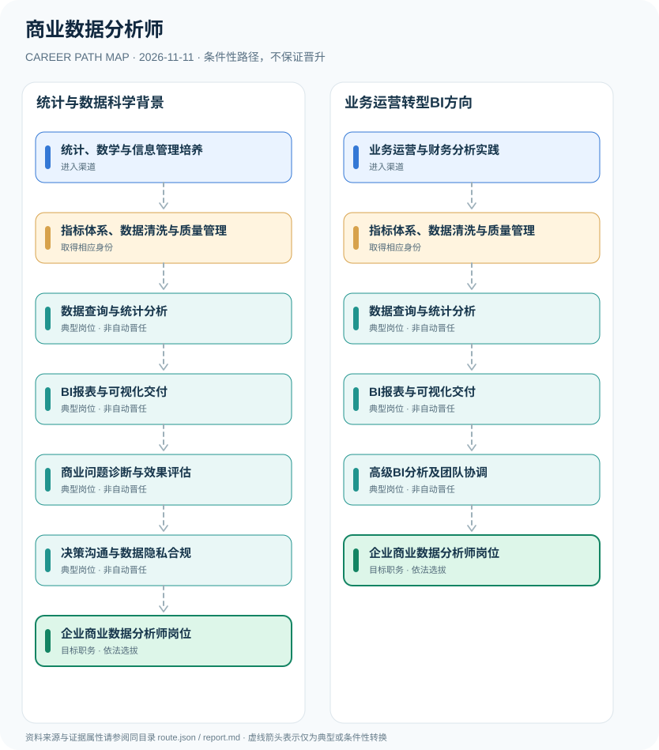

# 商业数据分析师

> **B14 深度研究 · JR-184** · **适用范围**：中国大陆企业商业分析及BI岗位；参照2024年《商务数据分析师国家职业标准》 · **官方资料核验日期**：2026-11-11

## 研究摘要与制度性质

商业数据分析师（BI Analyst）是企业用工岗位，主要涉及数据指标、可视化、商业问题诊断和实验评估；国家《商务数据分析师职业标准（2024）》提供相关技能等级评价基础，但与雇主自主设置的BI分析师或BI经理职位不是自动对应关系。

国家明确存在“商务数据分析师”（职业编码4-07-02-05），但企业使用的“商业数据分析师/BI Analyst”与其不是必然一一对应。这种名称接近而制度不同的情况，需要对职业技能等级和企业职位分别建模。

## 一、入职渠道与资格核验

- **统计、数学与信息管理培养**：从统计、计算机、经济和信息管理等学科积累数据处理、概率、分析和编程基础。
- **业务运营与财务分析实践**：从市场、销售、运营或财务工作理解业务口径，学习SQL、可视化与实验设计等数据技能。

## 二、两种职业发展路线

### 路线 1：统计与数据科学背景

通过分析技能、报表设计与商业问题评估形成业务分析能力，按岗位考核应聘BI职位。

**节点序列**：统计、数学与信息管理培养 → 指标体系、数据清洗与质量管理 → 数据查询与统计分析 → BI报表与可视化交付 → 商业问题诊断与效果评估 → 决策沟通与数据隐私合规 → 企业商业数据分析师岗位

**任用边界**：本路线是一种合理的条件性发展关系；不因完成上一个岗位或取得某张证书自动获得下一个岗位。

### 路线 2：业务运营转型BI方向

从业务熟悉度出发学习指标治理、SQL与可视化，以决策沟通和项目管理形成BI经验。

**节点序列**：业务运营与财务分析实践 → 指标体系、数据清洗与质量管理 → 数据查询与统计分析 → BI报表与可视化交付 → 高级BI分析及团队协调 → 企业商业数据分析师岗位

**任用边界**：本路线是一种合理的条件性发展关系；不因完成上一个岗位或取得某张证书自动获得下一个岗位。

## 三、岗位职责与长期成长

工作成果可用指标口径字典、可重复SQL分析、数据质量测试、Dashboard、营销与供应链影响评估来衡量。随着责任加深，可承担跨部门BI方案设计，但企业领导职务仍须另外选聘。

- **指标体系、数据清洗与质量管理**：定义业务指标、核验数据来源与口径，处理缺失异常和时效问题。
- **数据查询与统计分析**：应用SQL、电子表格或脚本完成数据抽取、转换、描述性统计和分组分析。
- **BI报表与可视化交付**：设计面向决策者的仪表盘、指标归因及有用的可视化报告。
- **商业问题诊断与效果评估**：开展指标拆解、用户行为分析和A/B实验方法评估，说明选择偏差及不确定性。
- **决策沟通与数据隐私合规**：与业务部门合作解释结果，保护商业机密和客户个人信息，避免指标误导。
- **高级BI分析及团队协调**：在雇主组织岗位允许时牵头业务分析框架和跨部门分析项目，经理职位由雇主选任。

## 四、正式政策、准入门槛及制度区分

- 商务数据分析师国家职业标准（2024年版）由人社部与商务部制定，职业编码4-07-02-05，技能评价等级为四级中级工至一级高级技师。
- 国家商务数据分析师职业技能等级属于专业技能评价体系，并不要求所有企业BI分析师或数据分析经理必须持该证书。
- 企业商业智能分析师、数据工程师和机器学习工程师分别偏向业务指标分析、数据基础设施与模型开发，不能混成同一岗位标准。

## 五、时效、地区和身份风险

- 具有商务数据分析师技能证书不等于自动成为BI Manager或数据科学家。
- 2024版国家职业技能标准规范的是相关职业活动和技能评价，不是统一限制性职业执照。
- 涉及客户及员工个人信息需依法合规使用，分析结果需注明数据质量和因果识别限制。

## 六、证据台账（图谱边）

每个转换都按 `conditional` 处理。法规和官方说明作为**节点依据**记入 `route.json` 的 `source_ids`；条件性箭头不代表法律保证、实际个人履历或确定晋升路径。任何法规变更均应同时更新数据与解释文本。

| 从 | 至 | 证据性质 | 适用限制 |
|---|---|---|---|
| 统计、数学与信息管理培养 | 指标体系、数据清洗与质量管理 | conditional | 从「统计、数学与信息管理培养」发展至「指标体系、数据清洗与质量管理」须独立满足职位、资格、考核及组织聘任要求，不能视为自动升级。 |
| 指标体系、数据清洗与质量管理 | 数据查询与统计分析 | conditional | 从「指标体系、数据清洗与质量管理」发展至「数据查询与统计分析」须独立满足职位、资格、考核及组织聘任要求，不能视为自动升级。 |
| 数据查询与统计分析 | BI报表与可视化交付 | conditional | 从「数据查询与统计分析」发展至「BI报表与可视化交付」须独立满足职位、资格、考核及组织聘任要求，不能视为自动升级。 |
| BI报表与可视化交付 | 商业问题诊断与效果评估 | conditional | 从「BI报表与可视化交付」发展至「商业问题诊断与效果评估」须独立满足职位、资格、考核及组织聘任要求，不能视为自动升级。 |
| 商业问题诊断与效果评估 | 决策沟通与数据隐私合规 | conditional | 从「商业问题诊断与效果评估」发展至「决策沟通与数据隐私合规」须独立满足职位、资格、考核及组织聘任要求，不能视为自动升级。 |
| 决策沟通与数据隐私合规 | 企业商业数据分析师岗位 | conditional | 从「决策沟通与数据隐私合规」发展至「企业商业数据分析师岗位」须独立满足职位、资格、考核及组织聘任要求，不能视为自动升级。 |
| 业务运营与财务分析实践 | 指标体系、数据清洗与质量管理 | conditional | 从「业务运营与财务分析实践」发展至「指标体系、数据清洗与质量管理」须独立满足职位、资格、考核及组织聘任要求，不能视为自动升级。 |
| BI报表与可视化交付 | 高级BI分析及团队协调 | conditional | 从「BI报表与可视化交付」发展至「高级BI分析及团队协调」须独立满足职位、资格、考核及组织聘任要求，不能视为自动升级。 |
| 高级BI分析及团队协调 | 企业商业数据分析师岗位 | conditional | 从「高级BI分析及团队协调」发展至「企业商业数据分析师岗位」须独立满足职位、资格、考核及组织聘任要求，不能视为自动升级。 |

## 七、可核对来源（含发布日期）

1. **中华人民共和国人力资源和社会保障部与商务部**：[商务数据分析师国家职业标准（2024年版）](https://www.mohrss.gov.cn/xxgk2020/fdzdgknr/rcrs_4225/jnrc/202402/W020240227591373272377.pdf)，原始发布日期 2024-02-06。
2. **中国就业网（人社部）**：[中华人民共和国职业分类大典（2022年版）政策介绍](https://chinajob.mohrss.gov.cn/h5/c/2022-10-08/361551.shtml)，原始发布日期 2022-10-08。

> **复核提醒**：年度岗位招聘及地方制度变化较快，申请前必须重新核验公告原文、适用人群及有效期。本研究仅公开制度与职业路线，不推断个人晋升概率。
