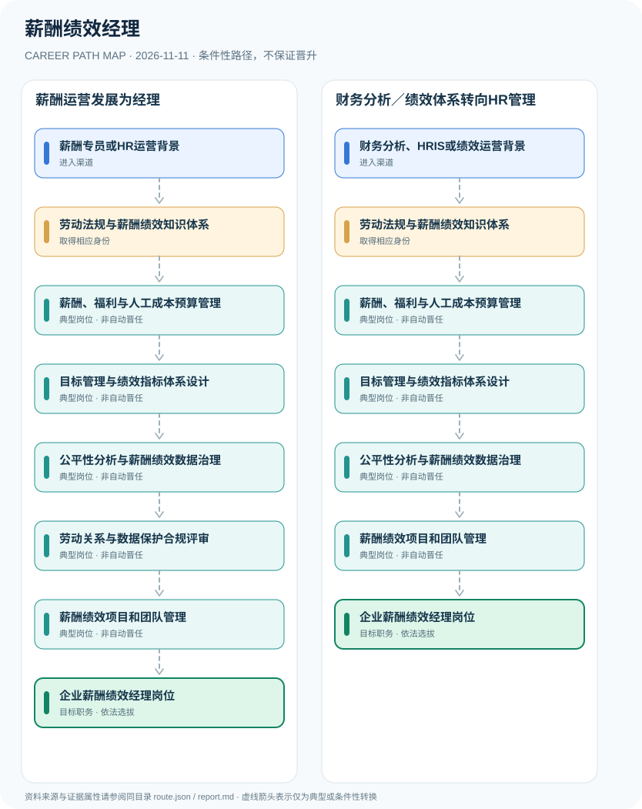

# 薪酬绩效经理

> **B16 深度研究 · JR-191** · 机构与地域：中国大陆企业人力资源管理部门；2026雇主招聘为实证案例 · **核验日期：2026-11-11**

## 一、职业定义与现行制度

薪酬绩效经理是企业任命的人力资源专业管理岗位，涉及薪酬预算、工资福利、绩效目标及奖金政策。企业人力资源管理师职业标准提供有关知识能力评价，不能代替企业经理职务；薪酬和绩效资料常涉及可识别员工信息，个人信息保护法允许在法定条件下实施必要的人力资源管理，但不意味着可以无限制收集或公开。

**法律条款与HR业务场景交叉**：2021个人信息保护法对依法制定劳动规章制度下所必需的人力资源管理设置个人信息处理合法性基础，却不意味着可以自由处理员工所有数据。2026两则大学就业平台转发的雇主公告分别提出绩效分析和薪酬激励职责，说明职位能力是真实市场需求，但单个企业的学历条件无法推广为全国统一标准。

## 二、两类准入与身份确认

- **薪酬专员或HR运营背景**：从员工薪酬核算、福利管理、薪酬调研和劳动关系合规工作积累人力资源运营技能。
- **财务分析、HRIS或绩效运营背景**：从财务预算、组织绩效、人力资源信息系统和数据分析实践转型，按雇主岗位条件补足劳动用工知识。

## 三、法规、资质和考试的判断

- 2025年人社部职业标准通知列出企业人力资源管理师相关职业标准，职业技能等级或标准不等于企业薪酬绩效经理法定个人执业许可。
- 《个人信息保护法》第十三条允许为订立履行合同所必需，或依依法制定的劳动规章制度和集体合同实施人力资源管理所必需，处理必要的个人信息；仍须遵守最小必要等原则。
- 2026年蓝月亮绩效管理和薪酬激励岗位公告明确KPI/OKR、指标维护、数据核验、薪酬激励方案等技能，学历要求仅为该雇主岗位案例。
- 企业员工工资和绩效奖金涉及劳动合同、企业规章和绩效程序，不存在全国一张证书即可取得公司经理职位的制度。

## 四、职业发展路径与条件性节点

### 路线1｜薪酬运营发展为经理

HR专员从薪酬预算和流程执行逐步积累员工绩效制度与数据保护专业能力，依法聘任经理岗位。

**条件性路径**：薪酬专员或HR运营背景 → 劳动法规与薪酬绩效知识体系 → 薪酬、福利与人工成本预算管理 → 目标管理与绩效指标体系设计 → 公平性分析与薪酬绩效数据治理 → 劳动关系与数据保护合规评审 → 薪酬绩效项目和团队管理 → 企业薪酬绩效经理岗位

该路线仅表示可能存在的职业经历；下一阶段均须重新核查资格、机构岗位和考核任职制度，不意味着保证录用或晋升。

### 路线2｜财务分析／绩效体系转向HR管理

已有财务数据背景者学习劳动法与薪酬政策、绩效设计及数据合规后在公司内部任职。

**条件性路径**：财务分析、HRIS或绩效运营背景 → 劳动法规与薪酬绩效知识体系 → 薪酬、福利与人工成本预算管理 → 目标管理与绩效指标体系设计 → 公平性分析与薪酬绩效数据治理 → 薪酬绩效项目和团队管理 → 企业薪酬绩效经理岗位

该路线仅表示可能存在的职业经历；下一阶段均须重新核查资格、机构岗位和考核任职制度，不意味着保证录用或晋升。

## 五、工作能力、项目与成果评价

业务成果包含薪酬预算偏差、薪酬带宽公允度、员工申诉处置、绩效指标可解释性及HRIS安全性。评价时应综合业务价值与员工权益保护，不应鼓励用不透明算法对个人作唯一重大决定。

- **劳动法规与薪酬绩效知识体系**：了解薪酬等级、岗位价值评估、绩效指标设计、劳动合同与个人信息保护的适用条件。
- **薪酬、福利与人工成本预算管理**：维护薪酬数据准确性、福利方案与预算规则，限制敏感薪酬信息访问与错误披露。
- **目标管理与绩效指标体系设计**：参与KPI/OKR、绩效沟通、校准、奖惩关联与申诉处理，保留可审计的政策记录。
- **公平性分析与薪酬绩效数据治理**：以合法必要为原则分析薪酬带宽、绩效分布及内部公平性，做好访问控制与数据保留。
- **劳动关系与数据保护合规评审**：依法制定劳动规章制度和员工信息处理政策，评估涉及重大员工权益的决策流程。
- **薪酬绩效项目和团队管理**：根据公司用人标准和真实岗位授权，统筹薪酬绩效项目；职称、职业技能等级与经理头衔独立。

## 六、适用地区、生效版本及风险

- 不能以“人力资源管理必需”为由无期限收集、对外泄露或跨部门滥用员工健康、薪酬与评价信息。
- 雇主可以将证书作为招聘参考，但企业HR职务任命不是职业技能资格证书的自动转换。
- 不同企业可能将薪酬与绩效分设两个经理，报告所示为组合职能样例，具体职责按组织架构确定。

## 七、证据与图谱的映射

对每一节点，`route.json` 中的 `source_ids` 指向下文的可核查公开来源；每条转换边均标为 `conditional`，不会冒充有明确法律规定的 `normative` 自动晋升。不同的法定资格、机构选聘、职位级别及劳动关系各自独立。

| 转换前 | 转换后 | 证据属性 | 适用限制 |
|---|---|---|---|
| 薪酬专员或HR运营背景 | 劳动法规与薪酬绩效知识体系 | `conditional` | 从「薪酬专员或HR运营背景」至「劳动法规与薪酬绩效知识体系」取决于法定资格、岗位条件或独立选聘考核，绝非自动晋升。 |
| 劳动法规与薪酬绩效知识体系 | 薪酬、福利与人工成本预算管理 | `conditional` | 从「劳动法规与薪酬绩效知识体系」至「薪酬、福利与人工成本预算管理」取决于法定资格、岗位条件或独立选聘考核，绝非自动晋升。 |
| 薪酬、福利与人工成本预算管理 | 目标管理与绩效指标体系设计 | `conditional` | 从「薪酬、福利与人工成本预算管理」至「目标管理与绩效指标体系设计」取决于法定资格、岗位条件或独立选聘考核，绝非自动晋升。 |
| 目标管理与绩效指标体系设计 | 公平性分析与薪酬绩效数据治理 | `conditional` | 从「目标管理与绩效指标体系设计」至「公平性分析与薪酬绩效数据治理」取决于法定资格、岗位条件或独立选聘考核，绝非自动晋升。 |
| 公平性分析与薪酬绩效数据治理 | 劳动关系与数据保护合规评审 | `conditional` | 从「公平性分析与薪酬绩效数据治理」至「劳动关系与数据保护合规评审」取决于法定资格、岗位条件或独立选聘考核，绝非自动晋升。 |
| 劳动关系与数据保护合规评审 | 薪酬绩效项目和团队管理 | `conditional` | 从「劳动关系与数据保护合规评审」至「薪酬绩效项目和团队管理」取决于法定资格、岗位条件或独立选聘考核，绝非自动晋升。 |
| 薪酬绩效项目和团队管理 | 企业薪酬绩效经理岗位 | `conditional` | 从「薪酬绩效项目和团队管理」至「企业薪酬绩效经理岗位」取决于法定资格、岗位条件或独立选聘考核，绝非自动晋升。 |
| 财务分析、HRIS或绩效运营背景 | 劳动法规与薪酬绩效知识体系 | `conditional` | 从「财务分析、HRIS或绩效运营背景」至「劳动法规与薪酬绩效知识体系」取决于法定资格、岗位条件或独立选聘考核，绝非自动晋升。 |
| 公平性分析与薪酬绩效数据治理 | 薪酬绩效项目和团队管理 | `conditional` | 从「公平性分析与薪酬绩效数据治理」至「薪酬绩效项目和团队管理」取决于法定资格、岗位条件或独立选聘考核，绝非自动晋升。 |

## 八、来源及原始发布日期

1. **中华人民共和国人力资源和社会保障部**：[人社部颁布33个国家职业标准通知（含企业人力资源管理师）](https://www.mohrss.gov.cn/xxgk2020/fdzdgknr/rcrs_4225/jnrc/202510/t20251016_560431.html)（原文件或规定日期：2025-08-27）。
2. **中央网络安全和信息化委员会办公室**：[中华人民共和国个人信息保护法](https://www.cac.gov.cn/2021-08/20/c_1631050028355286.htm)（原文件或规定日期：2021-08-20）。
3. **南开大学就业服务中心（转载企业招聘）**：[蓝月亮2026人资管培生—绩效管理招聘](https://career.nankai.edu.cn/correcruit/content/id/119956.html)（原文件或规定日期：2026-10-21）。
4. **南开大学就业服务中心（转载企业招聘）**：[蓝月亮2026人资管培生—薪酬激励招聘](https://career.nankai.edu.cn/correcruit/content/id/119957.html)（原文件或规定日期：2026-10-21）。

> **研究限制**：法规发布日期和实施日期可能不同；2027招录的专项条件以招聘公告实时版本及具体职位表为准。本研究不作个人晋升概率预测，不公开非公开的军队、警务、医疗或个人数据。
