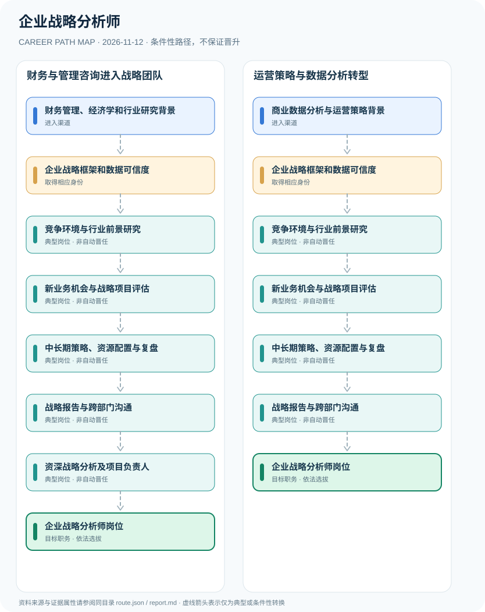

# 企业战略分析师

> **B17 深度调查 · JR-183**　|　**适用地域及机构**：中国大陆互联网、制造和服务企业战略规划部门；以滴滴2026招聘岗位为样例　|　**核验时间**：2026-11-12

## 摘要：岗位身份、适用制度和效力

企业战略分析师是企业内部战略规划和经营研究岗位，常分析行业竞争、业务增长方向、资源配置和新业务可行性。滴滴2026年公开职位包含高级战略分析师和战略分析经理，其工作由企业自主设置。企业内部战略研究不自动具有证券投资咨询业务执业权，岗位职级、金融职业资格和商业数据分析证书需分别核验。

**雇主岗位实证**：滴滴招聘官网2026年10月23日更新岗位库，提供高级战略分析师对标行业、研究前沿技术、评估增长机会等职责，说明这一职位由公司人力资源制度定义而非政府统一职业许可。研究将企业内部策略支持和对外证券投资咨询资质区分，避免将战略研究经历写成有资格向公众提供证券交易建议。

## 进入行业的合法渠道

- **财务管理、经济学和行业研究背景**：从财务分析、企业管理咨询、行业竞争研究或公司战略规划初岗积累业务分析与决策写作能力。
- **商业数据分析与运营策略背景**：从数据分析、产品运营或商业策略工作理解经营数据、用户行为及市场模型，转向公司战略部门。

## 两条可比较的职业发展路径

### 路径 1：财务与管理咨询进入战略团队

从经济与行业研究能力到竞争分析、项目评估，再按组织岗位负责战略方案和管理层沟通。

**条件性节点序列**：财务管理、经济学和行业研究背景 → 企业战略框架和数据可信度 → 竞争环境与行业前景研究 → 新业务机会与战略项目评估 → 中长期策略、资源配置与复盘 → 战略报告与跨部门沟通 → 资深战略分析及项目负责人 → 企业战略分析师岗位

路径只说明一种可解释的可能经历，后续岗位须满足新的资质、招聘、考核或任用要求。

### 路径 2：运营策略与数据分析转型

通过业务数据和市场研究进入战略分析岗位，形成管理层决策支持和目标管理能力。

**条件性节点序列**：商业数据分析与运营策略背景 → 企业战略框架和数据可信度 → 竞争环境与行业前景研究 → 新业务机会与战略项目评估 → 中长期策略、资源配置与复盘 → 战略报告与跨部门沟通 → 企业战略分析师岗位

路径只说明一种可解释的可能经历，后续岗位须满足新的资质、招聘、考核或任用要求。

## 关键技能、项目实践与考核

项目材料可包含竞争格局拆解、TAM/SAM/SOM估算、情景敏感性分析、用户生命周期、战略执行追踪与复盘。战略项目负责人需公司组织授权和团队协作能力。

- **竞争环境与行业前景研究**：研究行业经营模式、技术变革、竞品和市场结构，合理区分事实与战略假设。
- **新业务机会与战略项目评估**：建立投入回报、风险情景、增长机会和业务协同的研究报告，不向公众无资格提供受监管投资建议。
- **中长期策略、资源配置与复盘**：将项目分析转化为管理层报告、经营目标与可检验的执行计划，注意商业秘密保护。
- **战略报告与跨部门沟通**：协调产品、运营、财务和业务部门形成多情景分析，保存假设和数据血缘。
- **资深战略分析及项目负责人**：根据真实岗位需求和公司任用承担复杂项目或团队管理，不自动获得公司高级管理人员身份。

## 法定资格、制度区别与核查条目

- 滴滴2026年公开招聘职位包含‘高级战略分析师’及‘战略分析经理’，职责包括行业趋势研究、竞争对标、评估新业务机会与战略决策支持；为特定企业的岗位样例。
- 企业战略分析与依法需要资质的证券投资咨询服务性质不同，岗位任命不自动赋予对外发布受监管证券投资建议的权限。
- 战略研究者不自动成为公司董事、法定代表人、投资顾问或注册会计师，具体财务审计与投资业务应遵循独立职业制度。

## 风险与地区、年度限制

- 战略分析职位可位于企业战略部、经营分析部、CEO办公室或投资发展部门，不存在跨所有企业统一的管理晋升阶梯。
- 岗位案例中的学历及工作经验不能作为全国法定强制要求，原页面的‘更新时间’并非国家职业标准生效日期。
- 市场规模、增长率和投资回报估计可能受选择偏差和模型误差影响，应标示假设和风险而非给出确定承诺。

## 来源映射及路径证据

`route.json` 记录规范性文件、政策或招聘公告的原文 URL 和发布机构；节点引用 `source_ids`，每条岗位转换保守标为 `conditional`，而非保证升迁的 `normative` 法律权利。涉及真实法定准入的说明见上述条款，避免将机构权责套用到员工个人。

| 前一节点 | 后一节点 | 边属性 | 适用条件 |
|---|---|---|---|
| 财务管理、经济学和行业研究背景 | 企业战略框架和数据可信度 | `conditional` | 「财务管理、经济学和行业研究背景」到「企业战略框架和数据可信度」需要独立满足适用职位、资格、权限与机构安排，非自动晋升。 |
| 企业战略框架和数据可信度 | 竞争环境与行业前景研究 | `conditional` | 「企业战略框架和数据可信度」到「竞争环境与行业前景研究」需要独立满足适用职位、资格、权限与机构安排，非自动晋升。 |
| 竞争环境与行业前景研究 | 新业务机会与战略项目评估 | `conditional` | 「竞争环境与行业前景研究」到「新业务机会与战略项目评估」需要独立满足适用职位、资格、权限与机构安排，非自动晋升。 |
| 新业务机会与战略项目评估 | 中长期策略、资源配置与复盘 | `conditional` | 「新业务机会与战略项目评估」到「中长期策略、资源配置与复盘」需要独立满足适用职位、资格、权限与机构安排，非自动晋升。 |
| 中长期策略、资源配置与复盘 | 战略报告与跨部门沟通 | `conditional` | 「中长期策略、资源配置与复盘」到「战略报告与跨部门沟通」需要独立满足适用职位、资格、权限与机构安排，非自动晋升。 |
| 战略报告与跨部门沟通 | 资深战略分析及项目负责人 | `conditional` | 「战略报告与跨部门沟通」到「资深战略分析及项目负责人」需要独立满足适用职位、资格、权限与机构安排，非自动晋升。 |
| 资深战略分析及项目负责人 | 企业战略分析师岗位 | `conditional` | 「资深战略分析及项目负责人」到「企业战略分析师岗位」需要独立满足适用职位、资格、权限与机构安排，非自动晋升。 |
| 商业数据分析与运营策略背景 | 企业战略框架和数据可信度 | `conditional` | 「商业数据分析与运营策略背景」到「企业战略框架和数据可信度」需要独立满足适用职位、资格、权限与机构安排，非自动晋升。 |
| 战略报告与跨部门沟通 | 企业战略分析师岗位 | `conditional` | 「战略报告与跨部门沟通」到「企业战略分析师岗位」需要独立满足适用职位、资格、权限与机构安排，非自动晋升。 |

## 可复核的公开来源

1. **滴滴出行招聘官网**：[滴滴招聘：高级战略分析师与战略分析经理岗位列表（2026-10-23更新）](https://talent.didiglobal.com/social/neitui/4074)（原始制度日期 2026-10-23）
2. **中央网络安全和信息化委员会办公室**：[中华人民共和国个人信息保护法](https://www.cac.gov.cn/2021-08/20/c_1631050028355286.htm)（原始制度日期 2021-08-20）

> **研究说明**：来源的发布日期不代表法规施行日期；招聘公告不保证报名窗口仍开放。涉及跨地区或新版本制度时须重新核验。本路线不承诺个人晋升概率。
