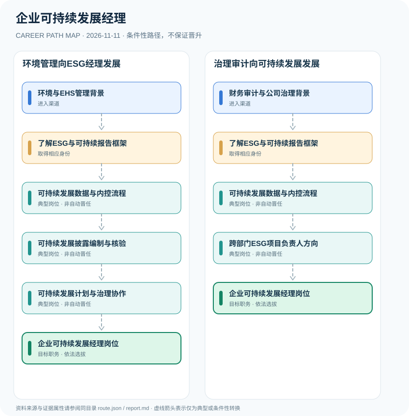

# 企业可持续发展经理

> **研究批次** B12 · JR-192　|　**范围**：中国大陆；以上交所2026年上市公司可持续发展报告编制指南为规则实例　|　**核验日期**：2026-11-11

## 摘要与职业定位

企业可持续发展经理是企业内部ESG战略和环境社会治理协调岗位，不是持统一证书才能上任的法定职务。证券交易所可持续发展披露规则的义务主体是适用范围内的上市公司，不能将信息披露义务直接认定为经理个人的执业许可。

**制度差别**：公司报告由适用规则确定信息披露范围，内部可持续发展经理通常是专业统筹者。上海证券交易所2026年修订的《可持续发展报告编制指南》是可核对的制度基础，不能据此创造所谓“全国ESG经理执业证”。

## 进入职业的合法渠道

- **环境与EHS管理背景**：从环境保护、能源管理、职业健康安全或企业运营治理实践进入可持续发展领域。
- **财务审计与公司治理背景**：从内部审计、风险合规、公司治理或资本市场信息披露进入ESG管理。

## 2 种代表性职业发展路线

### 1. 环境管理向ESG经理发展

从EHS与环境工作积累数据能力，参与披露与项目治理，逐步承担跨部门职责。

**岗位序列（条件性示意）**：环境与EHS管理背景 → 了解ESG与可持续报告框架 → 可持续发展数据与内控流程 → 可持续发展披露编制与核验 → 可持续发展计划与治理协作 → 企业可持续发展经理岗位

### 2. 治理审计向可持续发展发展

在审计风险与披露背景基础上掌握ESG框架、数据内控与战略项目，匹配企业岗位。

**岗位序列（条件性示意）**：财务审计与公司治理背景 → 了解ESG与可持续报告框架 → 可持续发展数据与内控流程 → 跨部门ESG项目负责人方向 → 企业可持续发展经理岗位

## 重要职责、技能和岗位发展

**职业能力**：环境和能源数据、财务治理、重大性分析、温室气体信息、供应链风险和报告核验。管理岗位的晋升取决于雇主职数、跨部门沟通能力和实际可衡量成果。

- **可持续发展数据与内控流程**：协调企业部门采集排放、能源、员工与治理等指标并建立内部证据与审核程序。
- **可持续发展披露编制与核验**：按适用交易所或监管要求组织报告编制、重大性评估及披露质量管理。
- **可持续发展计划与治理协作**：支持企业环境社会风险识别、经营策略协同及管理层决策。
- **跨部门ESG项目负责人方向**：经企业内部授权或招聘担任项目或团队负责人，不能直接推算为法定披露责任个人。

## 准入门槛与任职规则

- 上海证券交易所2026年1月修订指南新增污染物排放、能源利用和水资源利用等应用指南，覆盖适用上市公司可持续发展报告编制。
- 适用的信息披露义务由相关上市公司和信息披露义务人履行，不是“ESG经理个人考试发证”制度。
- 私营、未上市和不同交易所的披露义务范围有区别；应核对具体公司是否适用强制性报告要求。

## 证据状态与实际约束

路线图中的箭头均为 `conditional`：即使前一节点的经历成立，后续任用、考试、职业资格、选拔或招聘仍需独立满足制度要求。`normative` 专指法律直接规定的关系，`official_description` 指官方机构说明，`illustrative` 指仅用于理解的示例；具体证据来源链接见下文。

- ESG经理是企业内设职位，岗位名称、汇报关系与专业要求因企业而异。
- 2026上交所指南是上市公司报告编制指导，不可直接解释为所有中国企业必须发布同一标准的年度报告。
- 应避免以不经核验的宣传或绿色漂洗替代基于可验证数据的披露。

## 可复核原始资料

1. [上交所上市公司自律监管指南第4号——可持续发展报告编制（2026年1月修订）](https://www.sse.com.cn/lawandrules/guide2025/stock/zbxxpljg/ssgszljg/c/c_20260202_10807819.shtml)，上海证券交易所，2026-01-30。
2. [中华人民共和国公司法（2023修订）](https://www.samr.gov.cn/xyjgs/flfg/art/2024/art_d4e84936a8a744f8928ac7aec7594345.html)，全国人大常委会／中国政府网，2023-12-29。

> **复核提醒**：跨地区、跨机构或新招录年度，必须重新核查原始政策、职位计划及生效状态。此报告不推测晋升概率和个人任职结果。
