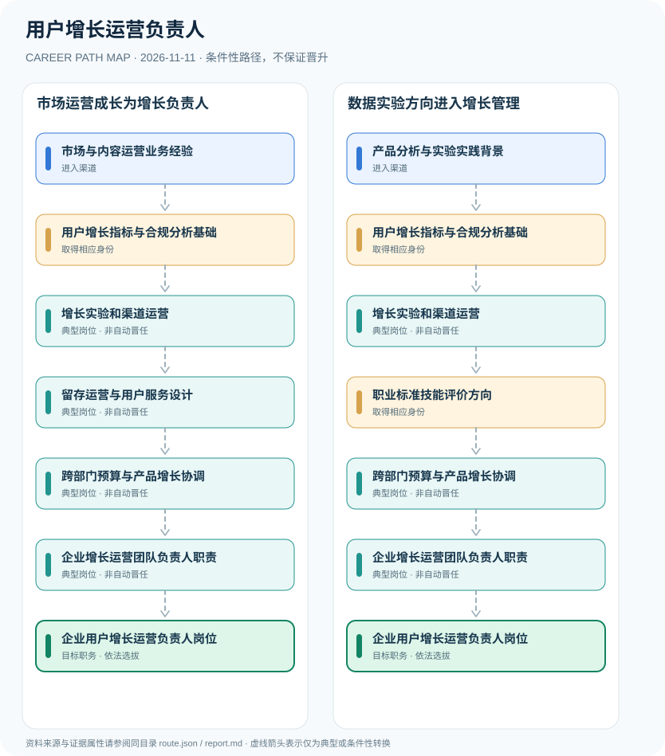

# 用户增长运营负责人

> **B15 深度研究 · JR-189**　｜　**地域与机构**：中国大陆企业增长运营岗位；参考2024职业公告及2026年版用户增长运营师职业标准　｜　**核验日期**：2026-11-11

## 01 职业定位与现行制度版本

用户增长运营负责人是企业内部组织管理职位，与人社部门正式发布的“用户增长运营师”国家职业并非一一对应。2024年用户增长运营师获列为19项新职业之一，2026年4月又发布了相关国家职业标准；职业技能等级和企业“增长负责人”岗位任命属于不同制度。增长运营还须遵守隐私保护、营销真实性与公平交易规则。

**版本核验**：2024年职业官方发布名单列明用户增长运营师，2026年4月发布国家职业标准，说明从职业认定进入标准化技能评价阶段。两项发布在时间上应区分；不能说截至2026年尚无用户增长运营师标准，也不能把国家职业技能等级直接解释成企业管理职务。

## 02 两类准入及真实制度门槛

- **市场与内容运营业务经验**：从合法市场推广、用户社群、产品运营或营销活动积累客户需求分析和运营服务能力。
- **产品分析与实验实践背景**：从数据分析、产品增长实验或客户成功岗位进入，掌握指标口径与可复现实验方法。

- 2024年8月人社部会同国家统计局等正式发布用户增长运营师新职业，职业编码4-07-02-06，核心活动为数字化用户增长、管理与运营。
- 人社部办公厅、工信部办公厅于2026年4月联合颁布《用户增长运营师S（2026年版）》国家职业标准，明确培训和技能评价框架。
- 用户增长运营师职业技能等级与企业“用户增长运营负责人”内部管理职位不构成法定自动对应。

## 03 典型发展路线及任职决定点

### 路线1：市场运营成长为增长负责人

从运营获客与用户服务实践形成指标、实验和跨部门管理能力，经企业招聘或晋任承担团队责任。

**条件性节点**：市场与内容运营业务经验 → 用户增长指标与合规分析基础 → 增长实验和渠道运营 → 留存运营与用户服务设计 → 跨部门预算与产品增长协调 → 企业增长运营团队负责人职责 → 企业用户增长运营负责人岗位

应在每次考试、身份取得、聘用、晋升或岗位任命时重新审核条件；不能把这条示意路径当作法律规定的必然晋升链条。

### 路线2：数据实验方向进入增长管理

从产品数据与实验分析实践形成经营增长能力，可参考国家职业标准再进入跨部门管理岗位。

**条件性节点**：产品分析与实验实践背景 → 用户增长指标与合规分析基础 → 增长实验和渠道运营 → 职业标准技能评价方向 → 跨部门预算与产品增长协调 → 企业增长运营团队负责人职责 → 企业用户增长运营负责人岗位

应在每次考试、身份取得、聘用、晋升或岗位任命时重新审核条件；不能把这条示意路径当作法律规定的必然晋升链条。

## 04 工作职责、核心能力与评价方式

可量化能力包括漏斗转化、渠道获客成本CAC、留存、生命周期价值LTV、实验统计设计、投诉与隐私风险控制。是否成为负责人取决于跨团队协同和组织聘任，不因为达到某个技能等级自动获得管理头衔。

- **用户增长指标与合规分析基础**：清楚定义获客、激活、留存、转化和生命周期价值指标，并合法处理用户数据。
- **增长实验和渠道运营**：按业务目标设计可检验增长方案，运用内容、私域社群和数字化工具而非不当诱导用户。
- **留存运营与用户服务设计**：通过用户反馈、服务质量改善与产品协作提升长期关系，记录实验结果和运营风险。
- **职业标准技能评价方向**：学习2026年用户增长运营师国家职业标准并可按适用渠道参与技能等级评价，等级证明不等于经理职位。
- **跨部门预算与产品增长协调**：结合产品、数据、销售和客服团队制定增长计划，报告收益、合规性和成本。
- **企业增长运营团队负责人职责**：根据公司组织岗位及绩效考核经正式聘用承担团队管理、目标协调和预算责任。

## 05 适用边界、时效与容易混淆的身份

- 不能把用户增长运营师职业技能评价证书包装成全国企业增长负责人强制执业许可证。
- 用户增长率、转化率和业务增长预算属于商业绩效指标，不能忽视客户隐私、知情同意与合规营销。
- 雇主内部增长负责人可以存在增长产品、市场增长、社群运营等不同组织架构，不能将某家企业要求作为全国统一门槛。

## 06 证据台账与图谱解释

规范性文件、机构职责和招聘公告分别记录在 `route.json` 的 `sources` 中，并由岗位节点使用 `source_ids` 引用。所有边标记为 `conditional`（条件性转换），**不得因来源中存在某项资格就推定本人必获后续岗位**。若需要标注法律明确规定的资格，应在研究说明中具体引用相关条款，而不能把一个推测性职位转换伪装成 `normative`。

| 转换前 | 转换后 | 证据类型 | 约束说明 |
|---|---|---|---|
| 市场与内容运营业务经验 | 用户增长指标与合规分析基础 | `conditional` | 从「市场与内容运营业务经验」到「用户增长指标与合规分析基础」须独立满足资格、岗位要求及考试或组织安排；示意路线不构成保证晋任。 |
| 用户增长指标与合规分析基础 | 增长实验和渠道运营 | `conditional` | 从「用户增长指标与合规分析基础」到「增长实验和渠道运营」须独立满足资格、岗位要求及考试或组织安排；示意路线不构成保证晋任。 |
| 增长实验和渠道运营 | 留存运营与用户服务设计 | `conditional` | 从「增长实验和渠道运营」到「留存运营与用户服务设计」须独立满足资格、岗位要求及考试或组织安排；示意路线不构成保证晋任。 |
| 留存运营与用户服务设计 | 跨部门预算与产品增长协调 | `conditional` | 从「留存运营与用户服务设计」到「跨部门预算与产品增长协调」须独立满足资格、岗位要求及考试或组织安排；示意路线不构成保证晋任。 |
| 跨部门预算与产品增长协调 | 企业增长运营团队负责人职责 | `conditional` | 从「跨部门预算与产品增长协调」到「企业增长运营团队负责人职责」须独立满足资格、岗位要求及考试或组织安排；示意路线不构成保证晋任。 |
| 企业增长运营团队负责人职责 | 企业用户增长运营负责人岗位 | `conditional` | 从「企业增长运营团队负责人职责」到「企业用户增长运营负责人岗位」须独立满足资格、岗位要求及考试或组织安排；示意路线不构成保证晋任。 |
| 产品分析与实验实践背景 | 用户增长指标与合规分析基础 | `conditional` | 从「产品分析与实验实践背景」到「用户增长指标与合规分析基础」须独立满足资格、岗位要求及考试或组织安排；示意路线不构成保证晋任。 |
| 增长实验和渠道运营 | 职业标准技能评价方向 | `conditional` | 从「增长实验和渠道运营」到「职业标准技能评价方向」须独立满足资格、岗位要求及考试或组织安排；示意路线不构成保证晋任。 |
| 职业标准技能评价方向 | 跨部门预算与产品增长协调 | `conditional` | 从「职业标准技能评价方向」到「跨部门预算与产品增长协调」须独立满足资格、岗位要求及考试或组织安排；示意路线不构成保证晋任。 |

## 07 官方与公开资料（可追溯）

1. [人社部联合发布生物工程技术人员等19个新职业（含用户增长运营师）](https://chinajob.mohrss.gov.cn/c/2024-08-01/413001.shtml) — 中国就业网（人社部）；来源原始日期 2024-08-01。
2. [用户增长运营师S国家职业标准（2026年版）正式颁布](https://www.cecc.org.cn/train-notice-detail/id/22017.html) — 中国电子商会（标准起草单位）；来源原始日期 2026-04-29。
3. [人社部办公厅和工信部办公厅2026年职业标准发布资讯](https://www.mohrss.gov.cn/xxgk2020/fdzdgknr/rcrs_4225/jnrc/) — 人力资源和社会保障部职业能力建设信息；来源原始日期 2026-04-17。

> **复核协议**：跨年度招生公告、法律修订、专业等级与机构设置可能变化。实际申请和转岗前，须核对当前官方原文、所在地文件及单位职位要求，尤其注意来源发布日期与生效日期未必一致。
