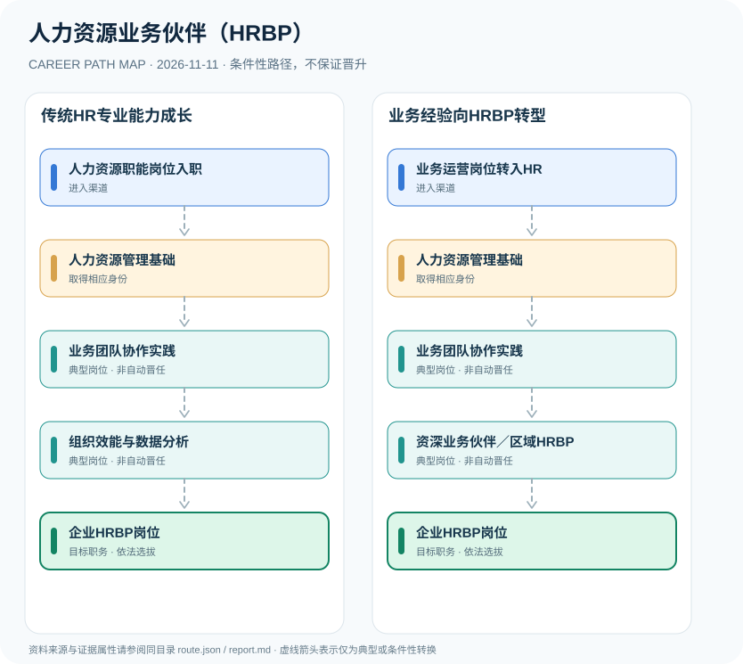

# 人力资源业务伙伴（HRBP）

> **批次**：B11 · JR-190 · **适用范围**：中国大陆·企业招聘与人力资源管理岗位（非统一法定执业身份） · **核验日期**：2026-11-11

## 执行摘要

HRBP是企业面向业务团队的人力资源伙伴岗位，通常要求招聘、绩效、组织发展与员工关系的组合能力。企业人力资源管理师职业标准可作知识背景，不构成HRBP必须取得统一执业证书的法规。

HRBP（Human Resources Business Partner）是企业在人力资源与业务管理之间设置的合作型职能，常见任务涉及组织与人才规划、招聘绩效和员工关系。

## 一、准入方式及行政／招聘程序

从HR专员成长或从业务岗位转型都可能进入HRBP，但两者需要补足不同的能力。人社部企业人力资源管理师标准说明人力资源管理知识体系；某个企业的HRBP招聘条件只用于展示市场实例，不能当作全国统一资格。

- **人力资源职能岗位入职**：通过企业人事专员、招聘与员工关系等岗位积累合法招聘及劳动关系基础。
- **业务运营岗位转入HR**：具有业务管理经验者可根据企业岗位招聘或内部转岗规则进入业务人力资源合作工作。

## 二、常见路线与机构决定点

### 1. 传统HR专业能力成长

从人力资源职能实践和业务团队协作积累专业能力，逐步进入HRBP岗位。

**阶段示意**：人力资源职能岗位入职 → 人力资源管理基础 → 业务团队协作实践 → 组织效能与数据分析 → 企业HRBP岗位

**解释**：上述转换由岗位条件、资格确认、招聘或任用程序控制。即使具有上一阶段经历，也不保证任职下一阶段。

### 2. 业务经验向HRBP转型

具有业务部门经验者经企业培训或相关岗位招聘后理解HR专业体系并承担伙伴职责。

**阶段示意**：业务运营岗位转入HR → 人力资源管理基础 → 业务团队协作实践 → 资深业务伙伴／区域HRBP → 企业HRBP岗位

**解释**：上述转换由岗位条件、资格确认、招聘或任用程序控制。即使具有上一阶段经历，也不保证任职下一阶段。

## 三、关键职责与专业发展

初级岗位重点在招聘、薪酬与劳动关系的执行质量；HRBP要求理解业务目标及人员结构、提供人才与组织方案；进一步发展可承担跨事业部合作或管理岗位。所有职级与称号属于企业管理，不是政府部门认定的行政级别。

- **人力资源管理基础**：熟悉招聘配置、培训发展、绩效薪酬、劳动关系与人力资源数据工作。
- **业务团队协作实践**：参与组织诊断、人才盘点、需求规划与管理者沟通，逐步从流程执行向业务支持发展。
- **组织效能与数据分析**：运用人员流动、招聘漏斗、组织结构等数据支持业务决策，依法处理员工信息。
- **资深业务伙伴／区域HRBP**：根据企业实际任职要求，可能管理更复杂的业务模块或区域，不是国家统一职级。

## 四、关键资格、执业条件与区别

- 企业人力资源管理师是国家职业分类体系内的技能评价相关职业，而HRBP是企业自行设置的岗位名称，两者不能直接划等号。
- 企业HRBP招聘示例通常涉及组织诊断、人才盘点、招聘、绩效、员工关系与人力资源数据；专业、学历和年限须以各单位岗位公告为准。
- 持有职业技能等级证书不能替代雇主岗位选聘，也不自动取得“资深HRBP”“HR经理”等职务。

## 五、证据分类和路线关系

本图把制度依据和职业经历分开：`normative` 表示有明确法规支持的规则，`official_description` 表示官方公开职责，`illustrative` 代表示意经历，`conditional` 代表资格、招聘、考核或任用控制的转换。本研究**不会把职业图谱中的箭头写成保证晋升**；全图边均显式标为条件性职业转换。职业身份、岗位层级、职称、行政职级和证书不可互换。

| 转换关系 | 证据分类 | 约束说明 |
|:--|:--|:--|
| 人力资源职能岗位入职 → 人力资源管理基础 | `conditional` | 从「人力资源职能岗位入职」转向「人力资源管理基础」须依本岗资格、机构要求和实际程序审核；不是任何人的自动晋升。 |
| 人力资源管理基础 → 业务团队协作实践 | `conditional` | 从「人力资源管理基础」转向「业务团队协作实践」须依本岗资格、机构要求和实际程序审核；不是任何人的自动晋升。 |
| 业务团队协作实践 → 组织效能与数据分析 | `conditional` | 从「业务团队协作实践」转向「组织效能与数据分析」须依本岗资格、机构要求和实际程序审核；不是任何人的自动晋升。 |
| 组织效能与数据分析 → 企业HRBP岗位 | `conditional` | 从「组织效能与数据分析」转向「企业HRBP岗位」须依本岗资格、机构要求和实际程序审核；不是任何人的自动晋升。 |
| 业务运营岗位转入HR → 人力资源管理基础 | `conditional` | 从「业务运营岗位转入HR」转向「人力资源管理基础」须依本岗资格、机构要求和实际程序审核；不是任何人的自动晋升。 |
| 业务团队协作实践 → 资深业务伙伴／区域HRBP | `conditional` | 从「业务团队协作实践」转向「资深业务伙伴／区域HRBP」须依本岗资格、机构要求和实际程序审核；不是任何人的自动晋升。 |
| 资深业务伙伴／区域HRBP → 企业HRBP岗位 | `conditional` | 从「资深业务伙伴／区域HRBP」转向「企业HRBP岗位」须依本岗资格、机构要求和实际程序审核；不是任何人的自动晋升。 |

## 六、适用边界与更新风险

- HRBP不是国家公务员人社部门的管理职务，也不是必须经过统一执业许可的独立受限制职业。
- 不同企业三支柱组织模式、岗位责任与职位名称不同；不要将招聘个案年龄或学历变成普遍规则。
- 本图谱仅讨论依法合规的HR和业务管理能力，不涉及操纵招聘或歧视性筛选。

## 七、官方和公开核验来源

1. [人社部颁布企业人力资源管理师等国家职业标准的通知](https://www.mohrss.gov.cn/xxgk2020/fdzdgknr/rcrs_4225/jnrc/202510/t20251016_560431.html) — 人力资源社会保障部，原文日期 2025-08-27。
2. [职业分类大典2022年版公开介绍](https://chinajob.mohrss.gov.cn/h5/c/2022-10-08/361551.shtml) — 中国就业网（人力资源社会保障部），原文日期 2022-10-08。
3. [大唐集团数字科技有限公司HRBP岗位招聘示例](https://www.gaoxiaojob.com/job/detail/2356775.html) — 高校人才网（转载雇主招聘），原文日期 2026-10-12。

> **下一次更新检查**：实际申请时重新查当年岗位计划、地区特殊限制和新规替代情形。个人发展结果不作预测。
