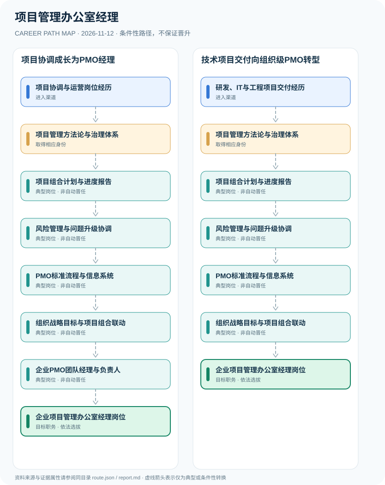

# 项目管理办公室经理

> **B17 深度调查 · JR-187**　|　**适用地域及机构**：中国大陆各行业企业项目管理办公室（PMO）岗位；天津利安隆2026招聘作为具体实例　|　**核验时间**：2026-11-12

## 摘要：岗位身份、适用制度和效力

项目管理办公室（PMO）经理属于企业经营管理岗位，负责项目组合治理、进度与风险、管理流程和跨部门资源协调，并非全国统一法定个人执业资格。2026年天津利安隆有PMO项目管理专员招聘，说明企业如何建立标准、绩效和项目经理培养体系；注册建造师则依法针对建设工程施工单位项目负责人等特定职责，不能把所有企业PMO岗位等同于注册建造师。

**证据与角色**：天津利安隆2026年PMO专员明确提出统一项目管理流程、报告和人才培养，显示PMO工作更偏向组织治理；住房城乡建设部《注册建造师管理规定》第三条限定特定建设工程施工项目负责人资格。将‘项目管理’四字理解为相同法定职业容易误导，所以在图谱中特意分离。

## 进入行业的合法渠道

- **项目协调与运营岗位经历**：从项目专员、运营、流程协调及交付报告岗位积累甘特计划、风险台账和跨部门沟通能力。
- **研发、IT与工程项目交付经历**：已有软件、制造或设备工程项目经验者，可以按企业职务要求转向项目组合管理和PMO治理。

## 两条可比较的职业发展路径

### 路径 1：项目协调成长为PMO经理

从项目专员与报告工作学习项目治理、跨团队协调及组织标准，符合条件时担任PMO负责人。

**条件性节点序列**：项目协调与运营岗位经历 → 项目管理方法论与治理体系 → 项目组合计划与进度报告 → 风险管理与问题升级协调 → PMO标准流程与信息系统 → 组织战略目标与项目组合联动 → 企业PMO团队经理与负责人 → 企业项目管理办公室经理岗位

路径只说明一种可解释的可能经历，后续岗位须满足新的资质、招聘、考核或任用要求。

### 路径 2：技术项目交付向组织级PMO转型

从研发和工程项目交付积累计划、质量与跨项目协同，再按企业职务聘任承担PMO管理。

**条件性节点序列**：研发、IT与工程项目交付经历 → 项目管理方法论与治理体系 → 项目组合计划与进度报告 → 风险管理与问题升级协调 → PMO标准流程与信息系统 → 组织战略目标与项目组合联动 → 企业项目管理办公室经理岗位

路径只说明一种可解释的可能经历，后续岗位须满足新的资质、招聘、考核或任用要求。

## 关键技能、项目实践与考核

可衡量成果包括项目按期率、组合资源负荷、风险关闭时间、管理报告完整率、项目经理培养成效和组织级项目组合收益。PMO办公室负责人职务由企业合法任用。

- **项目组合计划与进度报告**：协调资源配置、交付依赖、项目进度与管理层报告，定期检查偏差及调整依据。
- **风险管理与问题升级协调**：建立跨项目风险台账、障碍升级和复盘，支持关键项目质量与内部控制。
- **PMO标准流程与信息系统**：推动项目管理标准、绩效体系、项目经理培养和数字化工具应用，按权限管理项目数据。
- **组织战略目标与项目组合联动**：根据组织目标衡量项目业务价值及资源优先级，协同战略部门调整治理计划。
- **企业PMO团队经理与负责人**：依公司聘任和具体业务职责担任PMO经理，建设工程中需要法定执业者的施工项目另核资格。

## 法定资格、制度区别与核查条目

- 2026年10月8日河北工业大学就业平台转载天津利安隆PMO岗位，明确建立项目管理标准、项目绩效体系、项目经理培养及数字化工具的职责；仅作为该企业真实招聘样例。
- 《注册建造师管理规定》对建设工程施工单位特定项目负责人设置执业许可，法定适用对象不能推广至IT、消费品和企业战略PMO全部岗位。
- PMP、Prince2等行业项目管理认证及企业内部项目经理等级可能有帮助，但不是每家公司的PMO经理统一法定准入证书。

## 风险与地区、年度限制

- ‘PMO经理’和‘施工单位项目经理’在职责、项目属性、职业许可上不能直接等同，若实际承担受限制的建设工程执业则应独立满足建造师规定。
- 职位招聘样例是某公司项目管理专员，不是对全国经理最低经验或薪酬水平的统计。
- 项目组合预算、商业机密和员工绩效信息需在企业授权与合法数据使用范围内处理。

## 来源映射及路径证据

`route.json` 记录规范性文件、政策或招聘公告的原文 URL 和发布机构；节点引用 `source_ids`，每条岗位转换保守标为 `conditional`，而非保证升迁的 `normative` 法律权利。涉及真实法定准入的说明见上述条款，避免将机构权责套用到员工个人。

| 前一节点 | 后一节点 | 边属性 | 适用条件 |
|---|---|---|---|
| 项目协调与运营岗位经历 | 项目管理方法论与治理体系 | `conditional` | 「项目协调与运营岗位经历」到「项目管理方法论与治理体系」需要独立满足适用职位、资格、权限与机构安排，非自动晋升。 |
| 项目管理方法论与治理体系 | 项目组合计划与进度报告 | `conditional` | 「项目管理方法论与治理体系」到「项目组合计划与进度报告」需要独立满足适用职位、资格、权限与机构安排，非自动晋升。 |
| 项目组合计划与进度报告 | 风险管理与问题升级协调 | `conditional` | 「项目组合计划与进度报告」到「风险管理与问题升级协调」需要独立满足适用职位、资格、权限与机构安排，非自动晋升。 |
| 风险管理与问题升级协调 | PMO标准流程与信息系统 | `conditional` | 「风险管理与问题升级协调」到「PMO标准流程与信息系统」需要独立满足适用职位、资格、权限与机构安排，非自动晋升。 |
| PMO标准流程与信息系统 | 组织战略目标与项目组合联动 | `conditional` | 「PMO标准流程与信息系统」到「组织战略目标与项目组合联动」需要独立满足适用职位、资格、权限与机构安排，非自动晋升。 |
| 组织战略目标与项目组合联动 | 企业PMO团队经理与负责人 | `conditional` | 「组织战略目标与项目组合联动」到「企业PMO团队经理与负责人」需要独立满足适用职位、资格、权限与机构安排，非自动晋升。 |
| 企业PMO团队经理与负责人 | 企业项目管理办公室经理岗位 | `conditional` | 「企业PMO团队经理与负责人」到「企业项目管理办公室经理岗位」需要独立满足适用职位、资格、权限与机构安排，非自动晋升。 |
| 研发、IT与工程项目交付经历 | 项目管理方法论与治理体系 | `conditional` | 「研发、IT与工程项目交付经历」到「项目管理方法论与治理体系」需要独立满足适用职位、资格、权限与机构安排，非自动晋升。 |
| 组织战略目标与项目组合联动 | 企业项目管理办公室经理岗位 | `conditional` | 「组织战略目标与项目组合联动」到「企业项目管理办公室经理岗位」需要独立满足适用职位、资格、权限与机构安排，非自动晋升。 |

## 可复核的公开来源

1. **河北工业大学就业服务中心（转载雇主）**：[天津利安隆新材料股份有限公司项目管理专员（PMO）招聘](https://career.hebut.edu.cn/home/correcruit/content/id/81687.html)（原始制度日期 2026-10-08）
2. **中华人民共和国住房和城乡建设部**：[注册建造师管理规定（住房城乡建设部现行修订文本）](https://www.mohurd.gov.cn/gongkai/zhengce/gzk/art/2022/art_17337_763849.html)（原始制度日期 2016-09-13）

> **研究说明**：来源的发布日期不代表法规施行日期；招聘公告不保证报名窗口仍开放。涉及跨地区或新版本制度时须重新核验。本路线不承诺个人晋升概率。
