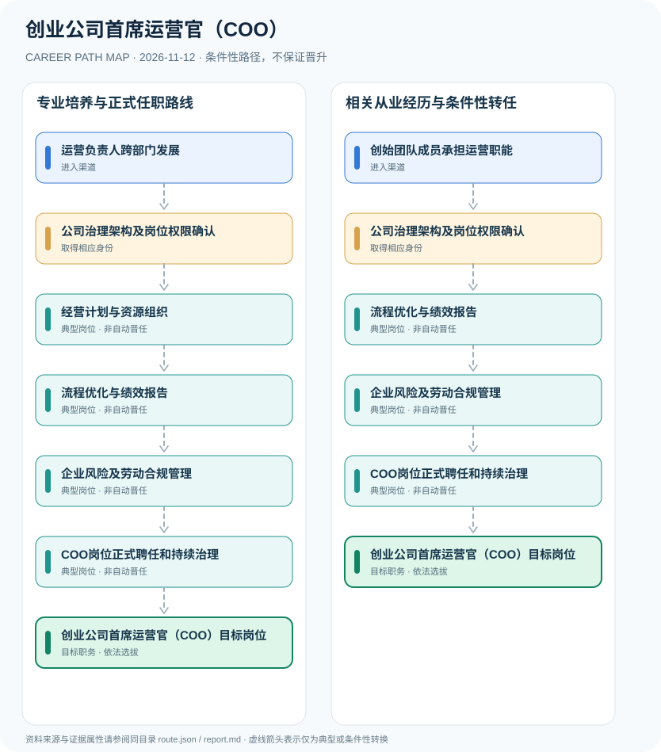

# 创业公司首席运营官（COO）

> **B18 深度职业研究 · JR-194** · 核验日期：2026-11-12 · 中国大陆创业公司与成长型企业，按公司章程、董事会授权及实际劳动关系判定

## 01 现行制度与职业身份

创业公司首席运营官（COO）通常负责业务流程、运营效率、跨部门项目交付和经营指标协同，职位名称由企业设置，并非全国统一法定职业许可。《公司法》2023年修订于2024年7月1日实施，规定公司经理的聘任和授权；但COO不必然就是公司法中的‘经理’，是否属于高级管理人员或章程列明的高管须按公司章程和实际授权认定。

公司法没有要求全国创业企业必须设置COO岗位。2023修订公司法明确经理可以由董事会聘任，但COO仅是常见企业治理头衔，是否构成法律上的经理或高管需查公司章程和实际授权。创业合伙人承担运营工作是可能的替代渠道，不是法定自动任职。

## 02 两种进入渠道

- **运营负责人跨部门发展**：在产品、供应链、销售或服务交付等业务中承担部门管理，积累组织协同与经营预算能力后依董事会或组织授权被聘任。
- **创始团队成员承担运营职能**：创业合伙人或创始成员可依公司章程与组织决定担任COO，创始股东身份并不自动产生总经理或董事权限。

## 03 职业路线与决定性环节

### 路径 1：专业培养与正式任职路线

在产品、供应链、销售或服务交付等业务中承担部门管理，积累组织协同与经营预算能力后依董事会或组织授权被聘任。

**条件性链条**：运营负责人跨部门发展 → 公司治理架构及岗位权限确认 → 经营计划与资源组织 → 流程优化与绩效报告 → 企业风险及劳动合规管理 → COO岗位正式聘任和持续治理 → 创业公司首席运营官（COO）目标岗位

各节点转换均需单独满足资格、岗位空缺、考核及组织任命要求。

### 路径 2：相关从业经历与条件性转任

创业合伙人或创始成员可依公司章程与组织决定担任COO，创始股东身份并不自动产生总经理或董事权限。

**条件性链条**：创始团队成员承担运营职能 → 公司治理架构及岗位权限确认 → 流程优化与绩效报告 → 企业风险及劳动合规管理 → COO岗位正式聘任和持续治理 → 创业公司首席运营官（COO）目标岗位

各节点转换均需单独满足资格、岗位空缺、考核及组织任命要求。

## 04 职业任务及专业能力

重点证据包括营收和成本口径、合同履约效率、跨团队交付、内部控制建设、组织运行质量及客户和员工权益保护。

- **公司治理架构及岗位权限确认**：核查公司组织形式、股东会/董事会权责、经理和COO的章程定义以及正式聘任手续。
- **经营计划与资源组织**：协调跨部门业务执行、增长策略、成本控制与交付服务，在授权范围内管理预算。
- **流程优化与绩效报告**：建立可核验KPI、业务流程和运营管理节奏，依法处理员工与客户数据。
- **企业风险及劳动合规管理**：审查合同履约、数据保护、内部控制与利益冲突；法定代表人身份、董事和高管身份各自独立。
- **COO岗位正式聘任和持续治理**：依章程或董事会/有权组织正式任用并确定授权范围，后续CEO职位不因担任COO自动获得。

## 05 法规、规范和真实岗位证据

- 《公司法》（2023年修订）自2024年7月1日起施行，第74条规定有限责任公司可以设经理，由董事会决定聘任或解聘。
- 公司法对经理等高管规定法定规则，但COO英文头衔不是全国统一的法定机构或必备职位，是否视作高管依具体章程和权限。
- 创业合伙人、股东、董事、法定代表人、经理及COO头衔是不同法律与组织身份；需以任命、章程及登记材料分别核查。

## 06 适用边界与不确定性

- 不同创业公司可以不设COO，组织负责人和董事会成员身份不能据头衔直接推断。
- 企业人事授权与法定代表人对外代表权不同；COO不能因公司内部头衔自动代公司签署所有合同。
- 不把未经核实的创业案例、估算薪资和所谓‘从主管3年到COO’路径当成证据。

## 07 全路径证据台账

每个节点的 `source_ids` 由 `route.json` 中可核查的法律、部门文件或岗位招聘支持，转换边统一采用 `conditional`，不创造自动晋升。发布日期与施行日期独立核验。

| 前置节点 | 后续节点 | 证据属性 | 适用限制 |
|---|---|---|---|
| 运营负责人跨部门发展 | 公司治理架构及岗位权限确认 | `conditional` | 从「运营负责人跨部门发展」到「公司治理架构及岗位权限确认」须独立满足招聘、资格、合规及组织任职要求，不能视为自动晋升。 |
| 公司治理架构及岗位权限确认 | 经营计划与资源组织 | `conditional` | 从「公司治理架构及岗位权限确认」到「经营计划与资源组织」须独立满足招聘、资格、合规及组织任职要求，不能视为自动晋升。 |
| 经营计划与资源组织 | 流程优化与绩效报告 | `conditional` | 从「经营计划与资源组织」到「流程优化与绩效报告」须独立满足招聘、资格、合规及组织任职要求，不能视为自动晋升。 |
| 流程优化与绩效报告 | 企业风险及劳动合规管理 | `conditional` | 从「流程优化与绩效报告」到「企业风险及劳动合规管理」须独立满足招聘、资格、合规及组织任职要求，不能视为自动晋升。 |
| 企业风险及劳动合规管理 | COO岗位正式聘任和持续治理 | `conditional` | 从「企业风险及劳动合规管理」到「COO岗位正式聘任和持续治理」须独立满足招聘、资格、合规及组织任职要求，不能视为自动晋升。 |
| COO岗位正式聘任和持续治理 | 创业公司首席运营官（COO）目标岗位 | `conditional` | 从「COO岗位正式聘任和持续治理」到「创业公司首席运营官（COO）目标岗位」须独立满足招聘、资格、合规及组织任职要求，不能视为自动晋升。 |
| 创始团队成员承担运营职能 | 公司治理架构及岗位权限确认 | `conditional` | 从「创始团队成员承担运营职能」到「公司治理架构及岗位权限确认」须独立满足招聘、资格、合规及组织任职要求，不能视为自动晋升。 |
| 公司治理架构及岗位权限确认 | 流程优化与绩效报告 | `conditional` | 从「公司治理架构及岗位权限确认」到「流程优化与绩效报告」须独立满足招聘、资格、合规及组织任职要求，不能视为自动晋升。 |

## 08 来源原文、发布机构及日期

1. **国家市场监督管理总局**：[中华人民共和国公司法（2023年修订）](https://www.samr.gov.cn/zw/zfxxgk/fdzdgknr/fgs/art/2023/art_067c072db6ef4679a2e0180996be4cf8.html)，文件日期 2023-12-29。
2. **中央网络安全和信息化委员会办公室**：[中华人民共和国个人信息保护法](https://www.cac.gov.cn/2021-08/20/c_1631050028355286.htm)，文件日期 2021-08-20。

> 不把学历或职称证书等同于行政任职，也不将单位或产品标准说成个人执业许可；具体招聘必须再查当年最新公告。
