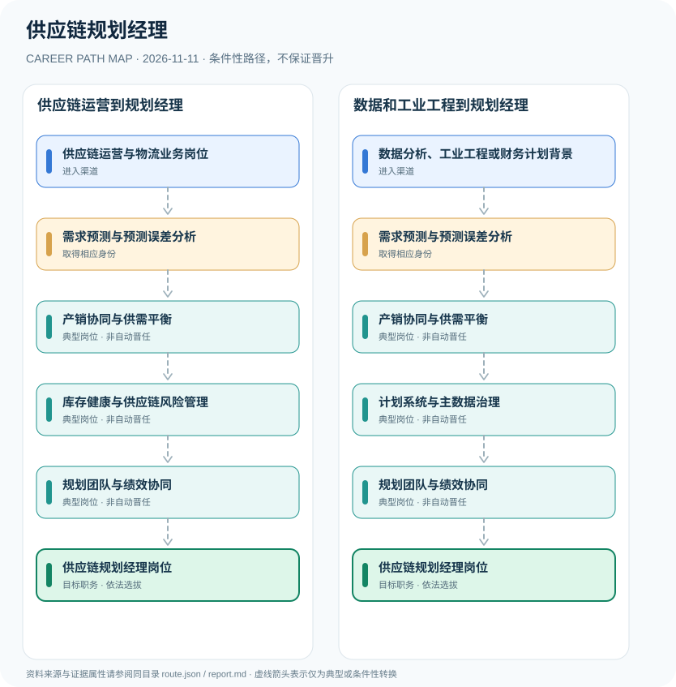

# 供应链规划经理

> **批次 B13 · JR-185** · 研究范围：中国大陆·制造、零售和供应链服务企业；岗位招聘作为行业实例 · **核验日期 2026-11-11**

## 职业定位与证据边界

供应链规划经理是企业岗位而非需要国家统一许可的职业身份，典型发展围绕需求预测、产销协同S&OP、供应与库存规划和跨部门指标治理。岗位职级与供应链职业培训证书是不同制度。

职业重点是**预测可行性、跨部门协同和库存风险权衡**。2026年企业岗位列举的S&OP和数据系统要求可以作为岗位能力案例，但并不形成行政审批意义上的职业准入。

## 一、两种主要职业进入方向

- **供应链运营与物流业务岗位**：从采购、库存控制、物流运营或计划助理工作入门，掌握企业业务和供应链基本指标。
- **数据分析、工业工程或财务计划背景**：拥有统计、工业工程、BI或财务分析背景者可转入需求预测与库存规划岗位。

## 二、典型发展路线与适用条件

### 1. 供应链运营到规划经理

从库存采购运营积累需求计划、S&OP及库存治理能力，逐步承担跨部门规划岗位。

**路线图**：供应链运营与物流业务岗位 → 需求预测与预测误差分析 → 产销协同与供需平衡 → 库存健康与供应链风险管理 → 规划团队与绩效协同 → 供应链规划经理岗位

以上各岗位转换均受任用、选拔、执业资格或招聘控制，不构成保证晋升的链条。

### 2. 数据和工业工程到规划经理

从预测与分析工作切入，搭建供需协同流程、计划系统和组织管理能力。

**路线图**：数据分析、工业工程或财务计划背景 → 需求预测与预测误差分析 → 产销协同与供需平衡 → 计划系统与主数据治理 → 规划团队与绩效协同 → 供应链规划经理岗位

以上各岗位转换均受任用、选拔、执业资格或招聘控制，不构成保证晋升的链条。

## 三、岗位职责与专业发展能力

应以预测准确率、缺货率、库存周转和供应链成本等可验证指标展示能力；向经理岗位发展需具备跨职能沟通和决策协调能力。不同企业可能采用S&OP、IBP或其他计划框架。

- **需求预测与预测误差分析**：运用历史销量、客户订单与业务活动调整预测，追踪预测偏差和更新假设。
- **产销协同与供需平衡**：协同销售、财务、生产和采购团队形成S&OP与中长期供需方案。
- **库存健康与供应链风险管理**：开展安全库存、周转、缺货风险、备货和库存调拨优化。
- **计划系统与主数据治理**：参与ERP、APS或BI计划系统，维护SKU和需求预测口径与版本管理。
- **规划团队与绩效协同**：承担跨品类或跨区域供应链规划管理工作，是否任经理由雇主职位要求决定。

## 四、现行法规、任职资格及关键区别

- 美团及其他企业公开招聘职位显示供应链规划职责包含S&OP、需求预测、仓容与备货协同，属于雇主内部岗位说明。
- 专业认证CPIM、CSCP等可能成为企业加分项，但不是全国性法定经理执业许可证。
- 制造和零售企业对学历、经验、数字化工具、计划周期的条件差异明显。

## 五、法律与数据风险提示

- 不将企业岗位招聘中的工作年限、专业学历等个案条件描述为全国统一制度。
- 采购经理、物流运营主管和供应链规划经理的职责存在交叉，但绩效指标和组织权限不同。
- 企业职务不属于公务员职级或国家职业技能等级。

## 六、证据分类和引用对应

**职业路径中所有转换为 `conditional`：满足条件时才可能发生。** `normative` 指法律明确规定的权利或义务；`official_description` 指官方发布的岗位事实；`illustrative` 只代表一种合理的示例经历。本报告不混淆行政领导职务、职级、执业资格、技术等级和雇主自行定义的岗位。

| 图中转换 | 证据属性 | 解释 |
|---|---|---|
| 供应链运营与物流业务岗位 → 需求预测与预测误差分析 | conditional | 从「供应链运营与物流业务岗位」到「需求预测与预测误差分析」取决于对应资格、空缺职位或机构选任，不是必然晋升。 |
| 需求预测与预测误差分析 → 产销协同与供需平衡 | conditional | 从「需求预测与预测误差分析」到「产销协同与供需平衡」取决于对应资格、空缺职位或机构选任，不是必然晋升。 |
| 产销协同与供需平衡 → 库存健康与供应链风险管理 | conditional | 从「产销协同与供需平衡」到「库存健康与供应链风险管理」取决于对应资格、空缺职位或机构选任，不是必然晋升。 |
| 库存健康与供应链风险管理 → 规划团队与绩效协同 | conditional | 从「库存健康与供应链风险管理」到「规划团队与绩效协同」取决于对应资格、空缺职位或机构选任，不是必然晋升。 |
| 规划团队与绩效协同 → 供应链规划经理岗位 | conditional | 从「规划团队与绩效协同」到「供应链规划经理岗位」取决于对应资格、空缺职位或机构选任，不是必然晋升。 |
| 数据分析、工业工程或财务计划背景 → 需求预测与预测误差分析 | conditional | 从「数据分析、工业工程或财务计划背景」到「需求预测与预测误差分析」取决于对应资格、空缺职位或机构选任，不是必然晋升。 |
| 产销协同与供需平衡 → 计划系统与主数据治理 | conditional | 从「产销协同与供需平衡」到「计划系统与主数据治理」取决于对应资格、空缺职位或机构选任，不是必然晋升。 |
| 计划系统与主数据治理 → 规划团队与绩效协同 | conditional | 从「计划系统与主数据治理」到「规划团队与绩效协同」取决于对应资格、空缺职位或机构选任，不是必然晋升。 |

## 七、官方和公开参考资料

1. [供应链管理岗应届岗位职责](https://zhaopin.meituan.com/web/position/detail?highlightType=campus&jobUnionId=4694853346) — 美团招聘官网（发布日期 2026-08-17）
2. [供应链计划管理部总监岗位招聘——需求、产销协同与库存管理](https://www.chinascom.com/pagezhuanzai?article_id=2846) — 中国供应链管理专业招聘信息平台SCOM（发布日期 2026-09-17）

> 资料只反映所列地域、法规和核验日期的公开信息。报名、岗位计划或法规发生变化时，必须重新核对原文，不能沿用过时条件。
