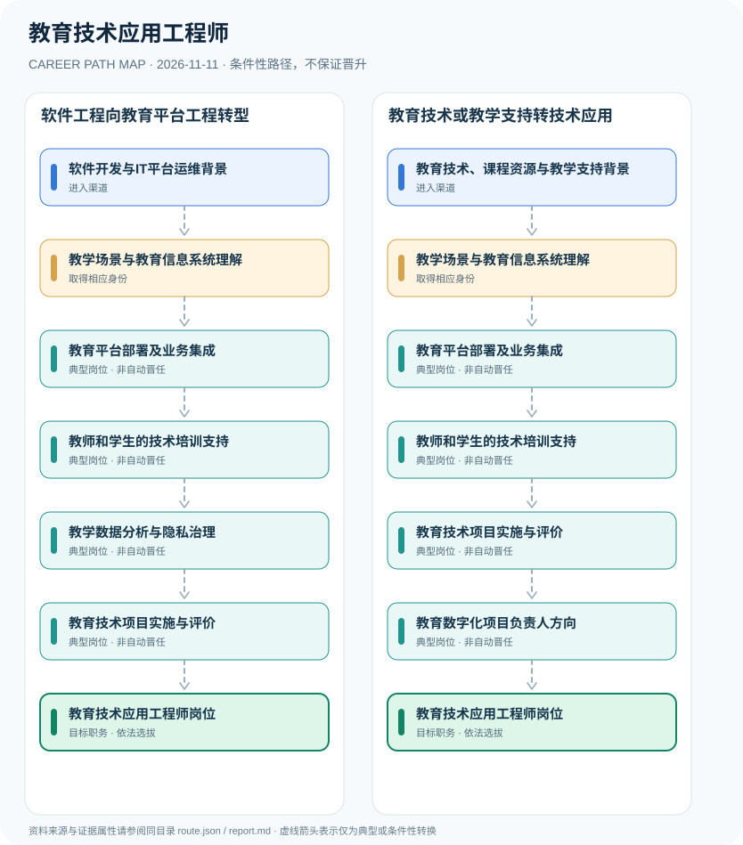

# 教育技术应用工程师

> **B16 深度研究 · JR-152** · 机构与地域：中国大陆高等教育、基础教育信息化服务机构及教育科技企业；按雇主实际职位聘用 · **核验日期：2026-11-11**

## 一、职业定义与现行制度

教育技术应用工程师属于教育平台建设、教学技术支持与教育数据应用的工程岗位，并非法定中小学教师资格、行政领导职务或全国统一许可的独立执业职业。教育部2025年九部门意见强调教育数字化、国家智慧教育平台和安全治理；2026高校教育大数据岗位招聘例子表明教育数字化科研项目也可采取合同或劳务派遣岗位身份。

**政策与岗位分离**：2025教育数字化文件是发展方向与治理要求，不是对每位工程师建立国家资格准入。2026年高校招聘给出了教育大数据项目的具体学历和岗位性质；其本质为一次局部招聘案例，不能将该岗位要求套用于全部教育技术工程师。

## 二、两类准入与身份确认

- **软件开发与IT平台运维背景**：拥有后端工程、前端系统、系统运维或数据库基础者，按学校或教育企业岗位需求进入教育数字化支持。
- **教育技术、课程资源与教学支持背景**：已有教育技术、教学设计或培训服务经历者，可以补足软件工程及数据治理能力后参与平台项目。

## 三、法规、资质和考试的判断

- 2025年教育部等九部门《关于加快推进教育数字化的意见》明确国家智慧教育公共服务平台、人工智能教育应用、资源共享和安全治理等政策方向，未创设“教育技术应用工程师”独立执业许可证。
- 2026年华中师范大学教育大数据应用技术国家工程研究中心公开招聘教育数字化相关助理研究员，明确其为劳务派遣合同制B类岗位，仅证明部分教育科技职位的实际招聘与用工身份。
- 教育信息化技术岗位不等同于依法专门从事学校课堂教学岗位；任课教师资格及高校职称评聘是独立体系。

## 四、职业发展路径与条件性节点

### 路线1｜软件工程向教育平台工程转型

从软件系统运维与教育场景理解开始，通过平台集成、教学支持和交付形成教育技术工程能力。

**条件性路径**：软件开发与IT平台运维背景 → 教学场景与教育信息系统理解 → 教育平台部署及业务集成 → 教师和学生的技术培训支持 → 教学数据分析与隐私治理 → 教育技术项目实施与评价 → 教育技术应用工程师岗位

该路线仅表示可能存在的职业经历；下一阶段均须重新核查资格、机构岗位和考核任职制度，不意味着保证录用或晋升。

### 路线2｜教育技术或教学支持转技术应用

已有教育服务背景人员补齐系统与数据能力，通过教学平台支持和项目组织进入技术岗位。

**条件性路径**：教育技术、课程资源与教学支持背景 → 教学场景与教育信息系统理解 → 教育平台部署及业务集成 → 教师和学生的技术培训支持 → 教育技术项目实施与评价 → 教育数字化项目负责人方向 → 教育技术应用工程师岗位

该路线仅表示可能存在的职业经历；下一阶段均须重新核查资格、机构岗位和考核任职制度，不意味着保证录用或晋升。

## 五、工作能力、项目与成果评价

核心工程成果可包括学习平台可用性与访问控制、稳定性、知识库更新、教师培训可用性、数据质量、无障碍支持及安全质量评测。向项目负责人发展需要跨部门协同与真实项目履历。

- **教学场景与教育信息系统理解**：理解课程资源、学习管理系统、学校网络、隐私保护和教育数据质量，不等同于取得教师任课资格。
- **教育平台部署及业务集成**：参与学校教学系统、认证权限、资源平台、自动化运维与接口对接，维护稳定性和无障碍可用性。
- **教师和学生的技术培训支持**：提供教学平台使用说明、故障响应和学习资源制作技术协作；正式课堂教学资格另行考核。
- **教学数据分析与隐私治理**：在合规授权下开展学习服务数据分析、产品评测、数据生命周期管理及应用质量反馈。
- **教育技术项目实施与评价**：与教研团队开展需求调研、可用性测试、上线回归及安全评审，记录技术与学习效果边界。
- **教育数字化项目负责人方向**：在雇主实际岗位任命条件下可能组织跨部门项目，事业编制、劳务派遣和合同聘用身份不得混同。

## 六、适用地区、生效版本及风险

- “教育技术应用工程师”“教育技术学教师”“教师发展中心人员”“教育信息化项目经理”可能名称相近但责任与用工制度不同。
- 校内信息中心的事业岗位与学校科研项目的劳务派遣合同不能直接互换，职位公告才是人员身份依据。
- 学校对未成年人个人信息和教学数据的使用需依法授权并遵守适用隐私安全规则。

## 七、证据与图谱的映射

对每一节点，`route.json` 中的 `source_ids` 指向下文的可核查公开来源；每条转换边均标为 `conditional`，不会冒充有明确法律规定的 `normative` 自动晋升。不同的法定资格、机构选聘、职位级别及劳动关系各自独立。

| 转换前 | 转换后 | 证据属性 | 适用限制 |
|---|---|---|---|
| 软件开发与IT平台运维背景 | 教学场景与教育信息系统理解 | `conditional` | 从「软件开发与IT平台运维背景」至「教学场景与教育信息系统理解」取决于法定资格、岗位条件或独立选聘考核，绝非自动晋升。 |
| 教学场景与教育信息系统理解 | 教育平台部署及业务集成 | `conditional` | 从「教学场景与教育信息系统理解」至「教育平台部署及业务集成」取决于法定资格、岗位条件或独立选聘考核，绝非自动晋升。 |
| 教育平台部署及业务集成 | 教师和学生的技术培训支持 | `conditional` | 从「教育平台部署及业务集成」至「教师和学生的技术培训支持」取决于法定资格、岗位条件或独立选聘考核，绝非自动晋升。 |
| 教师和学生的技术培训支持 | 教学数据分析与隐私治理 | `conditional` | 从「教师和学生的技术培训支持」至「教学数据分析与隐私治理」取决于法定资格、岗位条件或独立选聘考核，绝非自动晋升。 |
| 教学数据分析与隐私治理 | 教育技术项目实施与评价 | `conditional` | 从「教学数据分析与隐私治理」至「教育技术项目实施与评价」取决于法定资格、岗位条件或独立选聘考核，绝非自动晋升。 |
| 教育技术项目实施与评价 | 教育技术应用工程师岗位 | `conditional` | 从「教育技术项目实施与评价」至「教育技术应用工程师岗位」取决于法定资格、岗位条件或独立选聘考核，绝非自动晋升。 |
| 教育技术、课程资源与教学支持背景 | 教学场景与教育信息系统理解 | `conditional` | 从「教育技术、课程资源与教学支持背景」至「教学场景与教育信息系统理解」取决于法定资格、岗位条件或独立选聘考核，绝非自动晋升。 |
| 教师和学生的技术培训支持 | 教育技术项目实施与评价 | `conditional` | 从「教师和学生的技术培训支持」至「教育技术项目实施与评价」取决于法定资格、岗位条件或独立选聘考核，绝非自动晋升。 |
| 教育技术项目实施与评价 | 教育数字化项目负责人方向 | `conditional` | 从「教育技术项目实施与评价」至「教育数字化项目负责人方向」取决于法定资格、岗位条件或独立选聘考核，绝非自动晋升。 |
| 教育数字化项目负责人方向 | 教育技术应用工程师岗位 | `conditional` | 从「教育数字化项目负责人方向」至「教育技术应用工程师岗位」取决于法定资格、岗位条件或独立选聘考核，绝非自动晋升。 |

## 八、来源及原始发布日期

1. **中华人民共和国教育部**：[教育部等九部门关于加快推进教育数字化的意见](https://hudong.moe.gov.cn/srcsite/A01/s7048/202504/t20250416_1187476.html)（原文件或规定日期：2025-04-15）。
2. **中华人民共和国教育部（转载中共中央、国务院文件）**：[教育强国建设规划纲要（2024—2035年）](https://www.moe.gov.cn/jyb_xxgk/moe_1777/moe_1778/202501/t20250119_1176193.html)（原文件或规定日期：2025-01-19）。
3. **华中师范大学人工智能教育学部**：[华中师范大学教育大数据应用技术国家工程研究中心合同聘用招聘公告](https://foaie.ccnu.edu.cn/info/1066/14943.htm)（原文件或规定日期：2026-09-20）。

> **研究限制**：法规发布日期和实施日期可能不同；2027招录的专项条件以招聘公告实时版本及具体职位表为准。本研究不作个人晋升概率预测，不公开非公开的军队、警务、医疗或个人数据。
