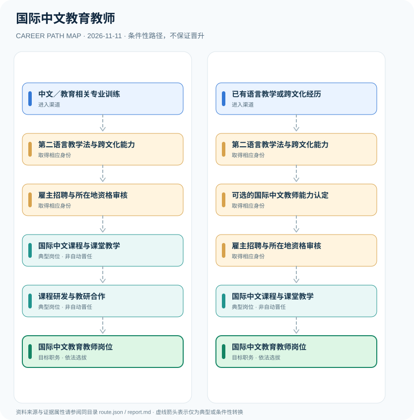

# 国际中文教育教师

> **研究批次** B12 · JR-145　|　**范围**：中国大陆与海外国际中文教学机构；以2026年国际中文教师证书计划为参照　|　**核验日期**：2026-11-11

## 摘要与职业定位

国际中文教育教师可以通过语言教育、跨文化教学与国际中文教师能力认定等途径进入不同教育机构；《国际中文教师证书》是能力证明而非普遍强制的国际职业许可，所在地法律与招聘条件仍须分别满足。

**证书与法定资格不同**：中外语言交流合作中心2021年官方声明已明确证书可用于证明教学能力，供聘用机构参考，但非国际中文教学的职业资格证。2026年考试有初级与中级分层，申请条件取决于考试类别、考点和地区。

## 进入职业的合法渠道

- **中文／教育相关专业训练**：语言学、教育学、汉语言文学及相关教学经验可作为发展基础，专业要求以当地雇主为准。
- **已有语言教学或跨文化经历**：已有中文教学、语言培训或海外教育服务经历者，可依据机构要求申请相关岗位。

## 2 种代表性职业发展路线

### 1. 教育专业培养与机构招聘

从中文与教育专业学习积累教学能力，经雇主及所在地准入审核后开展教学。

**岗位序列（条件性示意）**：中文／教育相关专业训练 → 第二语言教学法与跨文化能力 → 雇主招聘与所在地资格审核 → 国际中文课程与课堂教学 → 课程研发与教研合作 → 国际中文教育教师岗位

### 2. 在职教师与自愿证书路线

已有语言教学背景者可自愿参加能力认定考试，仍须满足独立的岗位及地区准入规则。

**岗位序列（条件性示意）**：已有语言教学或跨文化经历 → 第二语言教学法与跨文化能力 → 可选的国际中文教师能力认定 → 雇主招聘与所在地资格审核 → 国际中文课程与课堂教学 → 国际中文教育教师岗位

## 重要职责、技能和岗位发展

**典型工作方向**：课程与教材设计、中文教学、跨文化互动、教学评价和在线学习支持。经验积累可能促进教研、课程负责人或项目发展，但各机构职位条件独立，切忌以单张证书推断其具备各国教师执业资格。

- **国际中文课程与课堂教学**：设计语言学习课程、评估汉语交际能力并适应多语言文化背景开展课堂教学。
- **课程研发与教研合作**：积累教材研发、教学评价及教师培训经验，形成教研或项目组织能力。

## 准入门槛与任职规则

- 教育部中外语言交流合作中心2021年声明明确《国际中文教师证书》是能力认定，可供招聘参考，不是从事国际中文教学的职业资格认证。
- 2026年证书考试已采用初级、中级等分级，具体考试条件、笔试和面试以当次官方通知为准。
- 国内公办学校法定教师资格或海外当地教师执照要求须独立满足，持国际中文教师证书不自动替代。

## 证据状态与实际约束

路线图中的箭头均为 `conditional`：即使前一节点的经历成立，后续任用、考试、职业资格、选拔或招聘仍需独立满足制度要求。`normative` 专指法律直接规定的关系，`official_description` 指官方机构说明，`illustrative` 指仅用于理解的示例；具体证据来源链接见下文。

- 2026年11月新增初级笔试报名时间为10月20—29日，已结束；不要误导用户该窗口仍开放。
- 海外工作涉及当地教师职业许可、雇佣资格和签证政策；不能给出各国统一标准。
- 国际中文教师能力证书不代表教学机构保证录用或可自动晋升院校负责人。

## 可复核原始资料

1. [关于《国际中文教师证书》的声明](https://www.chineseteacher.org.cn/ctcsolNotice/detail.do?cnid=1200660)，教育部中外语言交流合作中心，2021-09-28。
2. [2026年11月国际中文教师证书笔试（初级）报名通知](https://www.chineseteacher.org.cn/ctcsolNotice/detail.do?cnid=1205540)，国际中文教师证书考试服务网，2026-10-13。

> **复核提醒**：跨地区、跨机构或新招录年度，必须重新核查原始政策、职位计划及生效状态。此报告不推测晋升概率和个人任职结果。
