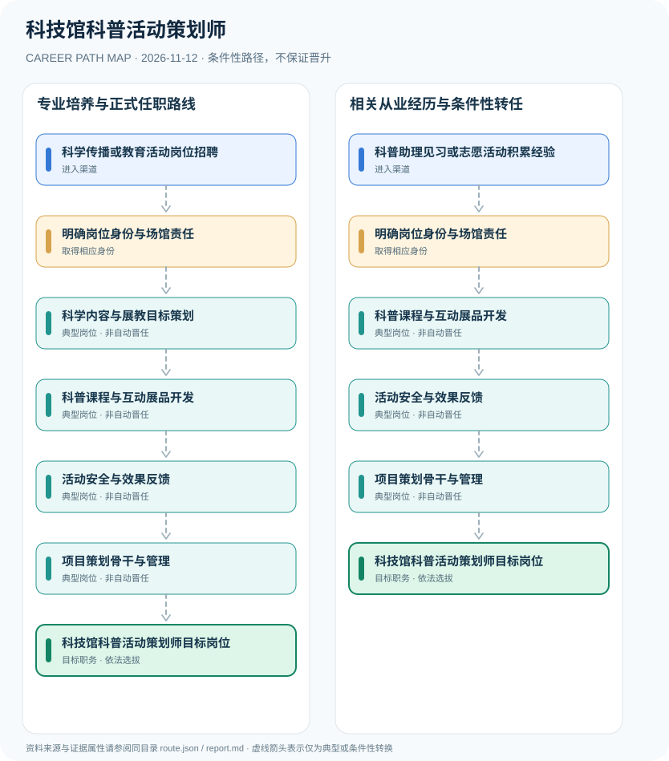

# 科技馆科普活动策划师

> **B18 深度职业研究 · JR-153** · 核验日期：2026-11-12 · 中国大陆科技馆与科学传播机构；2026常德科技馆见习及中国科技馆志愿项目为业务实例

## 01 现行制度与职业身份

科技馆科普活动策划师是科普机构内设计、组织和评估科普课程、互动展教与公众活动的业务岗位。2024修订《科学技术普及法》已施行，明确科技馆应当开展科普活动；2026年常德科技馆招聘科普助理见习人员，中国科技馆也有科普策划志愿工作，需严格区分正式雇佣、就业见习及志愿身份。

一项正式法律配合两份2026真实项目资料，说明科普策划工作存在不同用工形式。常德见习与中国科技馆志愿工作只能证明职业实践内容，不能写成全国事业单位招聘统一条件。

## 02 两种进入渠道

- **科学传播或教育活动岗位招聘**：科学、教育、展览设计等背景人员可申请科技馆及科普机构正式招聘，编制或劳动关系以单位公告为准。
- **科普助理见习或志愿活动积累经验**：经2026就业见习、讲解或志愿项目积累展教实践，见习和志愿经历不自动转为正式编制。

## 03 职业路线与决定性环节

### 路径 1：专业培养与正式任职路线

科学、教育、展览设计等背景人员可申请科技馆及科普机构正式招聘，编制或劳动关系以单位公告为准。

**条件性链条**：科学传播或教育活动岗位招聘 → 明确岗位身份与场馆责任 → 科学内容与展教目标策划 → 科普课程与互动展品开发 → 活动安全与效果反馈 → 项目策划骨干与管理 → 科技馆科普活动策划师目标岗位

各节点转换均需单独满足资格、岗位空缺、考核及组织任命要求。

### 路径 2：相关从业经历与条件性转任

经2026就业见习、讲解或志愿项目积累展教实践，见习和志愿经历不自动转为正式编制。

**条件性链条**：科普助理见习或志愿活动积累经验 → 明确岗位身份与场馆责任 → 科普课程与互动展品开发 → 活动安全与效果反馈 → 项目策划骨干与管理 → 科技馆科普活动策划师目标岗位

各节点转换均需单独满足资格、岗位空缺、考核及组织任命要求。

## 04 职业任务及专业能力

成果包括科普课程教案、观众体验研究、展品试验、活动反馈数据和跨学科科学传播作品。

- **明确岗位身份与场馆责任**：核对事业单位、合同制、就业见习和志愿服务的法律关系与人员要求。
- **科学内容与展教目标策划**：围绕科学方法、知识与科技伦理设计活动内容，依据2024科普法坚持公众可理解与参与。
- **科普课程与互动展品开发**：设计探究任务、互动展示、讲解文案和传播材料，遵守无障碍与版权规范。
- **活动安全与效果反馈**：协作场馆运营保障观众安全，对不同年龄群体收集反馈并评估理解效果。
- **项目策划骨干与管理**：通过活动组织和课程质量发展，项目主管仍由机构聘用或选任决定。

## 05 法规、规范和真实岗位证据

- 2024年12月25日修订通过的《科学技术普及法》自公布之日起施行，第二十八条明确科技馆等应组织科普教育活动。
- 常德市科学技术馆2026年8月招聘科普助理就业见习人员，职责包括科普活动策划、展厅讲解和科普文案，见习期限3至12个月。
- 中国科技馆2026年度志愿岗位也包含科普课程协作，但志愿身份不代表正式聘用或取得中小学教师资格。

## 06 适用边界与不确定性

- 国家科普法的场馆职责不能理解为创设‘科技馆科普活动策划师’个人强制性执业资格。
- 科技馆正式员工、志愿者、就业见习人员和学校教师不能混同。
- 对未成年人活动须落实场馆安全和隐私保护，不能因知识科普而忽略风险管理。

## 07 全路径证据台账

每个节点的 `source_ids` 由 `route.json` 中可核查的法律、部门文件或岗位招聘支持，转换边统一采用 `conditional`，不创造自动晋升。发布日期与施行日期独立核验。

| 前置节点 | 后续节点 | 证据属性 | 适用限制 |
|---|---|---|---|
| 科学传播或教育活动岗位招聘 | 明确岗位身份与场馆责任 | `conditional` | 从「科学传播或教育活动岗位招聘」到「明确岗位身份与场馆责任」须独立满足招聘、资格、合规及组织任职要求，不能视为自动晋升。 |
| 明确岗位身份与场馆责任 | 科学内容与展教目标策划 | `conditional` | 从「明确岗位身份与场馆责任」到「科学内容与展教目标策划」须独立满足招聘、资格、合规及组织任职要求，不能视为自动晋升。 |
| 科学内容与展教目标策划 | 科普课程与互动展品开发 | `conditional` | 从「科学内容与展教目标策划」到「科普课程与互动展品开发」须独立满足招聘、资格、合规及组织任职要求，不能视为自动晋升。 |
| 科普课程与互动展品开发 | 活动安全与效果反馈 | `conditional` | 从「科普课程与互动展品开发」到「活动安全与效果反馈」须独立满足招聘、资格、合规及组织任职要求，不能视为自动晋升。 |
| 活动安全与效果反馈 | 项目策划骨干与管理 | `conditional` | 从「活动安全与效果反馈」到「项目策划骨干与管理」须独立满足招聘、资格、合规及组织任职要求，不能视为自动晋升。 |
| 项目策划骨干与管理 | 科技馆科普活动策划师目标岗位 | `conditional` | 从「项目策划骨干与管理」到「科技馆科普活动策划师目标岗位」须独立满足招聘、资格、合规及组织任职要求，不能视为自动晋升。 |
| 科普助理见习或志愿活动积累经验 | 明确岗位身份与场馆责任 | `conditional` | 从「科普助理见习或志愿活动积累经验」到「明确岗位身份与场馆责任」须独立满足招聘、资格、合规及组织任职要求，不能视为自动晋升。 |
| 明确岗位身份与场馆责任 | 科普课程与互动展品开发 | `conditional` | 从「明确岗位身份与场馆责任」到「科普课程与互动展品开发」须独立满足招聘、资格、合规及组织任职要求，不能视为自动晋升。 |

## 08 来源原文、发布机构及日期

1. **中华人民共和国科学技术部**：[中华人民共和国科学技术普及法（2024年修订）](https://www.most.gov.cn/xxgk/xinxifenlei/fdzdgknr/fgzc/flfg/202412/t20241226_192778.html)，文件日期 2024-12-25。
2. **常德市科学技术馆**：[常德市科学技术馆2026年科普助理就业见习岗位招聘公告](https://www.cdast.org.cn/zhdt/tzgg/content_3167572)，文件日期 2026-08-10。
3. **中国科学技术馆**：[中国科技馆2026年度志愿者招募通告](https://www.cstm.org.cn/zyz/tzgg/art/2026/art_698bc1d6f46a4a31ba77076dc7cc53d4.html)，文件日期 2026-03-05。

> 不把学历或职称证书等同于行政任职，也不将单位或产品标准说成个人执业许可；具体招聘必须再查当年最新公告。
