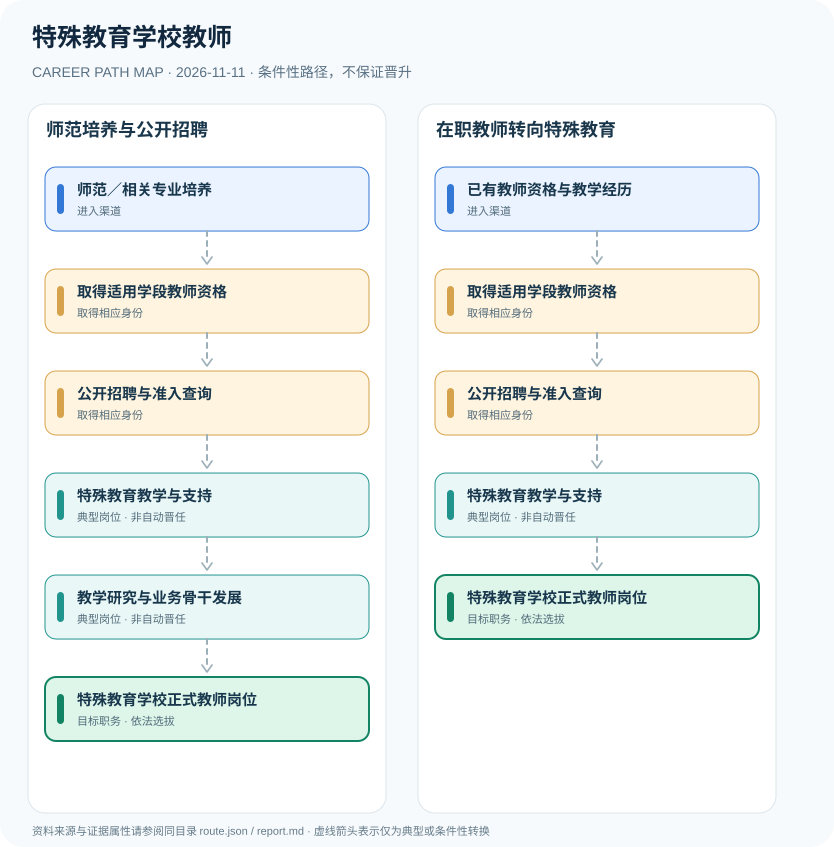

# 特殊教育学校教师

> **批次**：B11 · JR-143 · **适用范围**：中国大陆·公办特殊教育学校（以2026年全国教师招聘政策为基线） · **核验日期**：2026-11-11

## 执行摘要

特殊教育学校教师依法需要适用学段的教师资格，并按公开招聘或符合规定的岗位聘任程序任职；专业发展不等同于教师职称自动晋升。

特殊教育学校教师是专业教学岗位，其法律准入以相应教师资格为核心，学校聘任还包括综合能力、师德、招聘程序与岗位匹配。专业培养方向与教师资格类别要分开。

## 一、准入方式及行政／招聘程序

2026年人社部、教育部公开招聘工作通知指出特殊教育等紧缺学科师资需求，并要求符合教育教学准入条件和入职前准入查询。学校具体专业方向、面试试讲、学段与岗位配备仍以地区招聘计划为准。

- **师范／相关专业培养**：通过教师教育、特殊教育及相关专业学习积累教育教学和融合教育基础，具体专业是否符合岗位以招聘公告为准。
- **已有教师资格与教学经历**：持符合拟任学段的教师资格并具有相应教育教学经历者，可在满足招聘或交流条件时申请特殊教育岗位。

## 二、常见路线与机构决定点

### 1. 师范培养与公开招聘

通过教师教育和教师资格取得准入资格，再经学校岗位招聘进入教学岗位。

**阶段示意**：师范／相关专业培养 → 取得适用学段教师资格 → 公开招聘与准入查询 → 特殊教育教学与支持 → 教学研究与业务骨干发展 → 特殊教育学校正式教师岗位

**解释**：上述转换由岗位条件、资格确认、招聘或任用程序控制。即使具有上一阶段经历，也不保证任职下一阶段。

### 2. 在职教师转向特殊教育

已有适用教师资格者经过岗位条件审核、业务适应或交流录聘后进入特殊教育教学工作。

**阶段示意**：已有教师资格与教学经历 → 取得适用学段教师资格 → 公开招聘与准入查询 → 特殊教育教学与支持 → 特殊教育学校正式教师岗位

**解释**：上述转换由岗位条件、资格确认、招聘或任用程序控制。即使具有上一阶段经历，也不保证任职下一阶段。

## 三、关键职责与专业发展

典型工作包括个别化教育支持、课程调整、学习和行为支持、家庭沟通与跨专业协作。未来可从日常教学发展到学科教研和业务骨干，但职称评聘和管理岗位需满足各自规则，不应设置固定晋升年限。

- **取得适用学段教师资格**：依法取得与拟任教学岗位适用的教师资格；特殊教育岗位的专业要求由当地和学校招聘条件明确。
- **公开招聘与准入查询**：公办学校岗位按公开招聘程序考核，并依法落实入职前违法犯罪记录查询及师德审核。
- **特殊教育教学与支持**：依据学生个体教育需要开展教学、康复配合、沟通和家校协作，具体职责依学校岗位。
- **教学研究与业务骨干发展**：通过教学实践、继续教育和教育研究积累能力，职称、荣誉及骨干任用分别评审。

## 四、关键资格、执业条件与区别

- 《教师资格条例》规定从事教育教学工作应当依法取得教师资格，资格类别主要按学段和学校类型划分，不存在全国统一额外名为“特教教师资格”的法定类别。
- 教育部与人社部2026年教师招聘通知强调特殊教育师资补充，并要求在办理聘用手续前取得教师资格证。
- 公办学校聘用与教师职称、岗位等级及教学骨干称号不是同一制度。

## 五、证据分类和路线关系

本图把制度依据和职业经历分开：`normative` 表示有明确法规支持的规则，`official_description` 表示官方公开职责，`illustrative` 代表示意经历，`conditional` 代表资格、招聘、考核或任用控制的转换。本研究**不会把职业图谱中的箭头写成保证晋升**；全图边均显式标为条件性职业转换。职业身份、岗位层级、职称、行政职级和证书不可互换。

| 转换关系 | 证据分类 | 约束说明 |
|:--|:--|:--|
| 师范／相关专业培养 → 取得适用学段教师资格 | `conditional` | 从「师范／相关专业培养」转向「取得适用学段教师资格」须依本岗资格、机构要求和实际程序审核；不是任何人的自动晋升。 |
| 取得适用学段教师资格 → 公开招聘与准入查询 | `conditional` | 从「取得适用学段教师资格」转向「公开招聘与准入查询」须依本岗资格、机构要求和实际程序审核；不是任何人的自动晋升。 |
| 公开招聘与准入查询 → 特殊教育教学与支持 | `conditional` | 从「公开招聘与准入查询」转向「特殊教育教学与支持」须依本岗资格、机构要求和实际程序审核；不是任何人的自动晋升。 |
| 特殊教育教学与支持 → 教学研究与业务骨干发展 | `conditional` | 从「特殊教育教学与支持」转向「教学研究与业务骨干发展」须依本岗资格、机构要求和实际程序审核；不是任何人的自动晋升。 |
| 教学研究与业务骨干发展 → 特殊教育学校正式教师岗位 | `conditional` | 从「教学研究与业务骨干发展」转向「特殊教育学校正式教师岗位」须依本岗资格、机构要求和实际程序审核；不是任何人的自动晋升。 |
| 已有教师资格与教学经历 → 取得适用学段教师资格 | `conditional` | 从「已有教师资格与教学经历」转向「取得适用学段教师资格」须依本岗资格、机构要求和实际程序审核；不是任何人的自动晋升。 |
| 特殊教育教学与支持 → 特殊教育学校正式教师岗位 | `conditional` | 从「特殊教育教学与支持」转向「特殊教育学校正式教师岗位」须依本岗资格、机构要求和实际程序审核；不是任何人的自动晋升。 |

## 六、适用边界与更新风险

- 任教具体学段、课程与学生障碍支持领域的专业条件须查学校岗位公告。
- 教师资格证书不等于通过事业单位公开招聘；校内交流不等于自动变更岗位。
- 临床康复治疗师、心理咨询专业人员与特殊教育学校教师资格不能相互替代。

## 七、官方和公开核验来源

1. [教师资格条例](https://www.moe.gov.cn/jyb_sjzl/sjzl_zcfg/zcfg_jyxzfg/202204/t20220422_620496.html) — 中华人民共和国教育部，原文日期 1995-12-12。
2. [关于做好2026年中小学幼儿园教师公开招聘工作的通知](https://www.moe.gov.cn/jyb_xxgk/moe_1777/moe_1779/202604/t20260422_1434512.html) — 教育部·人力资源社会保障部，原文日期 2026-04-22。
3. [进一步做好事业单位公开招聘工作的通知](https://www.mohrss.gov.cn/wap/zc/zcwj/202409/t20240905_525231.html) — 人力资源和社会保障部，原文日期 2024-09-05。

> **下一次更新检查**：实际申请时重新查当年岗位计划、地区特殊限制和新规替代情形。个人发展结果不作预测。
