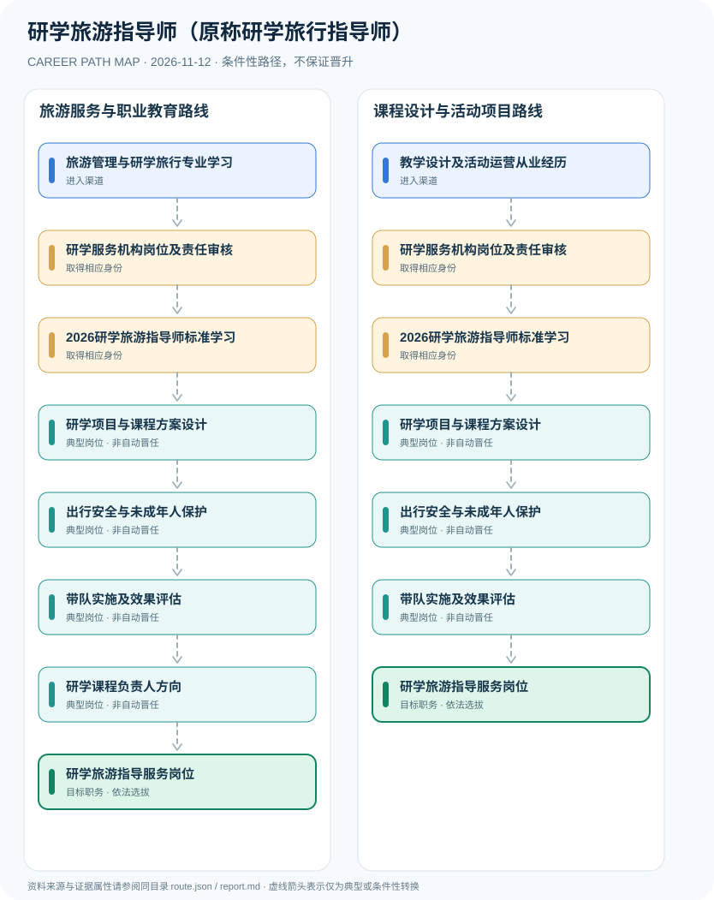

# 研学旅游指导师（原称研学旅行指导师）

> **B17 深度调查 · JR-151**　|　**适用地域及机构**：中国大陆研学旅游服务单位、研学营地和旅行社；2026年国家职业标准4-13-04-04　|　**核验时间**：2026-11-12

## 摘要：岗位身份、适用制度和效力

研学旅行指导师是历史或市场仍常用的岗位称呼，国家职业标准于2026年采用正式名称“研学旅游指导师”（职业编码4-13-04-04）。2026年国家职业标准建立四级至一级职业技能要求，但技能等级证、旅行社导游执业及学校任课教师资格不是同一许可。

**职业名称版本迁移**：2024职业信息调整后，研学旅行指导师更名为研学旅游指导师。2026年文旅部与人社部联合颁布国家职业标准，且教育部高职专业‘研学旅行管理与服务’仍保留原词——这既非矛盾也不说明存在两套强制许可制度。本条用新版职业名称作为页面标题并保留 backlog slug，维持数据可追溯。

## 进入行业的合法渠道

- **旅游管理与研学旅行专业学习**：从旅游服务、研学旅行管理与服务专业或研学课程学习积累行业活动知识，按雇主要求申请岗位。
- **教学设计及活动运营从业经历**：拥有非学历研学项目运营、学校活动组织或课程设计经验的人士可在合法机构招聘后参加行业技能培训。

## 两条可比较的职业发展路径

### 路径 1：旅游服务与职业教育路线

从研学专业与旅游服务经历进入机构，按照2026标准培训后设计课程、实施活动并发展管理能力。

**条件性节点序列**：旅游管理与研学旅行专业学习 → 研学服务机构岗位及责任审核 → 2026研学旅游指导师标准学习 → 研学项目与课程方案设计 → 出行安全与未成年人保护 → 带队实施及效果评估 → 研学课程负责人方向 → 研学旅游指导服务岗位

路径只说明一种可解释的可能经历，后续岗位须满足新的资质、招聘、考核或任用要求。

### 路径 2：课程设计与活动项目路线

具有课程或活动运营背景者经机构聘用、职业标准训练与服务实践进入研学指导服务。

**条件性节点序列**：教学设计及活动运营从业经历 → 研学服务机构岗位及责任审核 → 2026研学旅游指导师标准学习 → 研学项目与课程方案设计 → 出行安全与未成年人保护 → 带队实施及效果评估 → 研学旅游指导服务岗位

路径只说明一种可解释的可能经历，后续岗位须满足新的资质、招聘、考核或任用要求。

## 关键技能、项目实践与考核

可展示的业绩包括学习目标达成度、课程复盘质量、投诉与安全记录、课程资源开发、家校沟通及教师/景区资源协调。团队管理岗位取决于雇主任用，不能因行业技能等级自动成为校内教师。

- **研学项目与课程方案设计**：根据年龄特点、景区文化资源与学习目标设计课程、实践任务和参与者反馈。
- **出行安全与未成年人保护**：协助行程风险评估、应急预案及服务质量管理；涉及实际导游服务时另核导游执业规定。
- **带队实施及效果评估**：在机构授权和岗位能力范围内实施现场活动、教育引导与复盘，避免缺乏资质的人员承担受限职责。
- **研学课程负责人方向**：在真实企业与机构招聘条件下组织研学产品和课程团队，经理岗位需独立聘任。

## 法定资格、制度区别与核查条目

- LB/T 054-2025《研学旅游服务要求》自2025年5月19日施行，替代LB/T 054-2016《研学旅行服务规范》。它约束特定旅游服务主体和相关服务，不是职业技能评价证书。
- 人社部、文化和旅游部2026年人社厅发〔2026〕21号公布施行《研学旅游指导师国家职业标准》，职业代码4-13-04-04，标准包括四级中级工至一级高级技师。
- 2025年2月教育部高职专科《研学旅行管理与服务》专业教学标准仍使用‘研学旅行’作为专业名称，与2026职业标准的‘研学旅游指导师’可同时存在。
- 职业技能标准提供能力评价框架，不意味着任何培训班证书都属于国家限制性职业资格或替代导游证、教师资格。
- 研学活动涉及旅行社业务时应按旅游法与旅行社管理规定履行旅游服务和人员资质要求；中小学教师任职属于独立教师资格。

## 风险与地区、年度限制

- 研学旅行中学校教育活动与旅行社承接的研学旅游活动分属不同管理场景，不能套用相同经营资质要求。
- 不要将原候选名称‘研学旅行指导师’冒充2026职业标准的正式名称；历史专业名称和新职业标准名称也不能一概抹除。
- 行业培训证书、职业技能等级证书和法定导游资格证书属于不同类型，需辨认发证机构、评价性质和用途。
- 未成年人研学活动不能以取得某项培训证为由取消安全监督、监护同意和风险管理。

## 来源映射及路径证据

`route.json` 记录规范性文件、政策或招聘公告的原文 URL 和发布机构；节点引用 `source_ids`，每条岗位转换保守标为 `conditional`，而非保证升迁的 `normative` 法律权利。涉及真实法定准入的说明见上述条款，避免将机构权责套用到员工个人。

| 前一节点 | 后一节点 | 边属性 | 适用条件 |
|---|---|---|---|
| 旅游管理与研学旅行专业学习 | 研学服务机构岗位及责任审核 | `conditional` | 「旅游管理与研学旅行专业学习」到「研学服务机构岗位及责任审核」需要独立满足适用职位、资格、权限与机构安排，非自动晋升。 |
| 研学服务机构岗位及责任审核 | 2026研学旅游指导师标准学习 | `conditional` | 「研学服务机构岗位及责任审核」到「2026研学旅游指导师标准学习」需要独立满足适用职位、资格、权限与机构安排，非自动晋升。 |
| 2026研学旅游指导师标准学习 | 研学项目与课程方案设计 | `conditional` | 「2026研学旅游指导师标准学习」到「研学项目与课程方案设计」需要独立满足适用职位、资格、权限与机构安排，非自动晋升。 |
| 研学项目与课程方案设计 | 出行安全与未成年人保护 | `conditional` | 「研学项目与课程方案设计」到「出行安全与未成年人保护」需要独立满足适用职位、资格、权限与机构安排，非自动晋升。 |
| 出行安全与未成年人保护 | 带队实施及效果评估 | `conditional` | 「出行安全与未成年人保护」到「带队实施及效果评估」需要独立满足适用职位、资格、权限与机构安排，非自动晋升。 |
| 带队实施及效果评估 | 研学课程负责人方向 | `conditional` | 「带队实施及效果评估」到「研学课程负责人方向」需要独立满足适用职位、资格、权限与机构安排，非自动晋升。 |
| 研学课程负责人方向 | 研学旅游指导服务岗位 | `conditional` | 「研学课程负责人方向」到「研学旅游指导服务岗位」需要独立满足适用职位、资格、权限与机构安排，非自动晋升。 |
| 教学设计及活动运营从业经历 | 研学服务机构岗位及责任审核 | `conditional` | 「教学设计及活动运营从业经历」到「研学服务机构岗位及责任审核」需要独立满足适用职位、资格、权限与机构安排，非自动晋升。 |
| 带队实施及效果评估 | 研学旅游指导服务岗位 | `conditional` | 「带队实施及效果评估」到「研学旅游指导服务岗位」需要独立满足适用职位、资格、权限与机构安排，非自动晋升。 |

## 可复核的公开来源

4. **中华人民共和国文化和旅游部**：[关于发布《研学旅游服务要求》等3项文化和旅游行业标准的公告](https://zwgk.mct.gov.cn/zfxxgkml/hybz/202505/t20250519_960044.html)（原始制度日期 2025-02-19）

1. **中华人民共和国文化和旅游部**：[关于颁布景区运营管理师等2个国家职业标准的通知（研学旅游指导师）](https://zwgk.mct.gov.cn/zfxxgkml/rsxx/rcgl/202609/t20260924_967245.html)（原始制度日期 2026-09-24）
2. **郑州市文化广电和旅游局**：[景区运营管理师、研学旅游指导师国家职业标准颁布施行](https://wgl.zhengzhou.gov.cn/shce/10179494.jhtml)（原始制度日期 2026-07-30）
3. **中华人民共和国文化和旅游部**：[文旅部政协提案答复：研学旅行管理与服务专业与研学课程](https://zwgk.mct.gov.cn/zfxxgkml/zhgl/jytadf/202512/t20251217_963752.html)（原始制度日期 2025-12-17）

> **研究说明**：来源的发布日期不代表法规施行日期；招聘公告不保证报名窗口仍开放。涉及跨地区或新版本制度时须重新核验。本路线不承诺个人晋升概率。
