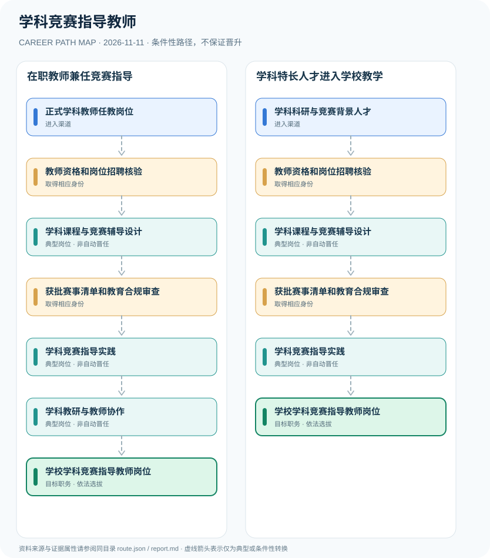

# 学科竞赛指导教师

> **批次 B13 · JR-150** · 研究范围：中国大陆·中小学学科竞赛教学和指导；参考教育部2025—2028学年竞赛清单 · **核验日期 2026-11-11**

## 职业定位与证据边界

学科竞赛指导教师通常是中学教学工作中的学科特长指导岗位，公办学校正式教师须依法取得适用教师资格；竞赛教练的聘任条件由学校确定，竞赛奖项不等于教师资格，更不能将竞赛结果作为中小学招生入学及高考加分依据。

职业关键是把**任课教师的法定资格**与**竞赛指导的校内岗位能力**分开。2025—2028学年教育部批准的赛事清单可核对，但不能由获奖名单推出某个指导教师具有资格证或编制。

## 一、两种主要职业进入方向

- **正式学科教师任教岗位**：通过适用教师资格与公办学校聘用等程序进入学校，逐步积累某学科课堂教学经验。
- **学科科研与竞赛背景人才**：具有学科专业成绩或教育教学经验者，符合学校教师资格及招聘要求时可应聘竞赛指导岗位。

## 二、典型发展路线与适用条件

### 1. 在职教师兼任竞赛指导

已有对应学段教师资格者，经校内安排开展课程和赛事指导，在教学实践中发展。

**路线图**：正式学科教师任教岗位 → 教师资格和岗位招聘核验 → 学科课程与竞赛辅导设计 → 获批赛事清单和教育合规审查 → 学科竞赛指导实践 → 学科教研与教师协作 → 学校学科竞赛指导教师岗位

以上各岗位转换均受任用、选拔、执业资格或招聘控制，不构成保证晋升的链条。

### 2. 学科特长人才进入学校教学

具备竞赛或科研专长的申请人仍须取得教师资格并经过学校招聘，再接受赛事合规管理。

**路线图**：学科科研与竞赛背景人才 → 教师资格和岗位招聘核验 → 学科课程与竞赛辅导设计 → 获批赛事清单和教育合规审查 → 学科竞赛指导实践 → 学校学科竞赛指导教师岗位

以上各岗位转换均受任用、选拔、执业资格或招聘控制，不构成保证晋升的链条。

## 三、岗位职责与专业发展能力

能力包括学科深度、教学评价、辅导计划、学生心理健康和竞赛伦理。优秀教练或教研负责人是学校选聘与专业发展结果，不是独立于教师资格制度的法律身份。

- **教师资格和岗位招聘核验**：学校教育教学岗位需具备对应学段的教师资格并按聘用程序进入；竞赛成绩不替代法定资格。
- **学科课程与竞赛辅导设计**：掌握学科核心知识、拓展课程、训练计划与学习反馈，并遵守减负和学生健康原则。
- **获批赛事清单和教育合规审查**：根据教育部公布的2025—2028学年赛事清单和全国性竞赛活动管理办法，核对合法竞赛范围。
- **学科竞赛指导实践**：在学校授权的教学计划中指导学生参加合规活动，注重公平、公正、适龄和非应试过度训练。
- **学科教研与教师协作**：参与教学研究、课程资源开发或教练培训，骨干教师评审与领导聘任另有规定。

## 四、现行法规、任职资格及关键区别

- 《教师资格条例》明确在各级各类学校和教育机构专门从事教育教学工作应依法取得相应教师资格。
- 2025—2028学年教育部核准全国性面向中小学生竞赛活动共47项，原则上赛事结果不得用于中小学招生入学或高考加分。
- 2022年《面向中小学生的全国性竞赛活动管理办法》规范赛事组织，不创设统一的全国“竞赛教练员执业证”。

## 五、法律与数据风险提示

- 高中数学、物理、化学、生物和信息学竞赛教练的实际任职要求依学校招聘、主办机构与所在地区规范。
- 学生参赛获奖不是指导教师岗位录用、编制或职称晋升的自动条件。
- 校外培训、商业机构与公办学校的人员身份、业务边界和监管要求不能互换。

## 六、证据分类和引用对应

**职业路径中所有转换为 `conditional`：满足条件时才可能发生。** `normative` 指法律明确规定的权利或义务；`official_description` 指官方发布的岗位事实；`illustrative` 只代表一种合理的示例经历。本报告不混淆行政领导职务、职级、执业资格、技术等级和雇主自行定义的岗位。

| 图中转换 | 证据属性 | 解释 |
|---|---|---|
| 正式学科教师任教岗位 → 教师资格和岗位招聘核验 | conditional | 从「正式学科教师任教岗位」到「教师资格和岗位招聘核验」取决于对应资格、空缺职位或机构选任，不是必然晋升。 |
| 教师资格和岗位招聘核验 → 学科课程与竞赛辅导设计 | conditional | 从「教师资格和岗位招聘核验」到「学科课程与竞赛辅导设计」取决于对应资格、空缺职位或机构选任，不是必然晋升。 |
| 学科课程与竞赛辅导设计 → 获批赛事清单和教育合规审查 | conditional | 从「学科课程与竞赛辅导设计」到「获批赛事清单和教育合规审查」取决于对应资格、空缺职位或机构选任，不是必然晋升。 |
| 获批赛事清单和教育合规审查 → 学科竞赛指导实践 | conditional | 从「获批赛事清单和教育合规审查」到「学科竞赛指导实践」取决于对应资格、空缺职位或机构选任，不是必然晋升。 |
| 学科竞赛指导实践 → 学科教研与教师协作 | conditional | 从「学科竞赛指导实践」到「学科教研与教师协作」取决于对应资格、空缺职位或机构选任，不是必然晋升。 |
| 学科教研与教师协作 → 学校学科竞赛指导教师岗位 | conditional | 从「学科教研与教师协作」到「学校学科竞赛指导教师岗位」取决于对应资格、空缺职位或机构选任，不是必然晋升。 |
| 学科科研与竞赛背景人才 → 教师资格和岗位招聘核验 | conditional | 从「学科科研与竞赛背景人才」到「教师资格和岗位招聘核验」取决于对应资格、空缺职位或机构选任，不是必然晋升。 |
| 学科竞赛指导实践 → 学校学科竞赛指导教师岗位 | conditional | 从「学科竞赛指导实践」到「学校学科竞赛指导教师岗位」取决于对应资格、空缺职位或机构选任，不是必然晋升。 |

## 七、官方和公开参考资料

1. [教师资格条例（国务院令第188号）](https://www.moe.gov.cn/jyb_sjzl/sjzl_zcfg/zcfg_jyxzfg/202204/t20220422_620496.html) — 中华人民共和国教育部（发布日期 1995-12-12）
2. [2025—2028学年面向中小学生的全国性竞赛活动名单通知](https://www.moe.gov.cn/srcsite/A29/202510/t20251029_1418393.html) — 中华人民共和国教育部（发布日期 2025-10-22）
3. [面向中小学生的全国性竞赛活动管理办法](https://www.moe.gov.cn/srcsite/A29/202203/t20220314_607247.html) — 中华人民共和国教育部（发布日期 2022-03-03）
4. [学科竞赛教练员校招岗位示例](https://jy.scu.edu.cn/index/index/employdetail.html?data=MDAwMDAwMDAwMJG6n3_Ed6imi4qQtLh5eN-Kuba2yGHRp7ugzc-GnZ2skMx9ZMN4gtKLipCwxKF0lZC5sq-0gqJv) — 四川大学就业指导中心（发布日期 2026-09-23）

> 资料只反映所列地域、法规和核验日期的公开信息。报名、岗位计划或法规发生变化时，必须重新核对原文，不能沿用过时条件。
