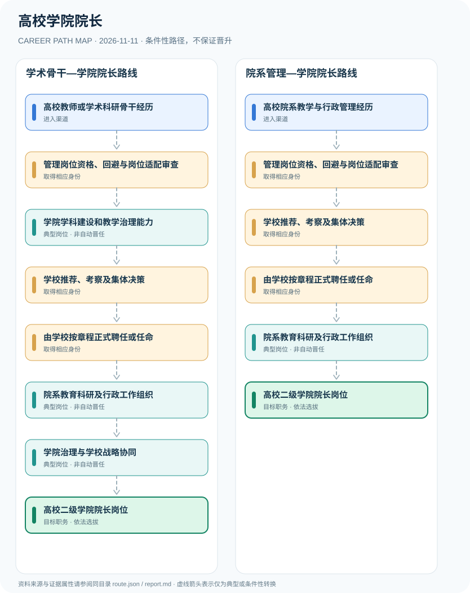

# 高校学院院长

> **B15 深度研究 · JR-148**　｜　**地域与机构**：中国大陆普通高等学校二级学院院长；区分国家举办高校和民办高校章程　｜　**核验日期**：2026-11-11

## 01 职业定位与现行制度版本

高校二级学院院长是学校内设教学科研单位行政负责人，不是因教授职称自动获得的岗位。2026年修订《高等学校领导人员管理办法》明确国家举办高校的内设机构负责人选拔任用按干部管理权限参照相关条款执行；具体任命、聘任、民主推荐与院系党政分工还须遵循各校章程和组织规定。

**重大新规**：2026年7月修订、8月发布的高校领导管理办法在第二条明确内设机构负责人依干部管理权限参照第二、三章。对院长本人，仍需查看学校章程、组织职数和内部制度；高校教师职称改革赋予学校自主评审权，却并不构成自动取得院长职务的法律依据。

## 02 两类准入及真实制度门槛

- **高校教师或学术科研骨干经历**：通过高校合法聘用积累教学科研、学科建设和人才培养能力；教授职称不当然具有院长行政资格。
- **高校院系教学与行政管理经历**：从专业负责人、系主任、副院长或跨校符合条件的教育管理岗位进入院系负责人选任视野。

- 2026年修订《高等学校领导人员管理办法》第二条明确国家举办高校领导班子及内设机构负责人的选任适用规则边界；并非所有条款直接作为内设院长的统一聘用资历。
- 教育部核准的北航大学章程规定院长人选由民主推荐或公开选拔、学校组织部门考察和党委常委会讨论决定，属该校具体章程实例。
- 民办高校如长沙科技学院院长可能由校务会、董事会等程序决定，不能用一所公立学校的程序推断所有学校。
- 教授、正高级职称、硕导博导资格与高校二级学院院长是不同职业身份。

## 03 典型发展路线及任职决定点

### 路线1：学术骨干—学院院长路线

从学术教学骨干积累院系治理能力，经资格核验、组织考察、学校任用后担任二级学院院长。

**条件性节点**：高校教师或学术科研骨干经历 → 管理岗位资格、回避与岗位适配审查 → 学院学科建设和教学治理能力 → 学校推荐、考察及集体决策 → 由学校按章程正式聘任或任命 → 院系教育科研及行政工作组织 → 学院治理与学校战略协同 → 高校二级学院院长岗位

应在每次考试、身份取得、聘用、晋升或岗位任命时重新审核条件；不能把这条示意路径当作法律规定的必然晋升链条。

### 路线2：院系管理—学院院长路线

已有院系管理或教育行政经历者，经适岗审查、校内外选任及正式任用承担院长职责。

**条件性节点**：高校院系教学与行政管理经历 → 管理岗位资格、回避与岗位适配审查 → 学校推荐、考察及集体决策 → 由学校按章程正式聘任或任命 → 院系教育科研及行政工作组织 → 高校二级学院院长岗位

应在每次考试、身份取得、聘用、晋升或岗位任命时重新审核条件；不能把这条示意路径当作法律规定的必然晋升链条。

## 04 工作职责、核心能力与评价方式

院长工作侧重学科规划、人才梯队、课程教学、科研治理、学术伦理、对外合作和经费合规。选任成功的核心是岗位需求与组织认可，而非按照教授任职年数排队。公众可查看学校章程、公开招聘或任命公告核实流程，不应猜测私下干部决策。

- **管理岗位资格、回避与岗位适配审查**：国家举办高校内设机构负责人需按2026年修订办法第二条参照选拔任用条款并依干部管理权限考察。
- **学院学科建设和教学治理能力**：具备专业人才引进、人才培养、课程、科研平台及预算合规能力；不将学术成果数量当作唯一选拔规则。
- **学校推荐、考察及集体决策**：根据高校性质和学校章程履行公开选拔、组织考察和集体决定等程序。
- **由学校按章程正式聘任或任命**：学校依据内部管理权限完成院长任职，民办高校可能由校务会和董事会等章程程序决定。
- **院系教育科研及行政工作组织**：领导院系教学、科研、学科、人才队伍等日常事务，并依法依章程与院系党组织分工协作。
- **学院治理与学校战略协同**：参与学科评价、经费与招生治理，履行利益冲突回避和学术伦理等约束，后续校级职务另经选任。

## 05 适用边界、时效与容易混淆的身份

- 《高等学校领导人员管理办法》第二条对国家举办高校及内设机构负责人的适用并不意味着把校级领导任期、任职年限全部机械套用二级学院院长。
- 不同高校的二级学院院长可采用选任、委任或聘任程序，具体以学校组织制度和已核准章程为准。
- 院长与学院党委书记各有分工；院系重大事项通常经党政联席会议等制度安排审议，不能混为一人单独决定。

## 06 证据台账与图谱解释

规范性文件、机构职责和招聘公告分别记录在 `route.json` 的 `sources` 中，并由岗位节点使用 `source_ids` 引用。所有边标记为 `conditional`（条件性转换），**不得因来源中存在某项资格就推定本人必获后续岗位**。若需要标注法律明确规定的资格，应在研究说明中具体引用相关条款，而不能把一个推测性职位转换伪装成 `normative`。

| 转换前 | 转换后 | 证据类型 | 约束说明 |
|---|---|---|---|
| 高校教师或学术科研骨干经历 | 管理岗位资格、回避与岗位适配审查 | `conditional` | 从「高校教师或学术科研骨干经历」到「管理岗位资格、回避与岗位适配审查」须独立满足资格、岗位要求及考试或组织安排；示意路线不构成保证晋任。 |
| 管理岗位资格、回避与岗位适配审查 | 学院学科建设和教学治理能力 | `conditional` | 从「管理岗位资格、回避与岗位适配审查」到「学院学科建设和教学治理能力」须独立满足资格、岗位要求及考试或组织安排；示意路线不构成保证晋任。 |
| 学院学科建设和教学治理能力 | 学校推荐、考察及集体决策 | `conditional` | 从「学院学科建设和教学治理能力」到「学校推荐、考察及集体决策」须独立满足资格、岗位要求及考试或组织安排；示意路线不构成保证晋任。 |
| 学校推荐、考察及集体决策 | 由学校按章程正式聘任或任命 | `conditional` | 从「学校推荐、考察及集体决策」到「由学校按章程正式聘任或任命」须独立满足资格、岗位要求及考试或组织安排；示意路线不构成保证晋任。 |
| 由学校按章程正式聘任或任命 | 院系教育科研及行政工作组织 | `conditional` | 从「由学校按章程正式聘任或任命」到「院系教育科研及行政工作组织」须独立满足资格、岗位要求及考试或组织安排；示意路线不构成保证晋任。 |
| 院系教育科研及行政工作组织 | 学院治理与学校战略协同 | `conditional` | 从「院系教育科研及行政工作组织」到「学院治理与学校战略协同」须独立满足资格、岗位要求及考试或组织安排；示意路线不构成保证晋任。 |
| 学院治理与学校战略协同 | 高校二级学院院长岗位 | `conditional` | 从「学院治理与学校战略协同」到「高校二级学院院长岗位」须独立满足资格、岗位要求及考试或组织安排；示意路线不构成保证晋任。 |
| 高校院系教学与行政管理经历 | 管理岗位资格、回避与岗位适配审查 | `conditional` | 从「高校院系教学与行政管理经历」到「管理岗位资格、回避与岗位适配审查」须独立满足资格、岗位要求及考试或组织安排；示意路线不构成保证晋任。 |
| 管理岗位资格、回避与岗位适配审查 | 学校推荐、考察及集体决策 | `conditional` | 从「管理岗位资格、回避与岗位适配审查」到「学校推荐、考察及集体决策」须独立满足资格、岗位要求及考试或组织安排；示意路线不构成保证晋任。 |
| 院系教育科研及行政工作组织 | 高校二级学院院长岗位 | `conditional` | 从「院系教育科研及行政工作组织」到「高校二级学院院长岗位」须独立满足资格、岗位要求及考试或组织安排；示意路线不构成保证晋任。 |

## 07 官方与公开资料（可追溯）

1. [高等学校领导人员管理办法（2026年修订）](https://www.moe.gov.cn/jyb_xxgk/moe_1777/moe_1779/202609/t20260916_1451003.html) — 中共中央组织部、教育部／教育部官网；来源原始日期 2026-08-12。
2. [北京航空航天大学章程（院长选任和党政联席会议）](https://www.moe.gov.cn/srcsite/A02/zfs_gdxxzc/201410/t20141020_182090.html) — 中华人民共和国教育部；来源原始日期 2014-10-20。
3. [长沙科技学院章程（民办学院院长程序）](https://jyt.hunan.gov.cn/jyt/sjyt/xxgk/qzqd1/xzzq/xzxk/202504/t20250414_1159415.html) — 湖南省教育厅；来源原始日期 2025-04-14。
4. [深化高等学校教师职称制度改革的指导意见](https://www.moe.gov.cn/jyb_xxgk/moe_1777/moe_1779/202101/t20210126_511116.html) — 中华人民共和国教育部；来源原始日期 2020-12-31。

> **复核协议**：跨年度招生公告、法律修订、专业等级与机构设置可能变化。实际申请和转岗前，须核对当前官方原文、所在地文件及单位职位要求，尤其注意来源发布日期与生效日期未必一致。
