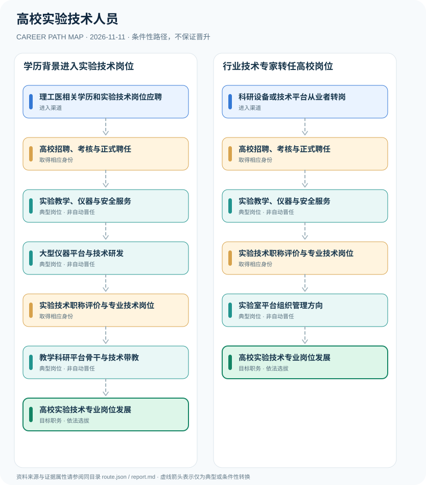

# 高校实验技术人员

> **B15 深度研究 · JR-146**　｜　**地域与机构**：中国大陆高校实验技术专业岗位；2021年国家职称指导意见与北京2022年地方实施办法　｜　**核验日期**：2026-11-11

## 01 职业定位与现行制度版本

高校实验技术人员承担实验室教学科研支撑、仪器设备管理与实验安全专业任务，职业职称序列独立于高校教师系列。2021年人社部和教育部职称改革将实验技术人员设为实验员、助理实验师、实验师、高级实验师、正高级实验师；岗位聘任与职称评审又是不同环节。

**技能和身份维度**：人社部与教育部明确实验技术职称从员级到正高，而高校教师职称独立。国家文件同时强调大型仪器设备功能开发、教学科研支撑等成果可以作为实验技术评审依据；北京实施方案提供区域层面的评价标准，仅用作地方对照。

## 02 两类准入及真实制度门槛

- **理工医相关学历和实验技术岗位应聘**：从物理、化学、生物、工程等专业经高校实验技术岗位招聘进入，实际专业条件以学校职位公告为准。
- **科研设备或技术平台从业者转岗**：有仪器应用、实验系统或科研辅助工作背景者，可按高校招聘及岗位资格申请实验技术岗。

- 人社部、教育部2021年《关于深化实验技术人才职称制度改革的指导意见》明确五级职称名称，并对应事业单位专业技术岗位等级。
- 北京市2022年实施办法对高校和科研机构实验技术人员适用范围与评审条件作出本地规定；不是全国统一要求。
- 高校实验技术系列与教授、副教授的高校教师系列不同；获得高级实验师职称也不保证担任实验室主任。

## 03 典型发展路线及任职决定点

### 路线1：学历背景进入实验技术岗位

从相关专业应聘和实验工作切入，经技术研发及职称评审逐步承担大型仪器和教学科研平台骨干工作。

**条件性节点**：理工医相关学历和实验技术岗位应聘 → 高校招聘、考核与正式聘任 → 实验教学、仪器与安全服务 → 大型仪器平台与技术研发 → 实验技术职称评价与专业技术岗位 → 教学科研平台骨干与技术带教 → 高校实验技术专业岗位发展

应在每次考试、身份取得、聘用、晋升或岗位任命时重新审核条件；不能把这条示意路径当作法律规定的必然晋升链条。

### 路线2：行业技术专家转任高校岗位

已有仪器研发或工程实践能力者，按招聘程序进入高校，结合实验安全与平台管理履职并可参与技术评价。

**条件性节点**：科研设备或技术平台从业者转岗 → 高校招聘、考核与正式聘任 → 实验教学、仪器与安全服务 → 实验技术职称评价与专业技术岗位 → 实验室平台组织管理方向 → 高校实验技术专业岗位发展

应在每次考试、身份取得、聘用、晋升或岗位任命时重新审核条件；不能把这条示意路径当作法律规定的必然晋升链条。

## 04 工作职责、核心能力与评价方式

可审计成果包括仪器正常运行时间、实验教学支撑数量与质量、实验技术改进、设备共享服务及安全事件预防。由高级实验师向实验中心负责人并非自动岗位晋升，需要学校另行设岗与任命。

- **高校招聘、考核与正式聘任**：经学校适用的事业单位或劳动用工招聘程序进入，聘任方式与编制身份应查具体岗位。
- **实验教学、仪器与安全服务**：开展实验准备、仪器维护、技术实验与实验安全培训，形成可追溯的质量和设备管理记录。
- **大型仪器平台与技术研发**：负责大型精密仪器技术方案、实验创新及平台效率提升，积累专业技术成果。
- **实验技术职称评价与专业技术岗位**：实验员、助理实验师、实验师、高级实验师、正高级实验师属于职称层级，与具体岗位聘任并行。
- **教学科研平台骨干与技术带教**：通过科研支撑、平台建设、培训和安全治理承担高级实验技术责任，负责人岗位需另行选拔。
- **实验室平台组织管理方向**：满足学校管理岗位资格时可能承担实验中心协调职责，实验技术职称本身不会自动授予行政领导。

## 05 适用边界、时效与容易混淆的身份

- 不同高校实验技术岗位可能是事业编制、合同聘任或其他人员身份，招聘公告才能最终确认。
- 正高级实验师与正高级职称的评审可存在成果、技能、破格等多种路径，不应画成固定年限必经流程。
- 实验室危险源管理须遵守单位安全规范，此职业图谱不提供高危实验的操作方法。

## 06 证据台账与图谱解释

规范性文件、机构职责和招聘公告分别记录在 `route.json` 的 `sources` 中，并由岗位节点使用 `source_ids` 引用。所有边标记为 `conditional`（条件性转换），**不得因来源中存在某项资格就推定本人必获后续岗位**。若需要标注法律明确规定的资格，应在研究说明中具体引用相关条款，而不能把一个推测性职位转换伪装成 `normative`。

| 转换前 | 转换后 | 证据类型 | 约束说明 |
|---|---|---|---|
| 理工医相关学历和实验技术岗位应聘 | 高校招聘、考核与正式聘任 | `conditional` | 从「理工医相关学历和实验技术岗位应聘」到「高校招聘、考核与正式聘任」须独立满足资格、岗位要求及考试或组织安排；示意路线不构成保证晋任。 |
| 高校招聘、考核与正式聘任 | 实验教学、仪器与安全服务 | `conditional` | 从「高校招聘、考核与正式聘任」到「实验教学、仪器与安全服务」须独立满足资格、岗位要求及考试或组织安排；示意路线不构成保证晋任。 |
| 实验教学、仪器与安全服务 | 大型仪器平台与技术研发 | `conditional` | 从「实验教学、仪器与安全服务」到「大型仪器平台与技术研发」须独立满足资格、岗位要求及考试或组织安排；示意路线不构成保证晋任。 |
| 大型仪器平台与技术研发 | 实验技术职称评价与专业技术岗位 | `conditional` | 从「大型仪器平台与技术研发」到「实验技术职称评价与专业技术岗位」须独立满足资格、岗位要求及考试或组织安排；示意路线不构成保证晋任。 |
| 实验技术职称评价与专业技术岗位 | 教学科研平台骨干与技术带教 | `conditional` | 从「实验技术职称评价与专业技术岗位」到「教学科研平台骨干与技术带教」须独立满足资格、岗位要求及考试或组织安排；示意路线不构成保证晋任。 |
| 教学科研平台骨干与技术带教 | 高校实验技术专业岗位发展 | `conditional` | 从「教学科研平台骨干与技术带教」到「高校实验技术专业岗位发展」须独立满足资格、岗位要求及考试或组织安排；示意路线不构成保证晋任。 |
| 科研设备或技术平台从业者转岗 | 高校招聘、考核与正式聘任 | `conditional` | 从「科研设备或技术平台从业者转岗」到「高校招聘、考核与正式聘任」须独立满足资格、岗位要求及考试或组织安排；示意路线不构成保证晋任。 |
| 实验教学、仪器与安全服务 | 实验技术职称评价与专业技术岗位 | `conditional` | 从「实验教学、仪器与安全服务」到「实验技术职称评价与专业技术岗位」须独立满足资格、岗位要求及考试或组织安排；示意路线不构成保证晋任。 |
| 实验技术职称评价与专业技术岗位 | 实验室平台组织管理方向 | `conditional` | 从「实验技术职称评价与专业技术岗位」到「实验室平台组织管理方向」须独立满足资格、岗位要求及考试或组织安排；示意路线不构成保证晋任。 |
| 实验室平台组织管理方向 | 高校实验技术专业岗位发展 | `conditional` | 从「实验室平台组织管理方向」到「高校实验技术专业岗位发展」须独立满足资格、岗位要求及考试或组织安排；示意路线不构成保证晋任。 |

## 07 官方与公开资料（可追溯）

1. [人社部、教育部关于深化实验技术人才职称制度改革的指导意见](https://www.moe.gov.cn/jyb_xxgk/moe_1777/moe_1779/202109/t20210907_560035.html) — 中华人民共和国教育部；来源原始日期 2021-08-23。
2. [北京市深化实验技术人才职称制度改革实施办法](https://www.beijing.gov.cn/zhengce/zhengcefagui/202301/t20230111_2896322.html) — 北京市人民政府；来源原始日期 2022-12-26。
3. [进一步做好事业单位公开招聘工作的通知](https://www.mohrss.gov.cn/wap/zc/zcwj/202409/t20240905_525231.html) — 人力资源和社会保障部；来源原始日期 2024-08-28。

> **复核协议**：跨年度招生公告、法律修订、专业等级与机构设置可能变化。实际申请和转岗前，须核对当前官方原文、所在地文件及单位职位要求，尤其注意来源发布日期与生效日期未必一致。
