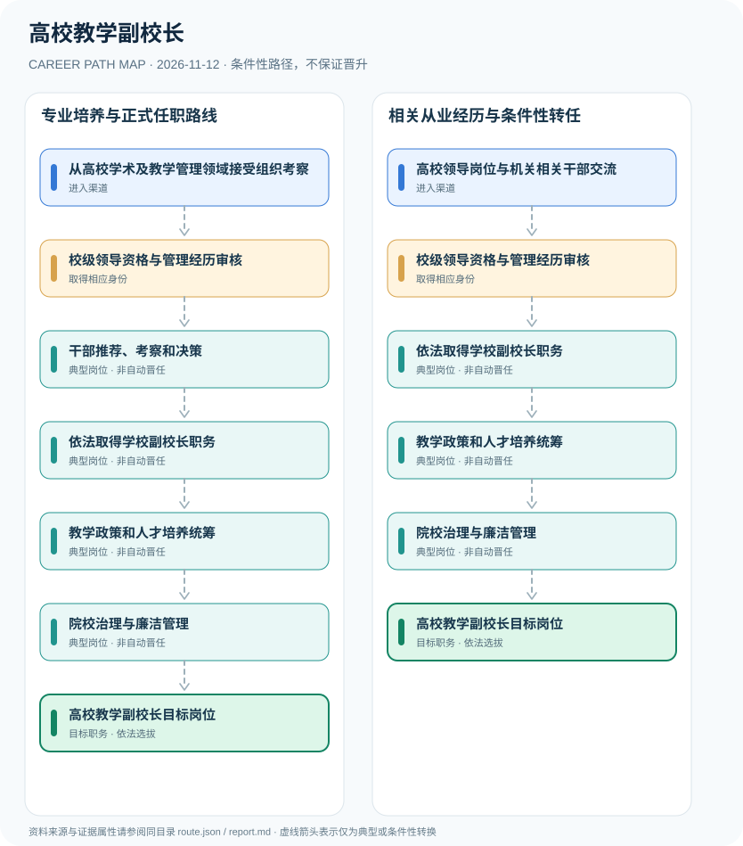

# 高校教学副校长

> **B18 深度职业研究 · JR-149** · 核验日期：2026-11-12 · 中国大陆国家举办的普通高等学校分管教学副校长，其他性质高校依章程核查

## 01 现行制度与职业身份

高校分管教学的副校长是校级领导班子成员，按干部管理权限选拔任用并依据学校分工统筹教学、专业建设、人才培养及质量保障。2026年修订《高等学校领导人员管理办法》自8月12日发布即施行，对校级领导的资格条件和组织任用有专门规定；教授职称、学院院长职务和副校长任用不能自动互换。

2026新版领导人员办法对国家举办的普通高校校级班子成员有明确适用，允许符合条件的专业技术人员按条件进入领导岗位，但强调管理经历和组织任用。‘高校教学副校长’不能简化为院长—教授—副校长的自动晋升。

## 02 两种进入渠道

- **从高校学术及教学管理领域接受组织考察**：具有相应教学科研或院系、学生管理经历的高校管理与专业人员，可在满足资格条件时按组织选任程序进入候选范围。
- **高校领导岗位与机关相关干部交流**：符合干部管理和高校领导人员资格的管理干部，可按适用交流任用程序纳入学校领导班子调整。

## 03 职业路线与决定性环节

### 路径 1：专业培养与正式任职路线

具有相应教学科研或院系、学生管理经历的高校管理与专业人员，可在满足资格条件时按组织选任程序进入候选范围。

**条件性链条**：从高校学术及教学管理领域接受组织考察 → 校级领导资格与管理经历审核 → 干部推荐、考察和决策 → 依法取得学校副校长职务 → 教学政策和人才培养统筹 → 院校治理与廉洁管理 → 高校教学副校长目标岗位

各节点转换均需单独满足资格、岗位空缺、考核及组织任命要求。

### 路径 2：相关从业经历与条件性转任

符合干部管理和高校领导人员资格的管理干部，可按适用交流任用程序纳入学校领导班子调整。

**条件性链条**：高校领导岗位与机关相关干部交流 → 校级领导资格与管理经历审核 → 依法取得学校副校长职务 → 教学政策和人才培养统筹 → 院校治理与廉洁管理 → 高校教学副校长目标岗位

各节点转换均需单独满足资格、岗位空缺、考核及组织任命要求。

## 04 职业任务及专业能力

能力重心为高等教育规律、教学质量评价、专业课程建设、财务合规、教育改革、校企合作及组织领导。

- **校级领导资格与管理经历审核**：2026新版规定涉及学历、工作经历、院系管理及专业技术岗位等要求，具体情况与例外条件需按条款评估。
- **干部推荐、考察和决策**：由主管部门党委及组织人事机关按干部管理权限履行选任、任用和监督程序。
- **依法取得学校副校长职务**：经正式任职并明确分管教学职责；教授、副教授等职称与领导职位属于不同体系。
- **教学政策和人才培养统筹**：协调培养方案、教学质量保障、专业建设、学科合作和教学科研资源配置。
- **院校治理与廉洁管理**：参与学校集体决策、预算和学术伦理监督，担任校长或书记须另行选任。

## 05 法规、规范和真实岗位证据

- 2026年8月12日发布施行的《高等学校领导人员管理办法》明确适用于国家举办的普通高校领导班子成员。
- 该办法第六条规定校级领导人员基本资格并对从专业技术岗位直接提任领导人员列出独立条件，不能视为教授自动升任。
- 高校内部院系负责人选任按干部权限参照第二、三章，但校级领导班子成员与院系负责人适用层次仍有区别。

## 06 适用边界与不确定性

- 公办高校、民办高校和中外合作办学机构在章程与任职程序上可能有差异。
- ‘分管教学’是学校领导班子工作分工，不一定是任命文件中单独的法定职务名称。
- 不根据学校个别领导履历推断全国最低任职年龄或必经职务。

## 07 全路径证据台账

每个节点的 `source_ids` 由 `route.json` 中可核查的法律、部门文件或岗位招聘支持，转换边统一采用 `conditional`，不创造自动晋升。发布日期与施行日期独立核验。

| 前置节点 | 后续节点 | 证据属性 | 适用限制 |
|---|---|---|---|
| 从高校学术及教学管理领域接受组织考察 | 校级领导资格与管理经历审核 | `conditional` | 从「从高校学术及教学管理领域接受组织考察」到「校级领导资格与管理经历审核」须独立满足招聘、资格、合规及组织任职要求，不能视为自动晋升。 |
| 校级领导资格与管理经历审核 | 干部推荐、考察和决策 | `conditional` | 从「校级领导资格与管理经历审核」到「干部推荐、考察和决策」须独立满足招聘、资格、合规及组织任职要求，不能视为自动晋升。 |
| 干部推荐、考察和决策 | 依法取得学校副校长职务 | `conditional` | 从「干部推荐、考察和决策」到「依法取得学校副校长职务」须独立满足招聘、资格、合规及组织任职要求，不能视为自动晋升。 |
| 依法取得学校副校长职务 | 教学政策和人才培养统筹 | `conditional` | 从「依法取得学校副校长职务」到「教学政策和人才培养统筹」须独立满足招聘、资格、合规及组织任职要求，不能视为自动晋升。 |
| 教学政策和人才培养统筹 | 院校治理与廉洁管理 | `conditional` | 从「教学政策和人才培养统筹」到「院校治理与廉洁管理」须独立满足招聘、资格、合规及组织任职要求，不能视为自动晋升。 |
| 院校治理与廉洁管理 | 高校教学副校长目标岗位 | `conditional` | 从「院校治理与廉洁管理」到「高校教学副校长目标岗位」须独立满足招聘、资格、合规及组织任职要求，不能视为自动晋升。 |
| 高校领导岗位与机关相关干部交流 | 校级领导资格与管理经历审核 | `conditional` | 从「高校领导岗位与机关相关干部交流」到「校级领导资格与管理经历审核」须独立满足招聘、资格、合规及组织任职要求，不能视为自动晋升。 |
| 校级领导资格与管理经历审核 | 依法取得学校副校长职务 | `conditional` | 从「校级领导资格与管理经历审核」到「依法取得学校副校长职务」须独立满足招聘、资格、合规及组织任职要求，不能视为自动晋升。 |

## 08 来源原文、发布机构及日期

1. **中华人民共和国教育部**：[高等学校领导人员管理办法（2026年修订）](https://www.moe.gov.cn/jyb_xxgk/moe_1777/moe_1779/202609/t20260916_1451003.html)，文件日期 2026-08-12。
2. **中华人民共和国教育部**：[北京航空航天大学章程](https://www.moe.gov.cn/srcsite/A02/zfs_gdxxzc/201410/t20141020_182090.html)，文件日期 2014-10-20。

> 不把学历或职称证书等同于行政任职，也不将单位或产品标准说成个人执业许可；具体招聘必须再查当年最新公告。
