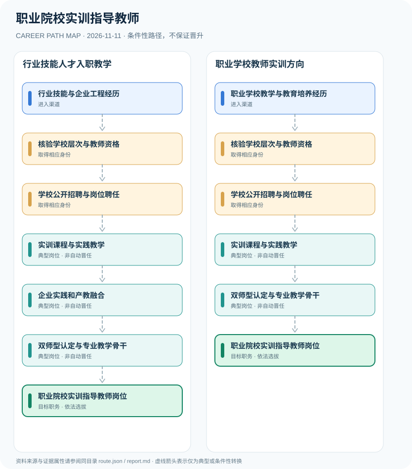

# 职业院校实训指导教师

> **B14 深度研究 · JR-144** · **适用范围**：中国大陆职业院校；区分中职实习指导教师与高职高校教师岗位 · **官方资料核验日期**：2026-11-11

## 研究摘要与制度性质

职业学校实训指导教师需按学校层次满足相应教师资格、技术技能与招聘要求。中等职业学校实习指导教师资格是《教师资格条例》明确的独立资格类别；教育部“双师型”教师认定属于职业教育专业能力评价，不能替代法定教师资格。

关键是区分 **执教资格**、**产业技能** 和 **双师型认定** 三条轴线。教师资格条例对中职实习指导教师设专门类别；高等职业院校教师通常适用高校教师资格及所在学校聘用制度，不能一概而论。

## 一、入职渠道与资格核验

- **行业技能与企业工程经历**：具备制造、信息、财经等专业实践能力的企业人才可在满足招聘和教师资格要求时进入职业教育教学岗位。
- **职业学校教学与教育培养经历**：从职业教育专业学习、职业院校相近教学岗位或其他已有教师资格背景申请实训教学职位。

## 二、两种职业发展路线

### 路线 1：行业技能人才入职教学

企业岗位实践者取得适用教师资格，经学校招聘进入实训教学，再发展双师型教学能力。

**节点序列**：行业技能与企业工程经历 → 核验学校层次与教师资格 → 学校公开招聘与岗位聘任 → 实训课程与实践教学 → 企业实践和产教融合 → 双师型认定与专业教学骨干 → 职业院校实训指导教师岗位

**任用边界**：本路线是一种合理的条件性发展关系；不因完成上一个岗位或取得某张证书自动获得下一个岗位。

### 路线 2：职业学校教师实训方向

具有职业教育背景的教育人员按学校层级核对资格后进入实训岗位并发展教研能力。

**节点序列**：职业学校教学与教育培养经历 → 核验学校层次与教师资格 → 学校公开招聘与岗位聘任 → 实训课程与实践教学 → 双师型认定与专业教学骨干 → 职业院校实训指导教师岗位

**任用边界**：本路线是一种合理的条件性发展关系；不因完成上一个岗位或取得某张证书自动获得下一个岗位。

## 三、岗位职责与长期成长

实训课程能力包括设备安全、操作步骤拆解、学生岗位评价与校企项目协作。争取成为实训中心负责人、学科带头人或双师型教师，需要另行符合专业认定与机构聘用条件。

- **核验学校层次与教师资格**：中职实习指导教师资格需按规定具备相应学历、助理工程师及以上职务或中级及以上工人技术等级等条件；高职另按高校教师资格。
- **学校公开招聘与岗位聘任**：按实际学校事业单位或依法设立机构招聘程序完成资格审查、试讲、实践技能考核和聘任。
- **实训课程与实践教学**：开展实验实训、技能教学、现场安全管理、工学结合项目设计及学习评价。
- **企业实践和产教融合**：与企业共同开发实践项目、校企协作及技能标准，保持专业技能与行业经验更新。
- **双师型认定与专业教学骨干**：符合教育部及地方2022年双师型教师标准时自愿申请认定；学校职称职务另依独立评审。

## 四、正式政策、准入门槛及制度区分

- 《教师资格条例》第四条区分中等职业学校实习指导教师资格，第七条规定申请者应满足相应学历与助理工程师以上专业技术职务或中级以上工人技术等级。
- 《职业教育法》2022年修订版第四十六条要求职业学校专业课教师（含实习指导教师）具有适当工作经历或实践经验和技术技能水平。
- 教育部2022年双师型教师认定主要适用于职业学校专业课教师（含实习指导教师），国家基础标准仍须结合地方实施办法。

## 五、时效、地区和身份风险

- 中职教师资格和高校教师资格不同；高职实训教师不自动适用中职实习指导教师资格证。
- 双师型教师认定不等于获得教师资格、专业技术职务或事业编制。
- 2026南京市教师资格认定条件仅适用于其辖区与该批次，其他地区按本地公告核查。

## 六、证据台账（图谱边）

每个转换都按 `conditional` 处理。法规和官方说明作为**节点依据**记入 `route.json` 的 `source_ids`；条件性箭头不代表法律保证、实际个人履历或确定晋升路径。任何法规变更均应同时更新数据与解释文本。

| 从 | 至 | 证据性质 | 适用限制 |
|---|---|---|---|
| 行业技能与企业工程经历 | 核验学校层次与教师资格 | conditional | 从「行业技能与企业工程经历」发展至「核验学校层次与教师资格」须独立满足职位、资格、考核及组织聘任要求，不能视为自动升级。 |
| 核验学校层次与教师资格 | 学校公开招聘与岗位聘任 | conditional | 从「核验学校层次与教师资格」发展至「学校公开招聘与岗位聘任」须独立满足职位、资格、考核及组织聘任要求，不能视为自动升级。 |
| 学校公开招聘与岗位聘任 | 实训课程与实践教学 | conditional | 从「学校公开招聘与岗位聘任」发展至「实训课程与实践教学」须独立满足职位、资格、考核及组织聘任要求，不能视为自动升级。 |
| 实训课程与实践教学 | 企业实践和产教融合 | conditional | 从「实训课程与实践教学」发展至「企业实践和产教融合」须独立满足职位、资格、考核及组织聘任要求，不能视为自动升级。 |
| 企业实践和产教融合 | 双师型认定与专业教学骨干 | conditional | 从「企业实践和产教融合」发展至「双师型认定与专业教学骨干」须独立满足职位、资格、考核及组织聘任要求，不能视为自动升级。 |
| 双师型认定与专业教学骨干 | 职业院校实训指导教师岗位 | conditional | 从「双师型认定与专业教学骨干」发展至「职业院校实训指导教师岗位」须独立满足职位、资格、考核及组织聘任要求，不能视为自动升级。 |
| 职业学校教学与教育培养经历 | 核验学校层次与教师资格 | conditional | 从「职业学校教学与教育培养经历」发展至「核验学校层次与教师资格」须独立满足职位、资格、考核及组织聘任要求，不能视为自动升级。 |
| 实训课程与实践教学 | 双师型认定与专业教学骨干 | conditional | 从「实训课程与实践教学」发展至「双师型认定与专业教学骨干」须独立满足职位、资格、考核及组织聘任要求，不能视为自动升级。 |

## 七、可核对来源（含发布日期）

1. **中华人民共和国教育部**：[教师资格条例](https://www.moe.gov.cn/jyb_sjzl/sjzl_zcfg/zcfg_jyxzfg/202204/t20220422_620496.html)，原始发布日期 1995-12-12。
2. **中华人民共和国教育部**：[中华人民共和国职业教育法（2022年修订）](https://www.moe.gov.cn/jyb_sjzl/sjzl_zcfg/zcfg_jyfl/202204/t20220421_620064.html)，原始发布日期 2022-04-20。
3. **中华人民共和国教育部**：[教育部办公厅关于做好职业教育双师型教师认定工作的通知](https://www.moe.gov.cn/srcsite/A10/s7034/202210/t20221027_672715.html)，原始发布日期 2022-10-25。
4. **南京市教育局**：[南京市2026年下半年教师资格认定公告](https://edu.nanjing.gov.cn/gg/202610/t20261014_6018493.html)，原始发布日期 2026-10-14。

> **复核提醒**：年度岗位招聘及地方制度变化较快，申请前必须重新核验公告原文、适用人群及有效期。本研究仅公开制度与职业路线，不推断个人晋升概率。
