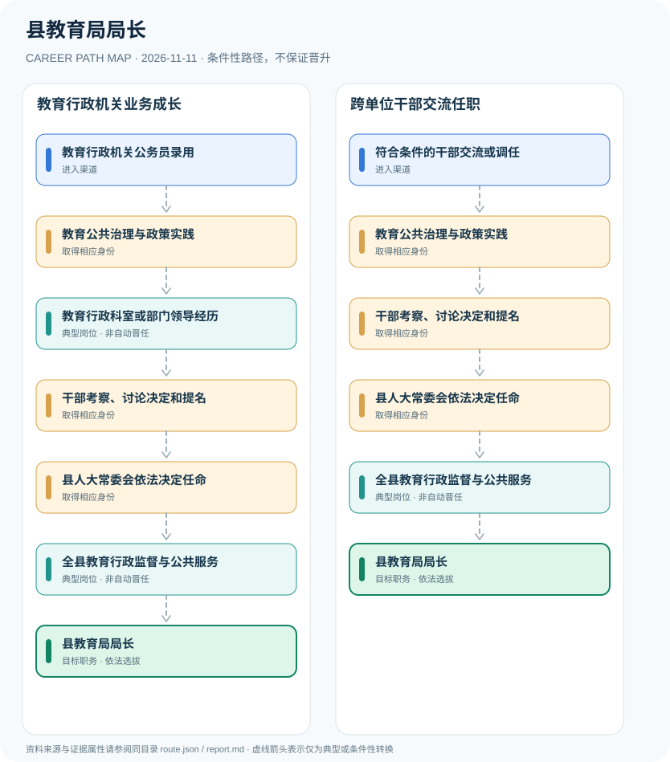

# 县教育局局长

> **B14 深度研究 · JR-125** · **适用范围**：中国大陆普通县的县政府教育行政主管部门；地方机构规格可能不同 · **官方资料核验日期**：2026-11-11

## 研究摘要与制度性质

县教育局局长是县政府教育行政部门领导职务，通常经干部管理权限下的组织考察、提名与县人大常委会法定任命产生；不等于普通教师、学校校长通过职称评聘即可自动转任。

常见误区是把校长—教育局长描绘成单一教育职业职称线。实际一个属于学校管理岗位，一个属于县政府行政领导，任用资格、组织关系与人大常委会任命程序均不同。

## 一、入职渠道与资格核验

- **教育行政机关公务员录用**：根据年度公务员招录职位表进入县级教育行政或相关党政机关，积累公共教育管理经历。
- **符合条件的干部交流或调任**：依法在干部管理权限、任职资格和编制范围内从相关党政或事业单位管理岗位交流调任。

## 二、两种职业发展路线

### 路线 1：教育行政机关业务成长

公务员积累教育治理和部门管理经验，符合任用资格且经组织提名、县人大常委会任命。

**节点序列**：教育行政机关公务员录用 → 教育公共治理与政策实践 → 教育行政科室或部门领导经历 → 干部考察、讨论决定和提名 → 县人大常委会依法决定任命 → 全县教育行政监督与公共服务 → 县教育局局长

**任用边界**：本路线是一种合理的条件性发展关系；不因完成上一个岗位或取得某张证书自动获得下一个岗位。

### 路线 2：跨单位干部交流任职

符合条件的其他党政或管理岗位干部通过交流与组织考察进入教育行政领导职务。

**节点序列**：符合条件的干部交流或调任 → 教育公共治理与政策实践 → 干部考察、讨论决定和提名 → 县人大常委会依法决定任命 → 全县教育行政监督与公共服务 → 县教育局局长

**任用边界**：本路线是一种合理的条件性发展关系；不因完成上一个岗位或取得某张证书自动获得下一个岗位。

## 三、岗位职责与长期成长

重要能力为教育投入与预算、义务教育政策、学校安全、师资和教育质量监管、家校沟通及行政程序合规。职务任免依组织程序，不存在从教师职称到局长的规定年限。

- **教育公共治理与政策实践**：参与学校管理政策、师资配置、义务教育、公办学校监管及教育公平等行政事务。
- **教育行政科室或部门领导经历**：承担科室管理、县直部门副职或相关领导职责，具体职数及职务层级需查当地机构规格。
- **干部考察、讨论决定和提名**：依党政领导干部选拔条例履行适岗考察、组织决定与相关提名程序。
- **县人大常委会依法决定任命**：县长依法提请本级人大常委会决定任命政府工作部门局长，与县长由县人大选举不同。
- **全县教育行政监督与公共服务**：在教育局权限范围内组织教育规划、学校治理与教师队伍公共管理。

## 四、正式政策、准入门槛及制度区分

- 2022年修正《地方组织法》规定县长提名本级人民政府局长任免，由本级人大常委会依法决定。
- 2019年《党政领导干部选拔任用工作条例》对领导干部选任规定任职资格、考察及集体讨论决定程序。
- 局长不是教师专业技术职称或学校校长行政职务的自动晋升下一站；教育治理能力与干部任用资格需要分别评估。

## 五、时效、地区和身份风险

- 不把所有县教育局局长视为固定统一行政级别，特殊行政区划和机构规格需核查。
- 教育局负责人不以教师资格证为唯一法定入口，若从事业单位转任则需符合额外调任与交流规定。
- 县教育局局长由人大常委会决定任命，不是由县人大直接选举产生。

## 六、证据台账（图谱边）

每个转换都按 `conditional` 处理。法规和官方说明作为**节点依据**记入 `route.json` 的 `source_ids`；条件性箭头不代表法律保证、实际个人履历或确定晋升路径。任何法规变更均应同时更新数据与解释文本。

| 从 | 至 | 证据性质 | 适用限制 |
|---|---|---|---|
| 教育行政机关公务员录用 | 教育公共治理与政策实践 | conditional | 从「教育行政机关公务员录用」发展至「教育公共治理与政策实践」须独立满足职位、资格、考核及组织聘任要求，不能视为自动升级。 |
| 教育公共治理与政策实践 | 教育行政科室或部门领导经历 | conditional | 从「教育公共治理与政策实践」发展至「教育行政科室或部门领导经历」须独立满足职位、资格、考核及组织聘任要求，不能视为自动升级。 |
| 教育行政科室或部门领导经历 | 干部考察、讨论决定和提名 | conditional | 从「教育行政科室或部门领导经历」发展至「干部考察、讨论决定和提名」须独立满足职位、资格、考核及组织聘任要求，不能视为自动升级。 |
| 干部考察、讨论决定和提名 | 县人大常委会依法决定任命 | conditional | 从「干部考察、讨论决定和提名」发展至「县人大常委会依法决定任命」须独立满足职位、资格、考核及组织聘任要求，不能视为自动升级。 |
| 县人大常委会依法决定任命 | 全县教育行政监督与公共服务 | conditional | 从「县人大常委会依法决定任命」发展至「全县教育行政监督与公共服务」须独立满足职位、资格、考核及组织聘任要求，不能视为自动升级。 |
| 全县教育行政监督与公共服务 | 县教育局局长 | conditional | 从「全县教育行政监督与公共服务」发展至「县教育局局长」须独立满足职位、资格、考核及组织聘任要求，不能视为自动升级。 |
| 符合条件的干部交流或调任 | 教育公共治理与政策实践 | conditional | 从「符合条件的干部交流或调任」发展至「教育公共治理与政策实践」须独立满足职位、资格、考核及组织聘任要求，不能视为自动升级。 |
| 教育公共治理与政策实践 | 干部考察、讨论决定和提名 | conditional | 从「教育公共治理与政策实践」发展至「干部考察、讨论决定和提名」须独立满足职位、资格、考核及组织聘任要求，不能视为自动升级。 |

## 七、可核对来源（含发布日期）

1. **山东省高级人民法院（转载法律）**：[中华人民共和国地方各级人民代表大会和地方各级人民政府组织法（2022年修正）](https://www.sdcourt.gov.cn/jningweisfy/385991/385992/8661225/index.html)，原始发布日期 2022-03-11。
2. **人力资源社会保障部（转载中央文件）**：[党政领导干部选拔任用工作条例](https://www.mohrss.gov.cn/SYrlzyhshbzb/ztzl/dflz/lzgd/201903/t20190321_312665.html)，原始发布日期 2019-03-03。
3. **中华人民共和国教育部**：[中华人民共和国教育法](https://www.moe.gov.cn/jyb_sjzl/sjzl_zcfg/zcfg_jyfl/202107/t20210730_547843.html)，原始发布日期 2021-04-29。
4. **国家统计局法规资料**：[中华人民共和国公务员法](https://www.stats.gov.cn/gk/tjfg/xgfxfg/202503/t20250310_1958920.html)，原始发布日期 2018-12-29。

> **复核提醒**：年度岗位招聘及地方制度变化较快，申请前必须重新核验公告原文、适用人群及有效期。本研究仅公开制度与职业路线，不推断个人晋升概率。
