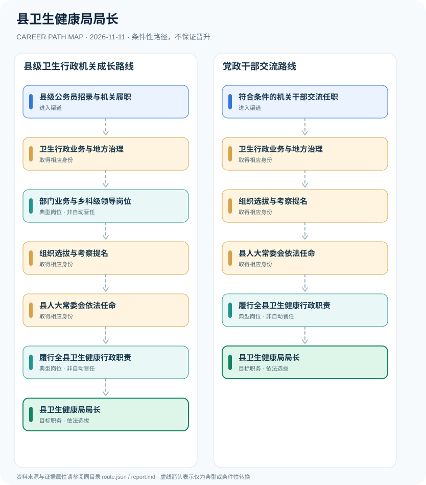

# 县卫生健康局局长

> **批次 B13 · JR-126** · 研究范围：中国大陆·普通县人民政府工作部门；四川邻水县2026职能配置作为县级实例 · **核验日期 2026-11-11**

## 职业定位与证据边界

县卫生健康局局长通常是县政府工作部门负责人，其产生涉及干部选拔提名和县人大常委会依法任命，不能仅通过医生资格考试获得。卫生行政业务、机关干部履历和医院医疗岗位分别属于不同职业制度。

职位本质是**行政领导职务**。普通县中县直部门一般为乡科级，但区县特例、地区机构规格需逐县核实；卫生管理专业素养是适岗能力，不等同于必须具备口腔/临床执业医师证。

## 一、两种主要职业进入方向

- **县级公务员招录与机关履职**：通过符合岗位条件的公务员招录进入卫生健康行政或相关综合管理机关工作。
- **符合条件的机关干部交流任职**：依法按干部管理权限从相关党政部门进行干部交流或调任，必须满足领导职务资格。

## 二、典型发展路线与适用条件

### 1. 县级卫生行政机关成长路线

公务员从卫生健康行政业务与领导岗位积累经验，符合条件时被组织提名并依法任命。

**路线图**：县级公务员招录与机关履职 → 卫生行政业务与地方治理 → 部门业务与乡科级领导岗位 → 组织选拔与考察提名 → 县人大常委会依法任命 → 履行全县卫生健康行政职责 → 县卫生健康局局长

以上各岗位转换均受任用、选拔、执业资格或招聘控制，不构成保证晋升的链条。

### 2. 党政干部交流路线

已符合党政领导干部资格的干部可以按程序交流提任进入卫生行政部门领导岗位。

**路线图**：符合条件的机关干部交流任职 → 卫生行政业务与地方治理 → 组织选拔与考察提名 → 县人大常委会依法任命 → 履行全县卫生健康行政职责 → 县卫生健康局局长

以上各岗位转换均受任用、选拔、执业资格或招聘控制，不构成保证晋升的链条。

## 三、岗位职责与专业发展能力

核心治理职责涵盖公共卫生、卫生资源配置、医院监管与基层医疗建设。依法选任之后仍需要承担行政程序、公共财政和应急治理等管理责任。

- **卫生行政业务与地方治理**：在医疗卫生规划、公共卫生、医疗机构管理、妇幼健康及基层医疗服务等领域积累行政经验。
- **部门业务与乡科级领导岗位**：可能担任科室负责人、县直部门副职等相关岗位，领导职务层次依本地编制和组织机构规定。
- **组织选拔与考察提名**：按干部管理权限开展资格审查、考察和领导职务推荐提名。
- **县人大常委会依法任命**：政府工作部门局长由县人民政府依法提请县人大常委会任命；不等于县人民代表大会选举县长。
- **履行全县卫生健康行政职责**：统筹卫生服务资源、公共卫生和医疗机构监督管理等法定职责，依法配合其他部门。

## 四、现行法规、任职资格及关键区别

- 2022年修正《地方组织法》明确县政府部门局长按规定由本级人大常委会任命，县长则由本级人民代表大会选举。
- 2026年邻水县卫生健康局职能配置列明县卫健局为县政府正科级工作部门，是地方实例而非所有地区永久统一级别。
- 《党政领导干部选拔任用工作条例》对县处级以下领导干部等适用干部管理和任职资历规定，不能以单纯工龄自动取得局长岗位。

## 五、法律与数据风险提示

- 县卫健局局长与医院院长、科主任或医师属于不同职业角色，具有医师资格不是担任局长的法定唯一途径。
- 县区的机构规格和领导职数可能不同，不据一个县推断所有行政区划。
- 行政机关职业发展涉及组织选拔和法定任命，不提供个人升迁几率或保证。

## 六、证据分类和引用对应

**职业路径中所有转换为 `conditional`：满足条件时才可能发生。** `normative` 指法律明确规定的权利或义务；`official_description` 指官方发布的岗位事实；`illustrative` 只代表一种合理的示例经历。本报告不混淆行政领导职务、职级、执业资格、技术等级和雇主自行定义的岗位。

| 图中转换 | 证据属性 | 解释 |
|---|---|---|
| 县级公务员招录与机关履职 → 卫生行政业务与地方治理 | conditional | 从「县级公务员招录与机关履职」到「卫生行政业务与地方治理」取决于对应资格、空缺职位或机构选任，不是必然晋升。 |
| 卫生行政业务与地方治理 → 部门业务与乡科级领导岗位 | conditional | 从「卫生行政业务与地方治理」到「部门业务与乡科级领导岗位」取决于对应资格、空缺职位或机构选任，不是必然晋升。 |
| 部门业务与乡科级领导岗位 → 组织选拔与考察提名 | conditional | 从「部门业务与乡科级领导岗位」到「组织选拔与考察提名」取决于对应资格、空缺职位或机构选任，不是必然晋升。 |
| 组织选拔与考察提名 → 县人大常委会依法任命 | conditional | 从「组织选拔与考察提名」到「县人大常委会依法任命」取决于对应资格、空缺职位或机构选任，不是必然晋升。 |
| 县人大常委会依法任命 → 履行全县卫生健康行政职责 | conditional | 从「县人大常委会依法任命」到「履行全县卫生健康行政职责」取决于对应资格、空缺职位或机构选任，不是必然晋升。 |
| 履行全县卫生健康行政职责 → 县卫生健康局局长 | conditional | 从「履行全县卫生健康行政职责」到「县卫生健康局局长」取决于对应资格、空缺职位或机构选任，不是必然晋升。 |
| 符合条件的机关干部交流任职 → 卫生行政业务与地方治理 | conditional | 从「符合条件的机关干部交流任职」到「卫生行政业务与地方治理」取决于对应资格、空缺职位或机构选任，不是必然晋升。 |
| 卫生行政业务与地方治理 → 组织选拔与考察提名 | conditional | 从「卫生行政业务与地方治理」到「组织选拔与考察提名」取决于对应资格、空缺职位或机构选任，不是必然晋升。 |

## 七、官方和公开参考资料

1. [邻水县卫生健康局职能配置（2026年）](https://www.scls.gov.cn/lsxrmzf/c105390/pc/content/content_1717620758701617152.html) — 邻水县人民政府（发布日期 2026-01-22）
2. [中华人民共和国地方各级人民代表大会和地方各级人民政府组织法（2022修正）](https://www.sdcourt.gov.cn/jningweisfy/385991/385992/8661225/index.html) — 山东省高级人民法院网站（转载）（发布日期 2022-03-11）
3. [中华人民共和国公务员法](https://www.stats.gov.cn/gk/tjfg/xgfxfg/202503/t20250310_1958920.html) — 国家统计局法规资料（发布日期 2018-12-29）
4. [党政领导干部选拔任用工作条例](https://www.xinhuanet.com/politics/2019-03/17/c_1124245012.htm) — 新华网（发布日期 2019-03-03）

> 资料只反映所列地域、法规和核验日期的公开信息。报名、岗位计划或法规发生变化时，必须重新核对原文，不能沿用过时条件。
