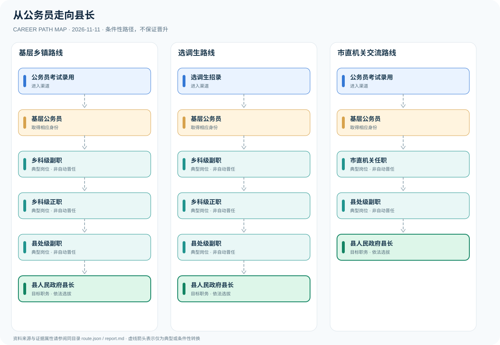

# 从公务员走向县长

> 中国大陆 · 普通县 · 资料核验 2026-11-11

## 职业定位

比较乡镇基层和市直机关交流两种职业经历，区分干部任职资格、组织选拔推荐与县人大依法选举。

## 常见职业路径

### 基层乡镇路线

历经基层、乡科级和县处级相关岗位。

公务员考试录用 → 基层公务员 → 乡科级副职 → 乡科级正职 → 县处级副职 → 县人民政府县长

### 选调生路线

通过选调生渠道进入基层，再参与干部选任。

选调生招录 → 基层公务员 → 乡科级副职 → 乡科级正职 → 县处级副职 → 县人民政府县长

### 市直机关交流路线

市直机关履历与县级岗位选任相结合。

公务员考试录用 → 基层公务员 → 市直机关任职 → 县处级副职 → 县人民政府县长

## 岗位说明

- **基层公务员**：基层机关岗位积累治理与行政执行经历。
- **乡科级副职**：副乡镇长等通常属于乡科级副职岗位。
- **乡科级正职**：乡镇长、县直部门正职等常见领导岗位。
- **市直机关任职**：市级机关经历可能通过交流任职衔接县级领导职位。
- **县处级副职**：副县长等通常属于县处级副职层次。
- **县人民政府县长**：普通县长一般为县处级正职，依法由本级人大选举。

## 任职资格与条件

- 县处级领导职位属于公务员法规定的领导职务层次。
- 提任县处级等职务须满足干部选任条例中相应的一般资历要求。
- 县长依法由本级人民代表大会选举产生。

## 注意事项与事实边界

- 最低任职资格不等于自动晋升或当选。
- 普通县与特殊行政区划的机构层级可能不同。
- 不对具体政治职位晋升机会作概率预测。

职业发展路线是制度说明与可能经历的图谱，**不是保证晋升的承诺**。所有跨岗位箭头均须依照职位条件及组织任用程序解释。

## 官方资料

1. [中华人民共和国公务员法](https://www.stats.gov.cn/gk/tjfg/xgfxfg/202503/t20250310_1958920.html) — 国家统计局（2018-12-29）
2. [党政领导干部选拔任用工作条例](https://www.xinhuanet.com/politics/2019-03/17/c_1124245012.htm) — 新华社（2019-03-17）
3. [中华人民共和国宪法（第一百零一条）](https://www.mfa.gov.cn/web/ziliao_674904/zt_674979/dnzt/qtzt/twwt/stflgf/202206/t20220606_10698959.html) — 中国外交部（2018-03-11）
