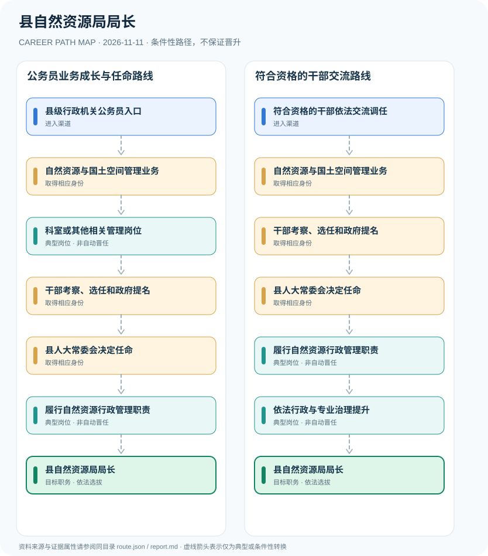

# 县自然资源局局长

> **B15 深度研究 · JR-124**　｜　**地域与机构**：中国大陆普通县政府自然资源主管部门；以2026年涟水县职责与迭部县任命为案例　｜　**核验日期**：2026-11-11

## 01 职业定位与现行制度版本

县自然资源局局长是县政府工作部门领导职务，不等于土地资源技术资格或事业单位岗位。常见相关经历包括国土空间规划、资源确权、土地矿产管理和行政业务；由干部管理机关履行选任与提名，县人大常委会依法决定任命。县局领导职务与自然资源领域行政执法证件属于不同制度。

**核验任命事实**：迭部县2026年8月26日人大常委会决定任命县自然资源局局长；这一事实证明法定任命主体，而不是任何特定干部履历属于普遍晋升路线。2026年涟水县机构说明为县域专业职责实例，不能直接推断全国每个县机构名称相同。

## 02 两类准入及真实制度门槛

- **县级行政机关公务员入口**：经公务员录用进入自然资源或规划等县级行政机关工作，实际职位资格以年度职位表为准。
- **符合资格的干部依法交流调任**：已有党政机关干部依法通过干部交流进入自然资源部门领导岗位，调任和聘用仍有独立程序。

- 《地方组织法》（2022年修正）明确县政府工作部门局长由县长依法提请本级人大常委会决定任命。
- 2026年迭部县人大常委会公开决定任免名单包含县自然资源局局长，展示法定任命程序的实际运作。
- 2026年涟水县自然资源和规划局机构简介包括自然资源权属、调查评价、国土空间用途管制、生态修复等职责，仅作为地方机构职能示例。
- 领导干部任用资格和行政执法证件分开，不把某一种注册规划师、测绘师资格当作局长唯一法定入职凭证。

## 03 典型发展路线及任职决定点

### 路线1：公务员业务成长与任命路线

从县级公务员自然资源业务工作到领导岗位，依法经组织提名及人大常委会决定任命。

**条件性节点**：县级行政机关公务员入口 → 自然资源与国土空间管理业务 → 科室或其他相关管理岗位 → 干部考察、选任和政府提名 → 县人大常委会决定任命 → 履行自然资源行政管理职责 → 县自然资源局局长

应在每次考试、身份取得、聘用、晋升或岗位任命时重新审核条件；不能把这条示意路径当作法律规定的必然晋升链条。

### 路线2：符合资格的干部交流路线

机关干部按干部任用权限经交流、考察及人大常委会任命转入县自然资源局负责岗位。

**条件性节点**：符合资格的干部依法交流调任 → 自然资源与国土空间管理业务 → 干部考察、选任和政府提名 → 县人大常委会决定任命 → 履行自然资源行政管理职责 → 依法行政与专业治理提升 → 县自然资源局局长

应在每次考试、身份取得、聘用、晋升或岗位任命时重新审核条件；不能把这条示意路径当作法律规定的必然晋升链条。

## 04 工作职责、核心能力与评价方式

核心公共管理技能涵盖国土空间规划、公地资源配置、政策公开、生态修复、矿产与测绘管理以及行政法。规划师、地质学家等专业经历可能有用，但选任领导职位须独立审查干部资格与组织程序。

- **自然资源与国土空间管理业务**：学习自然资源调查、国土空间用途管制、确权登记、土地矿产与生态修复法定职能。
- **科室或其他相关管理岗位**：从政策执行、规划审批、资源监管或综合管理岗位积累行政能力，具体领导职数和职级依当地机构规格。
- **干部考察、选任和政府提名**：按干部管理权限进行资格审查、考察、讨论决定并由县政府履行法定提名程序。
- **县人大常委会决定任命**：县政府工作部门局长由县长依法提请本级人大常委会决定任命，不能当作县人大代表大会直接选举局长。
- **履行自然资源行政管理职责**：按当地机构职能组织规划实施、土地及不动产登记协调、矿产资源与生态修复管理。
- **依法行政与专业治理提升**：推动数据合规、生态修复项目和行政决策透明，行政执法活动须符合法定职权与人员资格。

## 05 适用边界、时效与容易混淆的身份

- 县级自然资源局与自然资源部门下属测绘院、土地整理中心和不动产登记中心等事业单位不是统一的公务员身份。
- 县直机构规格、领导职数以及自然资源与规划的职能组合因地区和机构改革不同。
- 行政许可、处罚和监管执法按权限运行，局长行政负责人身份不等于一线执法人员可绕过执法资格或行政程序。

## 06 证据台账与图谱解释

规范性文件、机构职责和招聘公告分别记录在 `route.json` 的 `sources` 中，并由岗位节点使用 `source_ids` 引用。所有边标记为 `conditional`（条件性转换），**不得因来源中存在某项资格就推定本人必获后续岗位**。若需要标注法律明确规定的资格，应在研究说明中具体引用相关条款，而不能把一个推测性职位转换伪装成 `normative`。

| 转换前 | 转换后 | 证据类型 | 约束说明 |
|---|---|---|---|
| 县级行政机关公务员入口 | 自然资源与国土空间管理业务 | `conditional` | 从「县级行政机关公务员入口」到「自然资源与国土空间管理业务」须独立满足资格、岗位要求及考试或组织安排；示意路线不构成保证晋任。 |
| 自然资源与国土空间管理业务 | 科室或其他相关管理岗位 | `conditional` | 从「自然资源与国土空间管理业务」到「科室或其他相关管理岗位」须独立满足资格、岗位要求及考试或组织安排；示意路线不构成保证晋任。 |
| 科室或其他相关管理岗位 | 干部考察、选任和政府提名 | `conditional` | 从「科室或其他相关管理岗位」到「干部考察、选任和政府提名」须独立满足资格、岗位要求及考试或组织安排；示意路线不构成保证晋任。 |
| 干部考察、选任和政府提名 | 县人大常委会决定任命 | `conditional` | 从「干部考察、选任和政府提名」到「县人大常委会决定任命」须独立满足资格、岗位要求及考试或组织安排；示意路线不构成保证晋任。 |
| 县人大常委会决定任命 | 履行自然资源行政管理职责 | `conditional` | 从「县人大常委会决定任命」到「履行自然资源行政管理职责」须独立满足资格、岗位要求及考试或组织安排；示意路线不构成保证晋任。 |
| 履行自然资源行政管理职责 | 县自然资源局局长 | `conditional` | 从「履行自然资源行政管理职责」到「县自然资源局局长」须独立满足资格、岗位要求及考试或组织安排；示意路线不构成保证晋任。 |
| 符合资格的干部依法交流调任 | 自然资源与国土空间管理业务 | `conditional` | 从「符合资格的干部依法交流调任」到「自然资源与国土空间管理业务」须独立满足资格、岗位要求及考试或组织安排；示意路线不构成保证晋任。 |
| 自然资源与国土空间管理业务 | 干部考察、选任和政府提名 | `conditional` | 从「自然资源与国土空间管理业务」到「干部考察、选任和政府提名」须独立满足资格、岗位要求及考试或组织安排；示意路线不构成保证晋任。 |
| 履行自然资源行政管理职责 | 依法行政与专业治理提升 | `conditional` | 从「履行自然资源行政管理职责」到「依法行政与专业治理提升」须独立满足资格、岗位要求及考试或组织安排；示意路线不构成保证晋任。 |
| 依法行政与专业治理提升 | 县自然资源局局长 | `conditional` | 从「依法行政与专业治理提升」到「县自然资源局局长」须独立满足资格、岗位要求及考试或组织安排；示意路线不构成保证晋任。 |

## 07 官方与公开资料（可追溯）

1. [中华人民共和国地方各级人民代表大会和地方各级人民政府组织法（2022年修正）](https://www.sdcourt.gov.cn/jningweisfy/385991/385992/8661225/index.html) — 山东省高级人民法院（转载全国人大法律）；来源原始日期 2022-03-11。
2. [党政领导干部选拔任用工作条例](https://www.mohrss.gov.cn/SYrlzyhshbzb/ztzl/dflz/lzgd/201903/t20190321_312665.html) — 中华人民共和国人力资源社会保障部（转载）；来源原始日期 2019-03-03。
3. [中华人民共和国公务员法](https://www.stats.gov.cn/gk/tjfg/xgfxfg/202503/t20250310_1958920.html) — 国家统计局；来源原始日期 2018-12-29。
4. [涟水县自然资源和规划局机关简介](https://www.lianshui.gov.cn/col/17515_688223/art/16172064/1787732294923e3A4hJaZ.html) — 涟水县人民政府；来源原始日期 2026-08-26。
5. [迭部县人大常委会任免名单（自然资源局局长）](https://www.tewo.gov.cn/info/1069/62568.htm) — 迭部县人民政府；来源原始日期 2026-08-26。

> **复核协议**：跨年度招生公告、法律修订、专业等级与机构设置可能变化。实际申请和转岗前，须核对当前官方原文、所在地文件及单位职位要求，尤其注意来源发布日期与生效日期未必一致。
