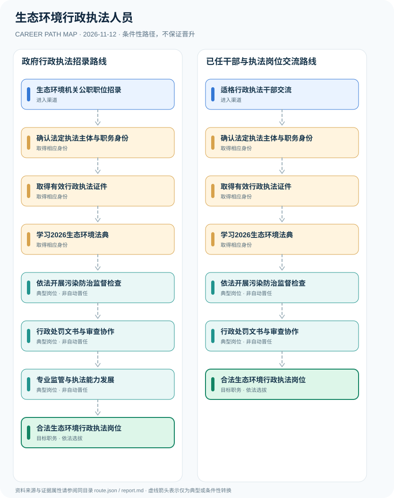

# 生态环境行政执法人员

> **B17 深度调查 · JR-129**　|　**适用地域及机构**：中国大陆各级生态环境主管部门与依法设立的生态环境综合行政执法机构　|　**核验时间**：2026-11-12

## 摘要：岗位身份、适用制度和效力

生态环境行政执法人员在法定生态环境机关及综合行政执法队伍内依法开展现场检查、案件调查和行政处罚等工作，须确认正式身份、执法授权和行政执法证件。2026年8月15日《生态环境法典》施行，2026年9月20日生态环境部令第39号修正《生态环境行政处罚办法》，不能沿用2023旧处罚条款不加版本说明。

**2026关键制度更新**：法典2026年8月生效，生态环境部随后依据新法修改或废止部分规章。生态环境行政执法是一项法定公权力，证书、编制和执法岗位各自独立；行政执法能力培训不替代法定授权。研究对2023-2026法规演变设置明确时间轴。

## 进入行业的合法渠道

- **生态环境机关公职职位招录**：通过公务员或依法适用的综合行政执法岗位招聘录用，核对行政机关、参公事业或辅助岗位身份及岗位条件。
- **适格行政执法干部交流**：已有合格公务员或执法人员经合法职位交流、机构安排和资格审核进入生态环境行政执法体系。

## 两条可比较的职业发展路径

### 路径 1：政府行政执法招录路线

经相关机关职位招录和个人执法资格审核，学习新法后参与监督检查及处罚程序工作。

**条件性节点序列**：生态环境机关公职职位招录 → 确认法定执法主体与职务身份 → 取得有效行政执法证件 → 学习2026生态环境法典 → 依法开展污染防治监督检查 → 行政处罚文书与审查协作 → 专业监管与执法能力发展 → 合法生态环境行政执法岗位

路径只说明一种可解释的可能经历，后续岗位须满足新的资质、招聘、考核或任用要求。

### 路径 2：已任干部与执法岗位交流路线

符合组织和职位条件的人员转任生态环境执法岗位，重新确认授权与证件后依法工作。

**条件性节点序列**：适格行政执法干部交流 → 确认法定执法主体与职务身份 → 取得有效行政执法证件 → 学习2026生态环境法典 → 依法开展污染防治监督检查 → 行政处罚文书与审查协作 → 合法生态环境行政执法岗位

路径只说明一种可解释的可能经历，后续岗位须满足新的资质、招聘、考核或任用要求。

## 关键技能、项目实践与考核

专业成果包括检查文书规范性、数据真实性、行政程序保障与整改后复核质量。应依法保护企业、公众与举报人权利；成为执法队负责人由干部管理程序决定。

- **依法开展污染防治监督检查**：在权限和行政程序允许时参与污染排放、环境违法线索调查与取证，完整记录并保护企业合法权益。
- **行政处罚文书与审查协作**：按2026修订的《生态环境行政处罚办法》和《行政处罚法》处理证据、告知、陈述申辩等程序。
- **专业监管与执法能力发展**：参与风险评估、业务培训与合法监测数据审核，人员职级、领导任用和执法证件分别管理。

## 法定资格、制度区别与核查条目

- 《中华人民共和国生态环境法典》2026年3月12日通过，自8月15日起施行。
- 生态环境部令第39号2026年9月20日公布并自公布之日起施行，对《生态环境行政处罚办法》作出修订，修订后的规章引用《生态环境法典》。
- 生态环境部2026年10月14日公布下半年核发行政执法证件人员名单，证明行政执法证件有单独管理与核发程序；地方证件应遵循当地适用制度。
- 环境检测工程师、环保企业合规官和政府行政执法人员身份与法定职权不同。

## 风险与地区、年度限制

- 2023年处罚办法在2026年9月修订，不能直接将2023年版作为当前完整法条且遗漏生态环境法典。
- 生态环境部核发的执法证件公开名单不能被理解为包含全国所有县市级执法人员，各地证件管理权限须另核对。
- 仅讨论合规执法程序，不涉及规避监管、污染排放操作或敏感现场部署。

## 来源映射及路径证据

`route.json` 记录规范性文件、政策或招聘公告的原文 URL 和发布机构；节点引用 `source_ids`，每条岗位转换保守标为 `conditional`，而非保证升迁的 `normative` 法律权利。涉及真实法定准入的说明见上述条款，避免将机构权责套用到员工个人。

| 前一节点 | 后一节点 | 边属性 | 适用条件 |
|---|---|---|---|
| 生态环境机关公职职位招录 | 确认法定执法主体与职务身份 | `conditional` | 「生态环境机关公职职位招录」到「确认法定执法主体与职务身份」需要独立满足适用职位、资格、权限与机构安排，非自动晋升。 |
| 确认法定执法主体与职务身份 | 取得有效行政执法证件 | `conditional` | 「确认法定执法主体与职务身份」到「取得有效行政执法证件」需要独立满足适用职位、资格、权限与机构安排，非自动晋升。 |
| 取得有效行政执法证件 | 学习2026生态环境法典 | `conditional` | 「取得有效行政执法证件」到「学习2026生态环境法典」需要独立满足适用职位、资格、权限与机构安排，非自动晋升。 |
| 学习2026生态环境法典 | 依法开展污染防治监督检查 | `conditional` | 「学习2026生态环境法典」到「依法开展污染防治监督检查」需要独立满足适用职位、资格、权限与机构安排，非自动晋升。 |
| 依法开展污染防治监督检查 | 行政处罚文书与审查协作 | `conditional` | 「依法开展污染防治监督检查」到「行政处罚文书与审查协作」需要独立满足适用职位、资格、权限与机构安排，非自动晋升。 |
| 行政处罚文书与审查协作 | 专业监管与执法能力发展 | `conditional` | 「行政处罚文书与审查协作」到「专业监管与执法能力发展」需要独立满足适用职位、资格、权限与机构安排，非自动晋升。 |
| 专业监管与执法能力发展 | 合法生态环境行政执法岗位 | `conditional` | 「专业监管与执法能力发展」到「合法生态环境行政执法岗位」需要独立满足适用职位、资格、权限与机构安排，非自动晋升。 |
| 适格行政执法干部交流 | 确认法定执法主体与职务身份 | `conditional` | 「适格行政执法干部交流」到「确认法定执法主体与职务身份」需要独立满足适用职位、资格、权限与机构安排，非自动晋升。 |
| 行政处罚文书与审查协作 | 合法生态环境行政执法岗位 | `conditional` | 「行政处罚文书与审查协作」到「合法生态环境行政执法岗位」需要独立满足适用职位、资格、权限与机构安排，非自动晋升。 |

## 可复核的公开来源

1. **中华人民共和国教育部（转载新华社）**：[生态环境法典第七十号主席令（2026年8月15日起施行）](https://www.moe.gov.cn/jyb_xwfb/s6052/moe_838/202603/t20260313_1430758.html)（原始制度日期 2026-03-12）
2. **生态环境部**：[关于修改和废止部分规章的决定（生态环境部令39号）](https://www.mee.gov.cn/xxgk2018/xxgk/xxgk02/202609/t20260922_1170492.html)（原始制度日期 2026-09-20）
3. **生态环境部**：[生态环境行政处罚办法（2026年修正现行全文）](https://www.mee.gov.cn/gzk/gz/202305/t20230516_1030105.shtml)（原始制度日期 2026-09-20）
4. **生态环境部**：[2026年下半年生态环境部核发行政执法证件人员名单](https://www.mee.gov.cn/ywgz/sthjzf/dwgl/202610/t20261014_1183008.shtml)（原始制度日期 2026-10-14）
5. **国家统计局（转载）**：[中华人民共和国公务员法](https://www.stats.gov.cn/gk/tjfg/xgfxfg/202503/t20250310_1958920.html)（原始制度日期 2018-12-29）

> **研究说明**：来源的发布日期不代表法规施行日期；招聘公告不保证报名窗口仍开放。涉及跨地区或新版本制度时须重新核验。本路线不承诺个人晋升概率。
