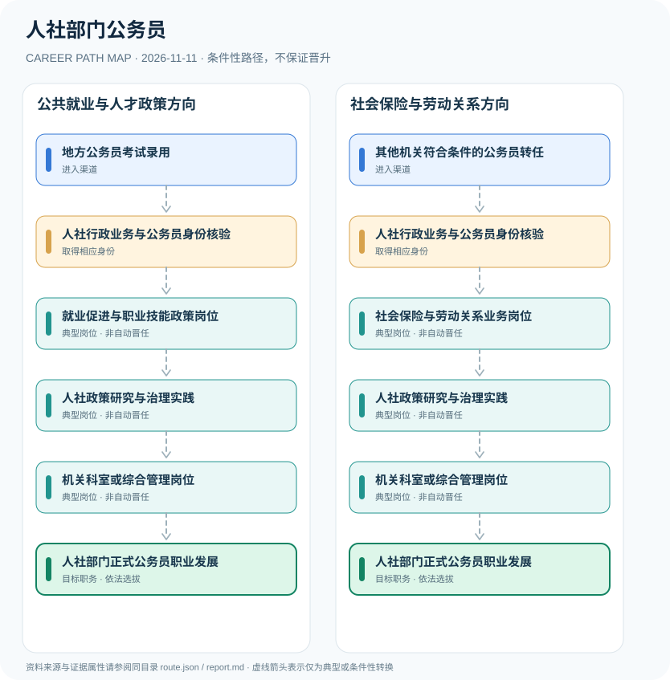

# 人社部门公务员

> **批次 B13 · JR-128** · 研究范围：中国大陆·市县人力资源社会保障行政机关；芜湖市2026职责作为实例 · **核验日期 2026-11-11**

## 职业定位与证据边界

人社部门公务员经国家或地方公务员招录与依法交流进入机关，从就业、社会保险、劳动关系、事业单位人事等公共管理领域发展；与企业HRBP、人力资源服务机构员工、社保经办事业单位人员不是同一身份。

该职业强调的是公共就业与社会保障的**行政机关工作身份**，并非HR企业职业序列。人社机关可能与社保经办中心等单位协作，但组织类别、职级和任用权限分别规定。

## 一、两种主要职业进入方向

- **地方公务员考试录用**：关注各省市公务员职位表中的人社局机关职位，符合专业学历等条件并经录用程序任职。
- **其他机关符合条件的公务员转任**：正式公务员可在符合法定职位、回避和任职权限时交流转任至人社机关。

## 二、典型发展路线与适用条件

### 1. 公共就业与人才政策方向

公务员录用后从就业、人才服务和政策分析岗位积累经验，逐步承担综合业务。

**路线图**：地方公务员考试录用 → 人社行政业务与公务员身份核验 → 就业促进与职业技能政策岗位 → 人社政策研究与治理实践 → 机关科室或综合管理岗位 → 人社部门正式公务员职业发展

以上各岗位转换均受任用、选拔、执业资格或招聘控制，不构成保证晋升的链条。

### 2. 社会保险与劳动关系方向

其他公务员转任后积累社保与劳动关系管理经验，可向综合性行政业务发展。

**路线图**：其他机关符合条件的公务员转任 → 人社行政业务与公务员身份核验 → 社会保险与劳动关系业务岗位 → 人社政策研究与治理实践 → 机关科室或综合管理岗位 → 人社部门正式公务员职业发展

以上各岗位转换均受任用、选拔、执业资格或招聘控制，不构成保证晋升的链条。

## 三、岗位职责与专业发展能力

工作能力包括政策法规解读、社保基金治理、公共就业服务协同、群众沟通和数据治理。由业务岗位迈向领导职务必须另经干部选拔，不能依据职龄自动跨越。

- **人社行政业务与公务员身份核验**：按录用或转任进入行政机关岗位，核验是否为公务员而非事业单位或劳务派遣聘用。
- **就业促进与职业技能政策岗位**：参与公共就业服务政策、技能人才项目、人才流动和就业援助等业务。
- **社会保险与劳动关系业务岗位**：参与养老失业工伤保险政策、劳动关系及相关基金监督协调职责。
- **人社政策研究与治理实践**：积累政策解释、统计评估、公共服务优化和依法行政能力。
- **机关科室或综合管理岗位**：在职位空缺、领导职务资格和组织选任条件下可能负责相关行政管理工作。

## 四、现行法规、任职资格及关键区别

- 公务员身份由《公务员法》规定，招录职位表与组织手续决定入职；企业人力资源管理师证书不是机关任用的替代条件。
- 2026年芜湖市人社局机构职责覆盖就业促进、社会保障、事业单位人员管理、劳动争议协调和专业技术人员管理等行政职能。
- 社保经办机构或公共就业服务机构中的事业编制和行政机关公务员身份需要分别核实。

## 五、法律与数据风险提示

- 同一地区的人社局可能包含机关、参公单位和事业单位岗位，不能把全部人员称为普通行政公务员。
- 公务员职级与部门科长等领导职务并不等同，职级晋升不会自动任命处室负责人。
- 报考条件因国家、地方、专业、工作经历和年份而不同，应查当年具体职位表。

## 六、证据分类和引用对应

**职业路径中所有转换为 `conditional`：满足条件时才可能发生。** `normative` 指法律明确规定的权利或义务；`official_description` 指官方发布的岗位事实；`illustrative` 只代表一种合理的示例经历。本报告不混淆行政领导职务、职级、执业资格、技术等级和雇主自行定义的岗位。

| 图中转换 | 证据属性 | 解释 |
|---|---|---|
| 地方公务员考试录用 → 人社行政业务与公务员身份核验 | conditional | 从「地方公务员考试录用」到「人社行政业务与公务员身份核验」取决于对应资格、空缺职位或机构选任，不是必然晋升。 |
| 人社行政业务与公务员身份核验 → 就业促进与职业技能政策岗位 | conditional | 从「人社行政业务与公务员身份核验」到「就业促进与职业技能政策岗位」取决于对应资格、空缺职位或机构选任，不是必然晋升。 |
| 就业促进与职业技能政策岗位 → 人社政策研究与治理实践 | conditional | 从「就业促进与职业技能政策岗位」到「人社政策研究与治理实践」取决于对应资格、空缺职位或机构选任，不是必然晋升。 |
| 人社政策研究与治理实践 → 机关科室或综合管理岗位 | conditional | 从「人社政策研究与治理实践」到「机关科室或综合管理岗位」取决于对应资格、空缺职位或机构选任，不是必然晋升。 |
| 机关科室或综合管理岗位 → 人社部门正式公务员职业发展 | conditional | 从「机关科室或综合管理岗位」到「人社部门正式公务员职业发展」取决于对应资格、空缺职位或机构选任，不是必然晋升。 |
| 其他机关符合条件的公务员转任 → 人社行政业务与公务员身份核验 | conditional | 从「其他机关符合条件的公务员转任」到「人社行政业务与公务员身份核验」取决于对应资格、空缺职位或机构选任，不是必然晋升。 |
| 人社行政业务与公务员身份核验 → 社会保险与劳动关系业务岗位 | conditional | 从「人社行政业务与公务员身份核验」到「社会保险与劳动关系业务岗位」取决于对应资格、空缺职位或机构选任，不是必然晋升。 |
| 社会保险与劳动关系业务岗位 → 人社政策研究与治理实践 | conditional | 从「社会保险与劳动关系业务岗位」到「人社政策研究与治理实践」取决于对应资格、空缺职位或机构选任，不是必然晋升。 |

## 七、官方和公开参考资料

1. [芜湖市人力资源和社会保障局机构简介（2026年）](https://rsj.wuhu.gov.cn/jggk/jgjj/index.html) — 芜湖市人民政府（发布日期 2026-04-03）
2. [中华人民共和国公务员法](https://www.stats.gov.cn/gk/tjfg/xgfxfg/202503/t20250310_1958920.html) — 国家统计局法规资料（发布日期 2018-12-29）

> 资料只反映所列地域、法规和核验日期的公开信息。报名、岗位计划或法规发生变化时，必须重新核对原文，不能沿用过时条件。
