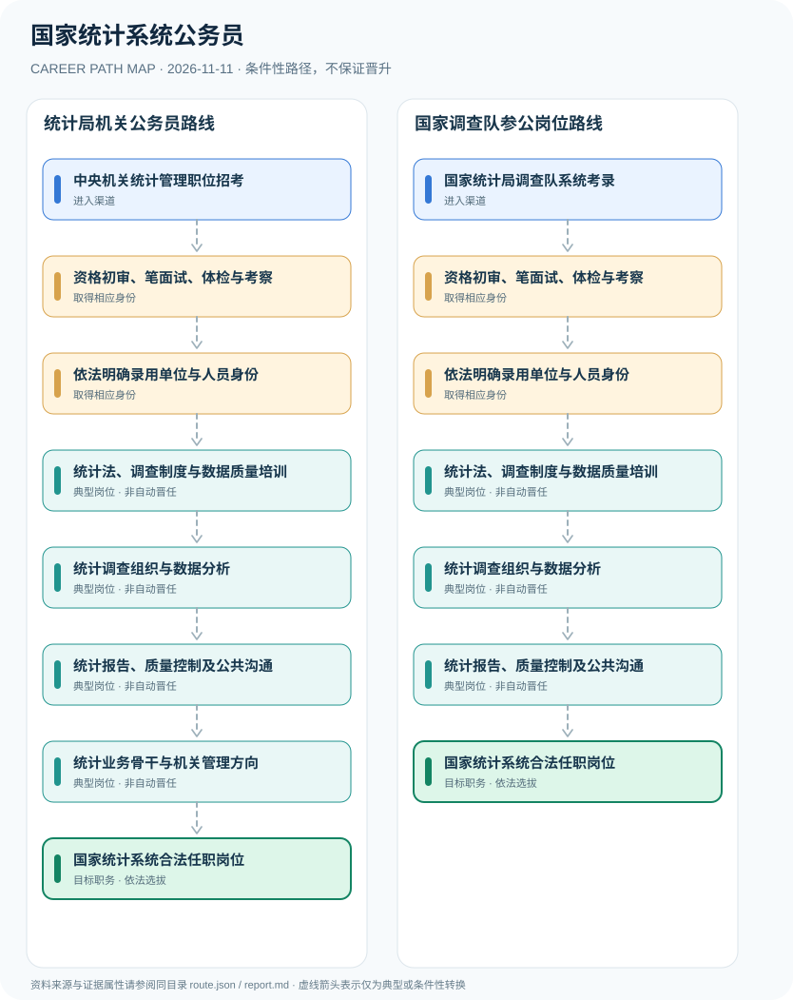

# 国家统计系统公务员

> **B16 深度研究 · JR-127** · 机构与地域：中国大陆国家统计局机关与国家统计局调查队系统；按实际职位区分公务员及参公身份 · **核验日期：2026-11-11**

## 一、职业定义与现行制度

国家统计系统包括国家统计局机关、直属调查队及其他事业单位等不同人员体系。实际招录由中央机关及其直属机构考试录用程序及职位表决定，2026年统计局调查队公示特别写明拟录用“参公单位工作人员”。2024年修正《统计法》强化统计资料真实性、统计监督和防范造假，专业统计职务与公务员职级不能相互等同。

**来源交叉核验**：2026年国家统计局公开公示清楚使用“参公单位工作人员”，这修正了将全国统计调查队统称为普通行政公务员的表达。同时国家统计局说明2024年法律修改属于“修正”而非法律重新整体施行；仍须正确解释原法条的实施日期。

## 二、两类准入与身份确认

- **中央机关统计管理职位招考**：按当年国家公务员考试职位表报考国家统计局机关具体岗位，核查职位性质、专业学历等条件。
- **国家统计局调查队系统考录**：报考国家调查总队、地市及县调查队职位，尤其核查“参公事业单位”编制身份与岗位条件。

## 三、法规、资质和考试的判断

- 2026年国家统计局调查队系统拟录用公示明确人员为“参公单位工作人员”，经笔试、面试、体检及考察，不应全部标注为行政机关普通公务员。
- 2024年9月13日《统计法》以修正方式修改，修改内容当日施行；全国人大法工委与国家统计局均强调加强防范和惩治统计造假。
- 国家统计局官方招录栏目并列机关和调查队系统公告，职位性质及人员身份须看当年职位表和招录单位。
- 统计专业资格、技术职称和公务员职务职级独立，统计岗位不因持专业职称即获得行政执法权限。

## 四、职业发展路径与条件性节点

### 路线1｜统计局机关公务员路线

通过公务员考试及职位要求进入统计机关，从统计法、调查技术和政策工作积累专业治理能力。

**条件性路径**：中央机关统计管理职位招考 → 资格初审、笔面试、体检与考察 → 依法明确录用单位与人员身份 → 统计法、调查制度与数据质量培训 → 统计调查组织与数据分析 → 统计报告、质量控制及公共沟通 → 统计业务骨干与机关管理方向 → 国家统计系统合法任职岗位

该路线仅表示可能存在的职业经历；下一阶段均须重新核查资格、机构岗位和考核任职制度，不意味着保证录用或晋升。

### 路线2｜国家调查队参公岗位路线

经国家调查队系统职位考试录用，在参公管理制度下履行统计调查与数据质量工作。

**条件性路径**：国家统计局调查队系统考录 → 资格初审、笔面试、体检与考察 → 依法明确录用单位与人员身份 → 统计法、调查制度与数据质量培训 → 统计调查组织与数据分析 → 统计报告、质量控制及公共沟通 → 国家统计系统合法任职岗位

该路线仅表示可能存在的职业经历；下一阶段均须重新核查资格、机构岗位和考核任职制度，不意味着保证录用或晋升。

## 五、工作能力、项目与成果评价

核心能力包括统计调查制度、数据清洗、抽样调查、依法审核、质量控制、政策文字说明和安全合规。不得因统计分析结果不符合管理期望而调整数据；领导岗位选任应遵守公职人员管理制度。

- **资格初审、笔面试、体检与考察**：依据中央机关招考和具体职位表完成综合选拔及公示，职位与参公身份由录用结果及有关编制确定。
- **依法明确录用单位与人员身份**：区分行政机关公务员、参公管理单位工作人员、其他事业单位聘用及政府购买服务。
- **统计法、调查制度与数据质量培训**：学习2024修正《统计法》及调查制度、统计保密义务与统计造假风险。
- **统计调查组织与数据分析**：在职责内开展调查设计、样本质量、数据审核与统计分析，禁止虚报瞒报和违规干预。
- **统计报告、质量控制及公共沟通**：规范汇总、分析、发布与保密管理，未经授权不得泄露统计调查对象的商业秘密与个人信息。
- **统计业务骨干与机关管理方向**：依法按职位、职级和人员制度评价选任，统计师专业职称与公务员领导职务不是同一体系。

## 六、适用地区、生效版本及风险

- 国家统计局调查队具有垂直管理特征，不应与地方政府统计局或企业统计分析职位混为一体。
- 国家统计局机关中的参公岗位亦需按具体岗位认定，不可因“机关”二字全部推断为行政编。
- 2027年国考各职位数量、门槛和工作地点需回到中央机关正式职位表，非官方报考统计人数只供参考，不能作为确定制度事实。

## 七、证据与图谱的映射

对每一节点，`route.json` 中的 `source_ids` 指向下文的可核查公开来源；每条转换边均标为 `conditional`，不会冒充有明确法律规定的 `normative` 自动晋升。不同的法定资格、机构选聘、职位级别及劳动关系各自独立。

| 转换前 | 转换后 | 证据属性 | 适用限制 |
|---|---|---|---|
| 中央机关统计管理职位招考 | 资格初审、笔面试、体检与考察 | `conditional` | 从「中央机关统计管理职位招考」至「资格初审、笔面试、体检与考察」取决于法定资格、岗位条件或独立选聘考核，绝非自动晋升。 |
| 资格初审、笔面试、体检与考察 | 依法明确录用单位与人员身份 | `conditional` | 从「资格初审、笔面试、体检与考察」至「依法明确录用单位与人员身份」取决于法定资格、岗位条件或独立选聘考核，绝非自动晋升。 |
| 依法明确录用单位与人员身份 | 统计法、调查制度与数据质量培训 | `conditional` | 从「依法明确录用单位与人员身份」至「统计法、调查制度与数据质量培训」取决于法定资格、岗位条件或独立选聘考核，绝非自动晋升。 |
| 统计法、调查制度与数据质量培训 | 统计调查组织与数据分析 | `conditional` | 从「统计法、调查制度与数据质量培训」至「统计调查组织与数据分析」取决于法定资格、岗位条件或独立选聘考核，绝非自动晋升。 |
| 统计调查组织与数据分析 | 统计报告、质量控制及公共沟通 | `conditional` | 从「统计调查组织与数据分析」至「统计报告、质量控制及公共沟通」取决于法定资格、岗位条件或独立选聘考核，绝非自动晋升。 |
| 统计报告、质量控制及公共沟通 | 统计业务骨干与机关管理方向 | `conditional` | 从「统计报告、质量控制及公共沟通」至「统计业务骨干与机关管理方向」取决于法定资格、岗位条件或独立选聘考核，绝非自动晋升。 |
| 统计业务骨干与机关管理方向 | 国家统计系统合法任职岗位 | `conditional` | 从「统计业务骨干与机关管理方向」至「国家统计系统合法任职岗位」取决于法定资格、岗位条件或独立选聘考核，绝非自动晋升。 |
| 国家统计局调查队系统考录 | 资格初审、笔面试、体检与考察 | `conditional` | 从「国家统计局调查队系统考录」至「资格初审、笔面试、体检与考察」取决于法定资格、岗位条件或独立选聘考核，绝非自动晋升。 |
| 统计报告、质量控制及公共沟通 | 国家统计系统合法任职岗位 | `conditional` | 从「统计报告、质量控制及公共沟通」至「国家统计系统合法任职岗位」取决于法定资格、岗位条件或独立选聘考核，绝非自动晋升。 |

## 八、来源及原始发布日期

1. **国家统计局浙江调查总队（转载人大法条）**：[中华人民共和国统计法（2024年第二次修正）](https://zjzd.stats.gov.cn/gjtjjhzdcd/zwgk/xxgkml/tjfg/art/2026/art_400e943b877a4dbc9f4b869a2c2b2609.html)（原文件或规定日期：2024-09-13）。
2. **国家统计局**：[关于新修改统计法施行时间的说明](https://www.stats.gov.cn/gk/tjfg/tjfl/202410/t20241024_1957127.html)（原文件或规定日期：2024-10-24）。
3. **国家统计局**：[国家统计局调查队系统2026年拟录用参公单位工作人员公示](https://www.stats.gov.cn/xw/tjxw/tzgg/202605/t20260514_1963696.html)（原文件或规定日期：2026-05-14）。
4. **国家统计局**：[国家统计局公务员招录信息目录](https://www.stats.gov.cn/xxgk/rsxx/gwyzl2020/)（原文件或规定日期：2026-05-18）。

> **研究限制**：法规发布日期和实施日期可能不同；2027招录的专项条件以招聘公告实时版本及具体职位表为准。本研究不作个人晋升概率预测，不公开非公开的军队、警务、医疗或个人数据。
