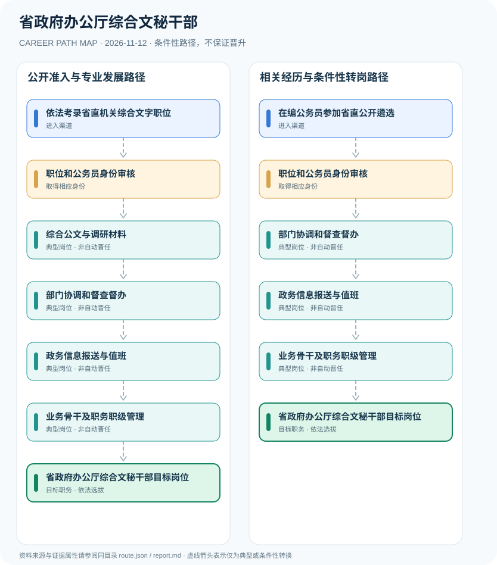

# 省政府办公厅综合文秘干部

> **B18 Deep Search | JR-119** · 核验 2026-11-12 · 中国大陆省政府办公厅行政机关；以甘肃省2026公开遴选和工作落实制度为例

## 一、职业定位与制度效力

省政府办公厅综合文字干部承担政策研究、公文草拟、会务、部门协调及政务信息汇总。综合文秘是一类业务方向而非统一职级；社会公众报考公务员与已有公务员通过省直机关公开遴选是不同渠道，办公厅所属事业单位人员也不自动具有公务员身份。

公开遴选面向既有在编人员，与考录初任公务员明显不同。省政府办公厅督办重大任务的业务职责由2026甘肃省政府正式文件支持，不能把所有省份的处室和任职级别写成统一模板。

## 二、两类正式进入渠道

- **依法考录省直机关综合文字职位**：符合省级公务员职位表要求者通过录用考试，只有实际录用机关及岗位决定人员身份。
- **在编公务员参加省直公开遴选**：具备相应基层年限及岗位资格的地方公务员可按甘肃2026省直遴选公告申请，社会企业求职者不适用。

## 三、发展路径与任职关口

### 路径1：公开准入与专业发展路径

符合省级公务员职位表要求者通过录用考试，只有实际录用机关及岗位决定人员身份。

**节点序列**：依法考录省直机关综合文字职位 → 职位和公务员身份审核 → 综合公文与调研材料 → 部门协调和督查督办 → 政务信息报送与值班 → 业务骨干及职务职级管理 → 省政府办公厅综合文秘干部目标岗位

> 此路径是条件性职业示意，不是职务晋升承诺，也不赋予法定许可。

### 路径2：相关经历与条件性转岗路径

具备相应基层年限及岗位资格的地方公务员可按甘肃2026省直遴选公告申请，社会企业求职者不适用。

**节点序列**：在编公务员参加省直公开遴选 → 职位和公务员身份审核 → 部门协调和督查督办 → 政务信息报送与值班 → 业务骨干及职务职级管理 → 省政府办公厅综合文秘干部目标岗位

> 此路径是条件性职业示意，不是职务晋升承诺，也不赋予法定许可。

## 四、岗位活动与专业能力

业务能力包括政策研究、权威事实核验、公文写作、督办台账、跨部门协作以及保密与程序控制。

- **职位和公务员身份审核**：明确职位表、机构性质、行政编制及任用程序，不能将秘书职业培训视为机关录用。
- **综合公文与调研材料**：草拟政策材料、会议资料和工作报告，公文签发由有权机关负责人决定。
- **部门协调和督查督办**：根据省政府工作部署协助责任分解、进展汇总和跨部门沟通。
- **政务信息报送与值班**：按授权协助重要信息核实报送，不以文秘身份独立发出行政指挥命令。
- **业务骨干及职务职级管理**：通过工作考核积累政策协调能力，公务员职级与领导职务另依选任制度。

## 五、法规与可核查准入条件

- 甘肃2026省直公开遴选以已登记备案在编公务员和符合条件参公人员为主要对象，需符合基层经历等条件。
- 2026甘肃省政府工作报告任务分解明确省政府办公厅负责落实台账和督查督办，提供具体业务例证。
- 公务员录用、机关内部岗位安排及公开遴选不能互换；综合文秘也不是法定‘副处级’身份。

## 六、边界、时效与主要风险

- 甘肃遴选是地区年度样例，不能推断各省2027招聘条件。
- 不把省政府领导个人秘书、机要岗位和综合文稿职位混称同一岗位。
- 无权发布公文或调动行政资源的文稿人员，不可冒充行政指挥主体。

## 七、逐边证据台账

说明：节点关联 `source_ids` 指向下列公开资料；各边为条件性关系而非法定自动晋升。适用法律与岗位招聘需按年度、地区和用人单位独立审核。

| 前置节点 | 后续节点 | 证据属性 | 条件 |
|---|---|---|---|
| 依法考录省直机关综合文字职位 | 职位和公务员身份审核 | `conditional` | 从「依法考录省直机关综合文字职位」到「职位和公务员身份审核」须独立满足适用招聘、岗位资格、机构授权及组织考核，不保证晋升。 |
| 职位和公务员身份审核 | 综合公文与调研材料 | `conditional` | 从「职位和公务员身份审核」到「综合公文与调研材料」须独立满足适用招聘、岗位资格、机构授权及组织考核，不保证晋升。 |
| 综合公文与调研材料 | 部门协调和督查督办 | `conditional` | 从「综合公文与调研材料」到「部门协调和督查督办」须独立满足适用招聘、岗位资格、机构授权及组织考核，不保证晋升。 |
| 部门协调和督查督办 | 政务信息报送与值班 | `conditional` | 从「部门协调和督查督办」到「政务信息报送与值班」须独立满足适用招聘、岗位资格、机构授权及组织考核，不保证晋升。 |
| 政务信息报送与值班 | 业务骨干及职务职级管理 | `conditional` | 从「政务信息报送与值班」到「业务骨干及职务职级管理」须独立满足适用招聘、岗位资格、机构授权及组织考核，不保证晋升。 |
| 业务骨干及职务职级管理 | 省政府办公厅综合文秘干部目标岗位 | `conditional` | 从「业务骨干及职务职级管理」到「省政府办公厅综合文秘干部目标岗位」须独立满足适用招聘、岗位资格、机构授权及组织考核，不保证晋升。 |
| 在编公务员参加省直公开遴选 | 职位和公务员身份审核 | `conditional` | 从「在编公务员参加省直公开遴选」到「职位和公务员身份审核」须独立满足适用招聘、岗位资格、机构授权及组织考核，不保证晋升。 |
| 职位和公务员身份审核 | 部门协调和督查督办 | `conditional` | 从「职位和公务员身份审核」到「部门协调和督查督办」须独立满足适用招聘、岗位资格、机构授权及组织考核，不保证晋升。 |

## 八、来源与发布机构（原始日期）

1. **甘肃省委组织部**：[甘肃省2026年度省直机关公开遴选和公开选调公务员公告](https://www.gsjn.gov.cn/zfxxgk/fdzdgknr/zkxx/art/2026/art_5a5d5d0967ca41a48c5e196c2977c19d.html)（2026-03-29）
2. **甘肃省人民政府**：[甘肃省人民政府关于分解落实2026年政府工作报告主要目标和重点工作的通知](https://zwfw.gansu.gov.cn/qingyang/zczx/sjzcxw/art/2026/art_cb97aaf479d84b0484a2a1849af0e137.html)（2026-01-30）
3. **国家统计局（转载法律）**：[中华人民共和国公务员法](https://www.stats.gov.cn/gk/tjfg/xgfxfg/202503/t20250310_1958920.html)（2018-12-29）

> **复核提醒**：发布日期不等于生效日期；已经结束的招聘不可作为仍开放的报名窗口。岗位身份、职业许可、业务权限和组织任用不可互换。
