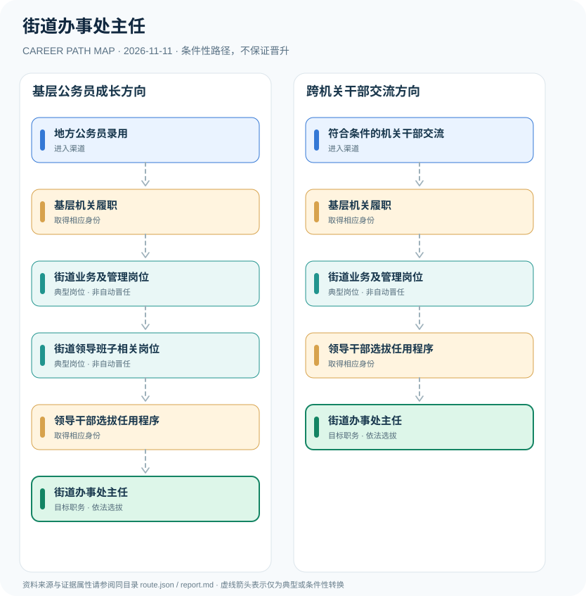

# 街道办事处主任

> **批次**：B11 · JR-121 · **适用范围**：中国大陆·普通城市街道（以北京市地方规定为例） · **核验日期**：2026-11-11

## 执行摘要

街道办事处是市辖区或不设区市人民政府的派出机关，主任属于行政领导岗位，不是经单一招聘考试即可直接获得；基层工作、干部交流与法定任命是不同环节。

街道办事处是基层行政派出机关，并非一级人民政府。主任负责街道办行政管理；街道党工委书记主持相应党组织工作，不能把两种角色写作一条自动继任链。

## 一、准入方式及行政／招聘程序

公开公务员招考是进入基层党政机关的入口之一，但不是“县长/街道主任招聘考试”。候选人通常需要符合干部选拔任用规则及具体岗位编制；跨机关干部交流也必须履行组织程序。

- **地方公务员录用**：经符合条件的地方公务员录用或选调进入机关工作，积累基层治理相关经历。
- **符合条件的机关干部交流**：经机关内部干部交流或调任进入街道岗位，不能以非编岗位工作自动取得公务员领导职务。

## 二、常见路线与机构决定点

### 1. 基层公务员成长方向

公务员通过基层岗位、街道管理工作及干部考察后进入街道主任岗位的条件性路径。

**阶段示意**：地方公务员录用 → 基层机关履职 → 街道业务及管理岗位 → 街道领导班子相关岗位 → 领导干部选拔任用程序 → 街道办事处主任

**解释**：上述转换由岗位条件、资格确认、招聘或任用程序控制。即使具有上一阶段经历，也不保证任职下一阶段。

### 2. 跨机关干部交流方向

已有机关任职干部经依法交流到街道，再根据干部管理权限获得领导任用。

**阶段示意**：符合条件的机关干部交流 → 基层机关履职 → 街道业务及管理岗位 → 领导干部选拔任用程序 → 街道办事处主任

**解释**：上述转换由岗位条件、资格确认、招聘或任用程序控制。即使具有上一阶段经历，也不保证任职下一阶段。

## 三、关键职责与专业发展

工作内容涵盖民生事务、公共治理、环境与城市管理、社区诉求协调等。岗位层级因行政区划和机构规格不同，任职资格和领导职数需以本地组织部门及法规核验。

- **基层机关履职**：在区县机关、街道办或其他基层岗位积累公共服务、社区协调与行政管理经历。
- **街道业务及管理岗位**：负责民生保障、基层治理、城市管理等事务的业务或管理职务。
- **街道领导班子相关岗位**：符合资格时可能担任副主任等街道领导岗位，但不是所有主任的必经前职。
- **领导干部选拔任用程序**：按照干部管理权限履行考察、讨论决定或相关任用手续。

## 四、关键资格、执业条件与区别

- 《地方组织法》第85、86条明确街道办事处的派出机关属性及其公共服务、公共管理等职能。
- 北京市《街道办事处条例》明确街道办事处实行主任负责制，并说明其辖区综合管理职责。
- 县处级或乡科级领导职务的具体层级因地方机构规格而异，不能将所有街道主任强行标为统一行政级别。
- 担任主任须走干部管理权限对应的选任及任命程序，不是公务员职级自动增长。

## 五、证据分类和路线关系

本图把制度依据和职业经历分开：`normative` 表示有明确法规支持的规则，`official_description` 表示官方公开职责，`illustrative` 代表示意经历，`conditional` 代表资格、招聘、考核或任用控制的转换。本研究**不会把职业图谱中的箭头写成保证晋升**；全图边均显式标为条件性职业转换。职业身份、岗位层级、职称、行政职级和证书不可互换。

| 转换关系 | 证据分类 | 约束说明 |
|:--|:--|:--|
| 地方公务员录用 → 基层机关履职 | `conditional` | 从「地方公务员录用」转向「基层机关履职」须依本岗资格、机构要求和实际程序审核；不是任何人的自动晋升。 |
| 基层机关履职 → 街道业务及管理岗位 | `conditional` | 从「基层机关履职」转向「街道业务及管理岗位」须依本岗资格、机构要求和实际程序审核；不是任何人的自动晋升。 |
| 街道业务及管理岗位 → 街道领导班子相关岗位 | `conditional` | 从「街道业务及管理岗位」转向「街道领导班子相关岗位」须依本岗资格、机构要求和实际程序审核；不是任何人的自动晋升。 |
| 街道领导班子相关岗位 → 领导干部选拔任用程序 | `conditional` | 从「街道领导班子相关岗位」转向「领导干部选拔任用程序」须依本岗资格、机构要求和实际程序审核；不是任何人的自动晋升。 |
| 领导干部选拔任用程序 → 街道办事处主任 | `conditional` | 从「领导干部选拔任用程序」转向「街道办事处主任」须依本岗资格、机构要求和实际程序审核；不是任何人的自动晋升。 |
| 符合条件的机关干部交流 → 基层机关履职 | `conditional` | 从「符合条件的机关干部交流」转向「基层机关履职」须依本岗资格、机构要求和实际程序审核；不是任何人的自动晋升。 |
| 街道业务及管理岗位 → 领导干部选拔任用程序 | `conditional` | 从「街道业务及管理岗位」转向「领导干部选拔任用程序」须依本岗资格、机构要求和实际程序审核；不是任何人的自动晋升。 |

## 六、适用边界与更新风险

- 街道办主任与街道党工委书记是不同党政职务，不能混为一谈。
- 北京地方规定用于说明制度实例，不自动适用于每一个城市街道。
- 社区工作者、网格员或其他聘用身份不会仅凭任职时间转化为街道办主任。

## 七、官方和公开核验来源

1. [中华人民共和国地方各级人民代表大会和地方各级人民政府组织法（2022年修正）](https://www.sdcourt.gov.cn/jningweisfy/385991/385992/8661225/index.html) — 山东省高级人民法院网站，原文日期 2022-03-11。
2. [北京市街道办事处条例](https://www.bjrd.gov.cn/rdzl/dfxfgk/dfxfg/202101/t20210106_2200218.html) — 北京市人民代表大会常务委员会，原文日期 2019-11-27。
3. [党政领导干部选拔任用工作条例](https://www.xinhuanet.com/politics/2019-03/17/c_1124245012.htm) — 新华社，原文日期 2019-03-17。
4. [中华人民共和国公务员法](https://www.stats.gov.cn/gk/tjfg/xgfxfg/202503/t20250310_1958920.html) — 国家统计局法规资料，原文日期 2018-12-29。

> **下一次更新检查**：实际申请时重新查当年岗位计划、地区特殊限制和新规替代情形。个人发展结果不作预测。
