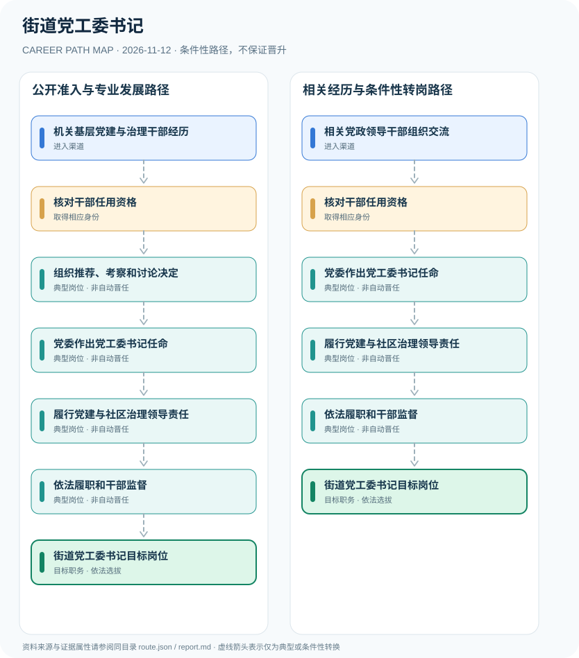

# 街道党工委书记

> **B18 Deep Search | JR-122** · 核验 2026-11-12 · 中国大陆街道党工委；以北京市石景山区公开规则及干部选拔条例解释

## 一、职业定位与制度效力

街道党工委是区委等上级党委的派出机关，党工委书记主持党工委工作，由有干部管理权限的党委按党内组织程序选任。党工委书记不等于街道办事处主任或居委会主任，其领导职务、职级及行政身份必须区别。

以2019年干部选任条例作为一般选任规则，以2018年石景山区规则验证街道党工委书记由上级区委决定的具体制度；不编造固定晋升年限。

## 二、两类正式进入渠道

- **机关基层党建与治理干部经历**：先依法通过公务员或适用渠道进入机关，形成党建组织、基层治理经验，经考察才可能进入领导岗位。
- **相关党政领导干部组织交流**：在街道办或区县机关履职的干部可按组织任用权限交流和考察，不能通过社会岗位招聘直接取得书记职务。

## 三、发展路径与任职关口

### 路径1：公开准入与专业发展路径

先依法通过公务员或适用渠道进入机关，形成党建组织、基层治理经验，经考察才可能进入领导岗位。

**节点序列**：机关基层党建与治理干部经历 → 核对干部任用资格 → 组织推荐、考察和讨论决定 → 党委作出党工委书记任命 → 履行党建与社区治理领导责任 → 依法履职和干部监督 → 街道党工委书记目标岗位

> 此路径是条件性职业示意，不是职务晋升承诺，也不赋予法定许可。

### 路径2：相关经历与条件性转岗路径

在街道办或区县机关履职的干部可按组织任用权限交流和考察，不能通过社会岗位招聘直接取得书记职务。

**节点序列**：相关党政领导干部组织交流 → 核对干部任用资格 → 党委作出党工委书记任命 → 履行党建与社区治理领导责任 → 依法履职和干部监督 → 街道党工委书记目标岗位

> 此路径是条件性职业示意，不是职务晋升承诺，也不赋予法定许可。

## 四、岗位活动与专业能力

以基层党建、公共协调、依法治理、群众服务、组织管理、廉政监督为能力基础，任职仍须组织决定。

- **核对干部任用资格**：根据干部管理权限、任职资格、回避和考核审核履历。
- **组织推荐、考察和讨论决定**：由有权限的上级党委及组织部门按规定落实选任程序。
- **党委作出党工委书记任命**：石景山区公开规则写明街道党工委书记、副书记任免由区委决定；其他地区须核对地方制度。
- **履行党建与社区治理领导责任**：主持党工委全面工作，贯彻民主集中制并协调区域公共服务和基层组织。
- **依法履职和干部监督**：履行纪律与工作责任；升迁与干部考察另有独立程序。

## 五、法规与可核查准入条件

- 北京市石景山区公开的2018年街道党工委议事规则明确书记、副书记任免由区委决定。
- 《党政领导干部选拔任用工作条例》对干部任用条件、考察、集体决策与管理权限作出规定。
- 党工委书记是党内组织职务，不能以街道行政办事处主任的招聘或任命直接替代。

## 六、边界、时效与主要风险

- 石景山区规则属地方样例，其委员数及街道机构规格不能推广到全国。
- 党内领导职务、行政职务、职级并不保证对应统一级别。
- 不猜测个人非公开的组织选拔过程。

## 七、逐边证据台账

说明：节点关联 `source_ids` 指向下列公开资料；各边为条件性关系而非法定自动晋升。适用法律与岗位招聘需按年度、地区和用人单位独立审核。

| 前置节点 | 后续节点 | 证据属性 | 条件 |
|---|---|---|---|
| 机关基层党建与治理干部经历 | 核对干部任用资格 | `conditional` | 从「机关基层党建与治理干部经历」到「核对干部任用资格」须独立满足适用招聘、岗位资格、机构授权及组织考核，不保证晋升。 |
| 核对干部任用资格 | 组织推荐、考察和讨论决定 | `conditional` | 从「核对干部任用资格」到「组织推荐、考察和讨论决定」须独立满足适用招聘、岗位资格、机构授权及组织考核，不保证晋升。 |
| 组织推荐、考察和讨论决定 | 党委作出党工委书记任命 | `conditional` | 从「组织推荐、考察和讨论决定」到「党委作出党工委书记任命」须独立满足适用招聘、岗位资格、机构授权及组织考核，不保证晋升。 |
| 党委作出党工委书记任命 | 履行党建与社区治理领导责任 | `conditional` | 从「党委作出党工委书记任命」到「履行党建与社区治理领导责任」须独立满足适用招聘、岗位资格、机构授权及组织考核，不保证晋升。 |
| 履行党建与社区治理领导责任 | 依法履职和干部监督 | `conditional` | 从「履行党建与社区治理领导责任」到「依法履职和干部监督」须独立满足适用招聘、岗位资格、机构授权及组织考核，不保证晋升。 |
| 依法履职和干部监督 | 街道党工委书记目标岗位 | `conditional` | 从「依法履职和干部监督」到「街道党工委书记目标岗位」须独立满足适用招聘、岗位资格、机构授权及组织考核，不保证晋升。 |
| 相关党政领导干部组织交流 | 核对干部任用资格 | `conditional` | 从「相关党政领导干部组织交流」到「核对干部任用资格」须独立满足适用招聘、岗位资格、机构授权及组织考核，不保证晋升。 |
| 核对干部任用资格 | 党委作出党工委书记任命 | `conditional` | 从「核对干部任用资格」到「党委作出党工委书记任命」须独立满足适用招聘、岗位资格、机构授权及组织考核，不保证晋升。 |

## 八、来源与发布机构（原始日期）

1. **共产党员网**：[北京市石景山区街道党工委议事规则](https://www.12371.cn/2018/10/31/ARTI1540982404212945.shtml)（2018-10-31）
2. **人力资源和社会保障部**：[党政领导干部选拔任用工作条例](https://www.mohrss.gov.cn/SYrlzyhshbzb/ztzl/dflz/lzgd/201903/t20190321_312665.html)（2019-03-03）

> **复核提醒**：发布日期不等于生效日期；已经结束的招聘不可作为仍开放的报名窗口。岗位身份、职业许可、业务权限和组织任用不可互换。
