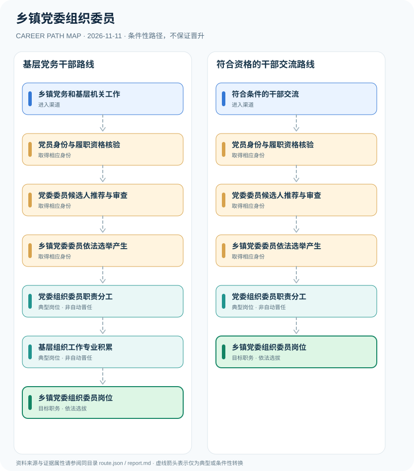

# 乡镇党委组织委员

> **研究批次** B12 · JR-123　|　**范围**：中国大陆；乡镇党组织，依2018年农村基层组织工作条例及2020年基层党组织选举条例　|　**核验日期**：2026-11-11

## 摘要与职业定位

乡镇党委组织委员属于乡镇党委班子中负责相关组织工作的委员职责分工，核心是党内组织程序和党组织工作职责，不能当作按公务员工龄自然晋升的行政职级。

**制度关键点**：乡镇党组织不仅有公务员管理体系，亦遵循党章、农村基层组织工作条例和基层党组织选举规则。组织委员通常首先是乡镇党委委员，再承担特定组织工作分工；不能用“科员→组织委员”的单箭头替代党内程序。

## 进入职业的合法渠道

- **乡镇党务和基层机关工作**：在乡镇基层党组织或相关机关依法任职，积累党员教育、干部组织等党务工作经验。
- **符合条件的干部交流**：已有基层党政机关工作经历的党员干部可按党内与干部任用制度参与组织交流选任。

## 2 种代表性职业发展路线

### 1. 基层党务干部路线

基层工作经历经身份审查、党内提名及委员选举，符合工作分工时履行组织委员职责。

**岗位序列（条件性示意）**：乡镇党务和基层机关工作 → 党员身份与履职资格核验 → 党委委员候选人推荐与审查 → 乡镇党委委员依法选举产生 → 党委组织委员职责分工 → 基层组织工作专业积累 → 乡镇党委组织委员岗位

### 2. 符合资格的干部交流路线

满足干部交流条件与党内选举程序后接受组织工作分工，不把交流安排视为自动当选党委委员。

**岗位序列（条件性示意）**：符合条件的干部交流 → 党员身份与履职资格核验 → 党委委员候选人推荐与审查 → 乡镇党委委员依法选举产生 → 党委组织委员职责分工 → 乡镇党委组织委员岗位

## 重要职责、技能和岗位发展

**典型职责**：党员发展和教育管理、基层党组织建设、组织生活规范与相关干部组织事务。是否兼任其他行政岗位、干部考核与交流方向均需按组织授权界定，研究不涉及非公开干部任用信息。

- **党委组织委员职责分工**：按乡镇党委组织设置与工作分工负责发展党员、基层组织建设等组织事务。
- **基层组织工作专业积累**：根据党委部署参与党员教育管理、基层组织评估和组织建设相关治理协调。

## 准入门槛与任职规则

- 《中国共产党农村基层组织工作条例》规定乡镇党委每届任期五年，党委一般设置7—9名委员且应设组织委员、宣传委员。
- 《中国共产党基层组织选举工作条例》规定基层委员会委员通过党内选举产生，候选人应按组织规定提名与审查。
- 乡镇党委组织委员身份、行政领导职务和公务员职级分别处理；不能以职级晋升直接得出党委委员职务。

## 证据状态与实际约束

路线图中的箭头均为 `conditional`：即使前一节点的经历成立，后续任用、考试、职业资格、选拔或招聘仍需独立满足制度要求。`normative` 专指法律直接规定的关系，`official_description` 指官方机构说明，`illustrative` 指仅用于理解的示例；具体证据来源链接见下文。

- 具体职数、副书记和组织委员分工因乡镇规模、地方党委批准设置及换届情况而有差异。
- 选举资格、组织推荐与工作分工是不同步骤，个人不能靠自选岗位直接取得该职务。
- 若党内组织机构调整，需核对地方现行组织设置及换届政策。

## 可复核原始资料

1. [中国共产党农村基层组织工作条例（2018年修订）](https://dangjian.people.com.cn/n1/2019/0111/c117092-30515995.html)，中国共产党新闻网·人民网（转载中共中央条例），2018-12-28。
2. [中国共产党基层组织选举工作条例](https://www.ndrc.gov.cn/fggz/fgdj/zydj/202008/t20200819_1236326_ext.html)，国家发展和改革委员会（转载中共中央条例），2020-07-13。
3. [党政领导干部选拔任用工作条例](https://www.mohrss.gov.cn/SYrlzyhshbzb/ztzl/dflz/lzgd/201903/t20190321_312665.html)，人力资源和社会保障部（转载），2019-03-03。

> **复核提醒**：跨地区、跨机构或新招录年度，必须重新核查原始政策、职位计划及生效状态。此报告不推测晋升概率和个人任职结果。
