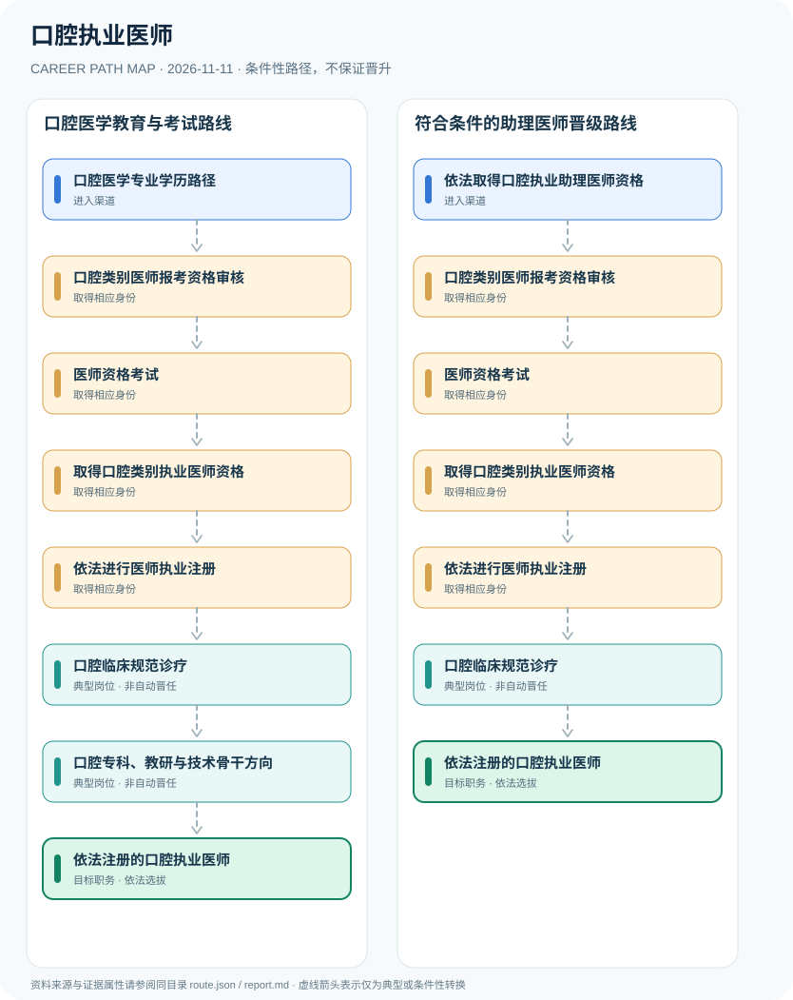

# 口腔执业医师

> **批次 B13 · JR-155** · 研究范围：中国大陆·口腔类别医师资格和医疗机构诊疗；以2026考试政策为准 · **核验日期 2026-11-11**

## 职业定位与证据边界

口腔执业医师属于法定医师执业类别，通常经符合报考条件的口腔医学教育和实践，通过相应资格考试并完成执业注册后依法开展口腔诊疗。资格证、执业证、医院岗位、专科职称是独立层次。

该职业的不可跳过环节是**资格考试+执业注册**。医师类别必须明确为口腔；学历与试用经历由当年考试要求核验，注册信息与医疗机构执业范围也须合规。

## 一、两种主要职业进入方向

- **口腔医学专业学历路径**：完成符合法定报名资格的口腔医学教育与实践训练，是否符合报考条件由学制、学历和实际试用经历决定。
- **依法取得口腔执业助理医师资格**：符合从执业助理医师晋级报名条件的人员，在满足实践年限和教育要求时可报考执业医师。

## 二、典型发展路线与适用条件

### 1. 口腔医学教育与考试路线

口腔医学学历和实践满足条件后参加医师资格考试，通过并注册后开展诊疗。

**路线图**：口腔医学专业学历路径 → 口腔类别医师报考资格审核 → 医师资格考试 → 取得口腔类别执业医师资格 → 依法进行医师执业注册 → 口腔临床规范诊疗 → 口腔专科、教研与技术骨干方向 → 依法注册的口腔执业医师

以上各岗位转换均受任用、选拔、执业资格或招聘控制，不构成保证晋升的链条。

### 2. 符合条件的助理医师晋级路线

持依法取得的口腔助理医师资格者，满足进一步报考条件后取得执业医师资格并注册。

**路线图**：依法取得口腔执业助理医师资格 → 口腔类别医师报考资格审核 → 医师资格考试 → 取得口腔类别执业医师资格 → 依法进行医师执业注册 → 口腔临床规范诊疗 → 依法注册的口腔执业医师

以上各岗位转换均受任用、选拔、执业资格或招聘控制，不构成保证晋升的链条。

## 三、岗位职责与专业发展能力

专业发展包括口腔检查、修复治疗、牙周及牙体牙髓等分支的持续教育和质量控制。岗位升任或专科业务骨干根据医院聘任与实际业绩进行，无法仅用学历自动推算。

- **口腔类别医师报考资格审核**：核验学历专业、临床实践和考试报名条件，不能以口腔卫生技术岗位证明替代法定资格。
- **医师资格考试**：按口腔类别进行实践技能及医学综合考试，考试形式和时间以国家当年公告为准。
- **取得口腔类别执业医师资格**：考试合格依法取得执业医师资格，与取得医疗机构雇佣岗位不同。
- **依法进行医师执业注册**：按国家医师执业注册办法申请注册并取得执业证书；不能未注册开展医师执业。
- **口腔临床规范诊疗**：在注册类别、范围和医疗机构资质许可范围内从事相应口腔诊疗，遵守医疗安全与感染防控要求。
- **口腔专科、教研与技术骨干方向**：通过继续教育、临床质量与专业研究发展能力，医院职称和科室领导岗位须独立评聘。

## 四、现行法规、任职资格及关键区别

- 2026年医师资格考试公告专设口腔类别，并要求网上报名、资格审核与实践技能、医学综合考核。
- 《中华人民共和国医师法》规定从事医师执业活动应依法取得资格并注册；口腔类别与临床、中医、公共卫生四个考试类别互不自动替代。
- 2026年修订《医师执业注册管理办法》明确未经注册取得执业证书不得开展医师执业活动。

## 五、法律与数据风险提示

- 口腔技师、牙科技工与口腔执业医师属于不同岗位和权限，不能将制作义齿或护理工作等同于独立诊疗资格。
- 口腔助理医师与执业医师资格不同，报名年限和学历条件必须按规定逐项审核。
- 医院的主治医师、副主任医师、科主任或院长等专业和管理岗位不因医师资格自动获得。

## 六、证据分类和引用对应

**职业路径中所有转换为 `conditional`：满足条件时才可能发生。** `normative` 指法律明确规定的权利或义务；`official_description` 指官方发布的岗位事实；`illustrative` 只代表一种合理的示例经历。本报告不混淆行政领导职务、职级、执业资格、技术等级和雇主自行定义的岗位。

| 图中转换 | 证据属性 | 解释 |
|---|---|---|
| 口腔医学专业学历路径 → 口腔类别医师报考资格审核 | conditional | 从「口腔医学专业学历路径」到「口腔类别医师报考资格审核」取决于对应资格、空缺职位或机构选任，不是必然晋升。 |
| 口腔类别医师报考资格审核 → 医师资格考试 | conditional | 从「口腔类别医师报考资格审核」到「医师资格考试」取决于对应资格、空缺职位或机构选任，不是必然晋升。 |
| 医师资格考试 → 取得口腔类别执业医师资格 | conditional | 从「医师资格考试」到「取得口腔类别执业医师资格」取决于对应资格、空缺职位或机构选任，不是必然晋升。 |
| 取得口腔类别执业医师资格 → 依法进行医师执业注册 | conditional | 从「取得口腔类别执业医师资格」到「依法进行医师执业注册」取决于对应资格、空缺职位或机构选任，不是必然晋升。 |
| 依法进行医师执业注册 → 口腔临床规范诊疗 | conditional | 从「依法进行医师执业注册」到「口腔临床规范诊疗」取决于对应资格、空缺职位或机构选任，不是必然晋升。 |
| 口腔临床规范诊疗 → 口腔专科、教研与技术骨干方向 | conditional | 从「口腔临床规范诊疗」到「口腔专科、教研与技术骨干方向」取决于对应资格、空缺职位或机构选任，不是必然晋升。 |
| 口腔专科、教研与技术骨干方向 → 依法注册的口腔执业医师 | conditional | 从「口腔专科、教研与技术骨干方向」到「依法注册的口腔执业医师」取决于对应资格、空缺职位或机构选任，不是必然晋升。 |
| 依法取得口腔执业助理医师资格 → 口腔类别医师报考资格审核 | conditional | 从「依法取得口腔执业助理医师资格」到「口腔类别医师报考资格审核」取决于对应资格、空缺职位或机构选任，不是必然晋升。 |
| 口腔临床规范诊疗 → 依法注册的口腔执业医师 | conditional | 从「口腔临床规范诊疗」到「依法注册的口腔执业医师」取决于对应资格、空缺职位或机构选任，不是必然晋升。 |

## 七、官方和公开参考资料

1. [国家卫生健康委员会2026年医师资格考试公告](https://www.nhc.gov.cn/yzygj/c100067/202601/134520df641b4e99b8f8db7c64abc7f3.shtml) — 国家卫生健康委员会（发布日期 2026-01-26）
2. [医师执业注册管理办法（2026修订）](https://www.moj.gov.cn/pub/sfbgw/flfggz/flfggzbmgz/202608/t20260819_538650.html) — 中华人民共和国司法部（发布日期 2026-06-05）
3. [中华人民共和国医师法](https://wjw.beijing.gov.cn/zwgk_20040/zcwj2022/flfg/202304/t20230407_2992842.html) — 北京市卫生健康委员会（发布日期 2021-08-20）

> 资料只反映所列地域、法规和核验日期的公开信息。报名、岗位计划或法规发生变化时，必须重新核对原文，不能沿用过时条件。
