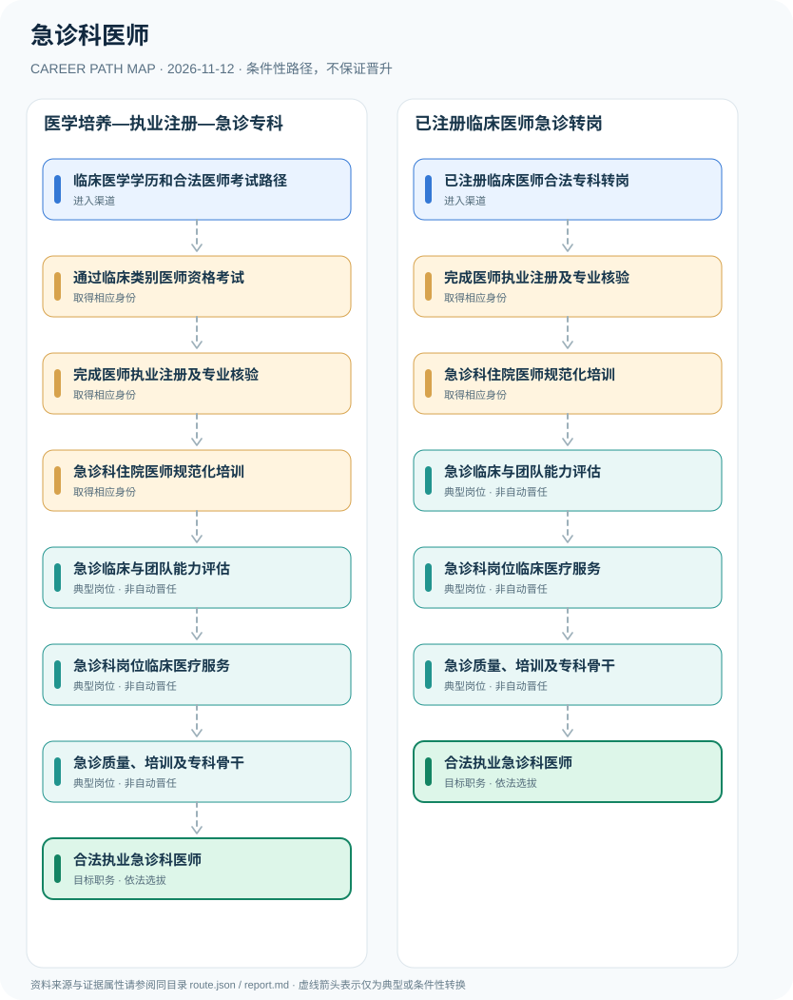

# 急诊科医师

> **B17 深度调查 · JR-157**　|　**适用地域及机构**：中国大陆具备急诊科设置的医疗机构；医师法、2026资格考试与注册规章适用　|　**核验时间**：2026-11-12

## 摘要：岗位身份、适用制度和效力

急诊科医师是具有合法临床类别医师资格并完成执业注册、在医疗机构急诊专业岗位诊疗的医生。医师资格考试、执业证注册、急诊专业的住院医师规范化培训和医院排班聘任，是四个不同制度环节；单纯轮转急诊科或持护理急救证书不等于成为急诊医师。

**准入层级核对**：2026年部门规章更新了医师注册规则；2026资格考试公告和住培考核通知都不是‘急诊科专用个人执业证’。医学教育、临床执业许可、专业能力培训和院内聘任需要逐层核实，医生可以依法从其他临床专科调整岗位，但必须符合注册范围与医院适岗条件。

## 进入行业的合法渠道

- **临床医学学历和合法医师考试路径**：经过符合医师资格考试要求的临床医学教育、实习和资格审核，参加国家医师资格考试。
- **已注册临床医师合法专科转岗**：已持有适用有效医师执业证的临床医师，可依专业培训、注册范围和医院招聘条件申请急诊岗位。

## 两条可比较的职业发展路径

### 路径 1：医学培养—执业注册—急诊专科

从医学教育和医师考试开始，依法注册并参加适用急诊专科培训，取得医院相应岗位任职。

**条件性节点序列**：临床医学学历和合法医师考试路径 → 通过临床类别医师资格考试 → 完成医师执业注册及专业核验 → 急诊科住院医师规范化培训 → 急诊临床与团队能力评估 → 急诊科岗位临床医疗服务 → 急诊质量、培训及专科骨干 → 合法执业急诊科医师

路径只说明一种可解释的可能经历，后续岗位须满足新的资质、招聘、考核或任用要求。

### 路径 2：已注册临床医师急诊转岗

既有合法临床医师在匹配执业范围、专业能力和医院招聘条件下进入急诊岗位。

**条件性节点序列**：已注册临床医师合法专科转岗 → 完成医师执业注册及专业核验 → 急诊科住院医师规范化培训 → 急诊临床与团队能力评估 → 急诊科岗位临床医疗服务 → 急诊质量、培训及专科骨干 → 合法执业急诊科医师

路径只说明一种可解释的可能经历，后续岗位须满足新的资质、招聘、考核或任用要求。

## 关键技能、项目实践与考核

可核验能力包括医疗质量指标、临床文书、跨科协同、患者权益、培训考核及质量复盘。担任科室主任和取得高级专业职称须分别通过医院人事与职称评聘，不能只按工龄顺推。

- **急诊临床与团队能力评估**：在急诊科合法岗位中积累急危重症评估、转诊协作、病历质量和沟通安全，遵守医院专业准入。
- **急诊科岗位临床医疗服务**：经医院安排在执业许可和医疗机构职责范围内承担急诊诊疗，与护理急救及院前救护人员岗位区分。
- **急诊质量、培训及专科骨干**：通过临床质量改善、教研或跨专业协作积累能力；主治医师评聘、主任职务和医疗技术准入分别判断。

## 法定资格、制度区别与核查条目

- 《医师执业注册管理办法》2026年6月5日修订，第二条强调医师执业应经注册取得执业证，未经注册不得从事医师执业活动。
- 2026年国家医师资格考试公告明确临床、口腔、公共卫生及中医等类别的相关资格考试；急诊科工作岗位本身并不取代临床类别医师执业注册。
- 2026年国家卫生健康委人才交流服务中心公布22个住培专业的临床实践考核培训，其中包括急诊科专业；具体住培及考核要求以适用政策为准。
- 岗位转型必须核查医师执业注册范围、医疗机构资质和急诊科招聘考核，不能只凭急诊轮转或公共急救培训证承诺独立执业。

## 风险与地区、年度限制

- 不同医疗机构和住培对象的规培方式及豁免条件可能有差别，不可把某项培训班一律写成强制全国准入许可证。
- 急诊医生、急诊护士、急救员和院前医疗急救工作人员职责与职业资格不同。
- 本研究说明职业路径，不提供诊疗处方、药量或急危重症处置操作步骤。

## 来源映射及路径证据

`route.json` 记录规范性文件、政策或招聘公告的原文 URL 和发布机构；节点引用 `source_ids`，每条岗位转换保守标为 `conditional`，而非保证升迁的 `normative` 法律权利。涉及真实法定准入的说明见上述条款，避免将机构权责套用到员工个人。

| 前一节点 | 后一节点 | 边属性 | 适用条件 |
|---|---|---|---|
| 临床医学学历和合法医师考试路径 | 通过临床类别医师资格考试 | `conditional` | 「临床医学学历和合法医师考试路径」到「通过临床类别医师资格考试」需要独立满足适用职位、资格、权限与机构安排，非自动晋升。 |
| 通过临床类别医师资格考试 | 完成医师执业注册及专业核验 | `conditional` | 「通过临床类别医师资格考试」到「完成医师执业注册及专业核验」需要独立满足适用职位、资格、权限与机构安排，非自动晋升。 |
| 完成医师执业注册及专业核验 | 急诊科住院医师规范化培训 | `conditional` | 「完成医师执业注册及专业核验」到「急诊科住院医师规范化培训」需要独立满足适用职位、资格、权限与机构安排，非自动晋升。 |
| 急诊科住院医师规范化培训 | 急诊临床与团队能力评估 | `conditional` | 「急诊科住院医师规范化培训」到「急诊临床与团队能力评估」需要独立满足适用职位、资格、权限与机构安排，非自动晋升。 |
| 急诊临床与团队能力评估 | 急诊科岗位临床医疗服务 | `conditional` | 「急诊临床与团队能力评估」到「急诊科岗位临床医疗服务」需要独立满足适用职位、资格、权限与机构安排，非自动晋升。 |
| 急诊科岗位临床医疗服务 | 急诊质量、培训及专科骨干 | `conditional` | 「急诊科岗位临床医疗服务」到「急诊质量、培训及专科骨干」需要独立满足适用职位、资格、权限与机构安排，非自动晋升。 |
| 急诊质量、培训及专科骨干 | 合法执业急诊科医师 | `conditional` | 「急诊质量、培训及专科骨干」到「合法执业急诊科医师」需要独立满足适用职位、资格、权限与机构安排，非自动晋升。 |
| 已注册临床医师合法专科转岗 | 完成医师执业注册及专业核验 | `conditional` | 「已注册临床医师合法专科转岗」到「完成医师执业注册及专业核验」需要独立满足适用职位、资格、权限与机构安排，非自动晋升。 |

## 可复核的公开来源

1. **中华人民共和国司法部**：[医师执业注册管理办法（2026年修订）](https://www.moj.gov.cn/pub/sfbgw/flfggz/flfggzbmgz/202608/t20260819_538650.html)（原始制度日期 2026-06-05）
2. **国家卫生健康委员会**：[2026年国家医师资格考试公告](https://www.nhc.gov.cn/yzygj/c100067/202601/134520df641b4e99b8f8db7c64abc7f3.shtml)（原始制度日期 2026-01-26）
3. **国家卫生健康委人才交流服务中心**：[2026年全国住培临床实践考核考官培训（含急诊专业）](https://www.21wecan.com/wsrcw/TZGG/202603/1002911.shtml)（原始制度日期 2026-03-01）

> **研究说明**：来源的发布日期不代表法规施行日期；招聘公告不保证报名窗口仍开放。涉及跨地区或新版本制度时须重新核验。本路线不承诺个人晋升概率。
