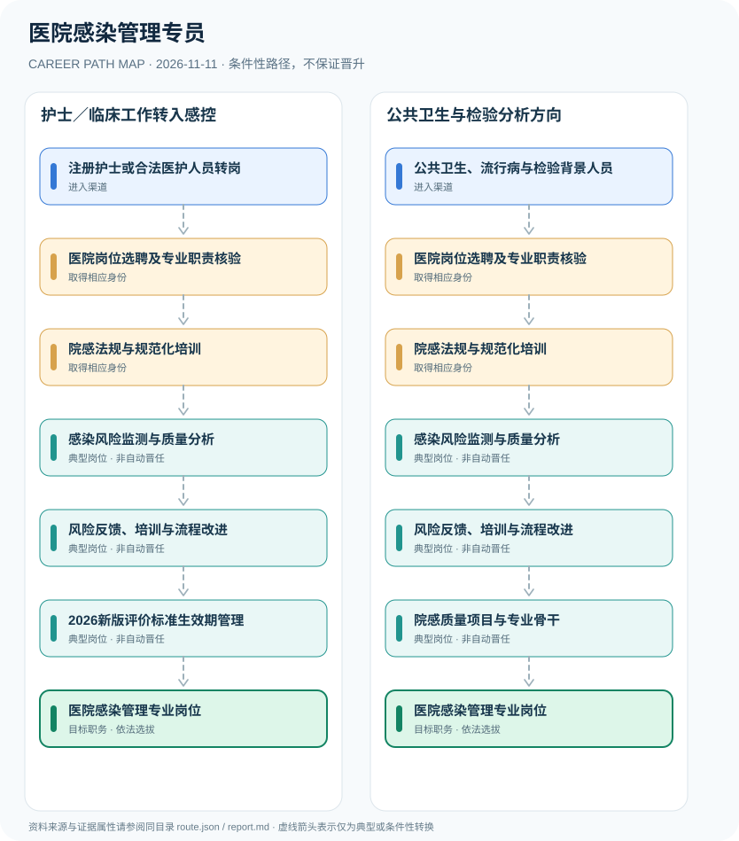

# 医院感染管理专员

> **B16 深度研究 · JR-165** · 机构与地域：中国大陆合法医疗机构的医院感染预防与控制专业岗位 · **核验日期：2026-11-11**

## 一、职业定义与现行制度

医院感染管理专员通常属于医院感染管理部门或与感控相关的专业岗位，受医疗机构法定感染管理责任、岗位培训和专业能力要求约束。医院感染管理团队可由临床、护理、检验或公共卫生背景人员组成，并非全部必须持公共卫生类别医师执照。WS/T 592—2026新版评价标准已公布，但要到2026年12月1日才施行。

**标准版本的精确时间轴**：院感管理的部门规章长期存在，2025年国家卫健委通告的16项WS/T卫生行业推荐性标准从2026年2月1日正式生效；但WS/T 592—2026要等到2026年12月1日生效。专业招聘也必须按医护或公共卫生岗位分别核查资格，不能将医院感控部门各成员自动设为有执业医师许可证。

## 二、两类准入与身份确认

- **注册护士或合法医护人员转岗**：具备合法相应专业身份的医护人员，经医院岗位资格审核与感控培训进入医院感染管理领域。
- **公共卫生、流行病与检验背景人员**：拥有医院流行病学、临床检验、公共卫生或相关专业背景者可按医疗机构招聘申请感控管理岗位。

## 三、法规、资质和考试的判断

- 国家卫健委《医院感染管理办法》第六条规定100张以上床位医院应设医院感染管理委员会及独立的医院感染管理部门；其他医疗机构按规模指定部门或专兼职人员。
- 该办法第二十四至二十六条规定感染管理专业人员的岗位规范培训、继续教育和专业能力要求，未设全国统一“院感专员执业证”。
- 国家卫健委2025年发布的16项WS/T推荐性标准包括《医院感染病例判定标准》等，自2026年2月1日起实施。
- WS/T 592—2026新版《医院感染预防与控制评价标准》2026年6月29日公布，但2026年12月1日才实施；本次核验时仍属未来生效。

## 四、职业发展路径与条件性节点

### 路线1｜护士／临床工作转入感控

合法医护人员经医院组织安排，完成岗位培训后从事感染监测、风险反馈及质量改进。

**条件性路径**：注册护士或合法医护人员转岗 → 医院岗位选聘及专业职责核验 → 院感法规与规范化培训 → 感染风险监测与质量分析 → 风险反馈、培训与流程改进 → 2026新版评价标准生效期管理 → 医院感染管理专业岗位

该路线仅表示可能存在的职业经历；下一阶段均须重新核查资格、机构岗位和考核任职制度，不意味着保证录用或晋升。

### 路线2｜公共卫生与检验分析方向

来自统计流行病学与检验背景的人员按岗位聘用后接受感控专门训练，承担监测评估职责。

**条件性路径**：公共卫生、流行病与检验背景人员 → 医院岗位选聘及专业职责核验 → 院感法规与规范化培训 → 感染风险监测与质量分析 → 风险反馈、培训与流程改进 → 院感质量项目与专业骨干 → 医院感染管理专业岗位

该路线仅表示可能存在的职业经历；下一阶段均须重新核查资格、机构岗位和考核任职制度，不意味着保证录用或晋升。

## 五、工作能力、项目与成果评价

能力表现包括标准化感染病例判定、监测口径一致性、消毒隔离培训和问题闭环等；院感负责人需要承担制度执行与多学科协调责任，依据医院聘用与考核确定。

- **医院岗位选聘及专业职责核验**：依法按照医院人事制度明确岗位、培训责任和专业边界，部门设置根据医疗机构床位及规模确定。
- **院感法规与规范化培训**：按《医院感染管理办法》及相关规范参与岗位培训、继续教育和医院感染管理制度学习。
- **感染风险监测与质量分析**：协助感染数据监测、病例判定、消毒隔离、环境清洁和重点环节预防监测，合理处理患者隐私。
- **风险反馈、培训与流程改进**：根据监测和现场核查记录推动院感培训、落实医疗质量安全核心制度及改进措施。
- **2026新版评价标准生效期管理**：区分2026年2月已实施的一批WS/T新标准与2026年12月1日才施行的WS/T 592—2026。
- **院感质量项目与专业骨干**：在医院岗位聘任和专业能力发展条件下可承担项目负责人或教育培训职责，不因此成为公共卫生执业医师。

## 六、适用地区、生效版本及风险

- WS/T 592—2026尚未施行时不可写成现行已强制标准；而2025年发布并于2026年2月实施的多项标准应按各自条款适用。
- 院感专员与防疫行政执法公务员、传染病临床医师或公共卫生执业医师并不自动等同。
- 该岗位涉及患者感染监测与敏感健康信息，任何报告均不包含可识别患者的诊疗资料。

## 七、证据与图谱的映射

对每一节点，`route.json` 中的 `source_ids` 指向下文的可核查公开来源；每条转换边均标为 `conditional`，不会冒充有明确法律规定的 `normative` 自动晋升。不同的法定资格、机构选聘、职位级别及劳动关系各自独立。

| 转换前 | 转换后 | 证据属性 | 适用限制 |
|---|---|---|---|
| 注册护士或合法医护人员转岗 | 医院岗位选聘及专业职责核验 | `conditional` | 从「注册护士或合法医护人员转岗」至「医院岗位选聘及专业职责核验」取决于法定资格、岗位条件或独立选聘考核，绝非自动晋升。 |
| 医院岗位选聘及专业职责核验 | 院感法规与规范化培训 | `conditional` | 从「医院岗位选聘及专业职责核验」至「院感法规与规范化培训」取决于法定资格、岗位条件或独立选聘考核，绝非自动晋升。 |
| 院感法规与规范化培训 | 感染风险监测与质量分析 | `conditional` | 从「院感法规与规范化培训」至「感染风险监测与质量分析」取决于法定资格、岗位条件或独立选聘考核，绝非自动晋升。 |
| 感染风险监测与质量分析 | 风险反馈、培训与流程改进 | `conditional` | 从「感染风险监测与质量分析」至「风险反馈、培训与流程改进」取决于法定资格、岗位条件或独立选聘考核，绝非自动晋升。 |
| 风险反馈、培训与流程改进 | 2026新版评价标准生效期管理 | `conditional` | 从「风险反馈、培训与流程改进」至「2026新版评价标准生效期管理」取决于法定资格、岗位条件或独立选聘考核，绝非自动晋升。 |
| 2026新版评价标准生效期管理 | 医院感染管理专业岗位 | `conditional` | 从「2026新版评价标准生效期管理」至「医院感染管理专业岗位」取决于法定资格、岗位条件或独立选聘考核，绝非自动晋升。 |
| 公共卫生、流行病与检验背景人员 | 医院岗位选聘及专业职责核验 | `conditional` | 从「公共卫生、流行病与检验背景人员」至「医院岗位选聘及专业职责核验」取决于法定资格、岗位条件或独立选聘考核，绝非自动晋升。 |
| 风险反馈、培训与流程改进 | 院感质量项目与专业骨干 | `conditional` | 从「风险反馈、培训与流程改进」至「院感质量项目与专业骨干」取决于法定资格、岗位条件或独立选聘考核，绝非自动晋升。 |
| 院感质量项目与专业骨干 | 医院感染管理专业岗位 | `conditional` | 从「院感质量项目与专业骨干」至「医院感染管理专业岗位」取决于法定资格、岗位条件或独立选聘考核，绝非自动晋升。 |

## 八、来源及原始发布日期

1. **国家卫生健康委员会**：[医院感染管理办法（卫生部令第48号）](https://www.nhc.gov.cn/wjw/c100221/202201/793c3dae63ca49b08dda27b03f9e8fd6.shtml)（原文件或规定日期：2006-07-06）。
2. **国家卫生健康委员会卫生健康标准网**：[国卫通〔2025〕9号：16项卫生行业标准2026年2月1日实施](https://wsbz.nhc.gov.cn/wsbzw/article/7/2025/8/4090028198bbd8e40198bc0efef70001.html)（原文件或规定日期：2025-07-30）。
3. **国家卫生健康委员会卫生健康标准网**：[WS/T 592—2026 医院感染预防与控制评价标准](https://wsbz.nhc.gov.cn/wsbzw/article/StandardLibrary/4848e49b20644099012064432ace0001/2026/7/409002819f64b671019f64f082280023.html)（原文件或规定日期：2026-06-29）。

> **研究限制**：法规发布日期和实施日期可能不同；2027招录的专项条件以招聘公告实时版本及具体职位表为准。本研究不作个人晋升概率预测，不公开非公开的军队、警务、医疗或个人数据。
