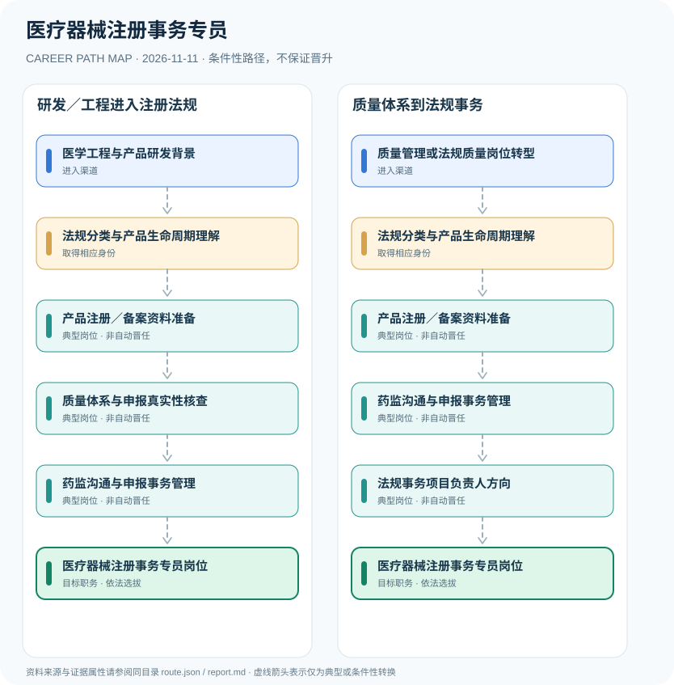

# 医疗器械注册事务专员

> **研究批次** B12 · JR-166　|　**范围**：中国大陆；医疗器械注册申请人或备案人相关企业岗位　|　**核验日期**：2026-11-11

## 摘要与职业定位

医疗器械注册事务专员是企业内负责法规研究、申报材料和产品审评协作的岗位，依规须掌握相关专业知识；依法承担产品注册申请与质量主体责任的是注册申请人、注册人或备案人，而不是某个员工单独持有的“注册专员证”。

**责任结构**：注册申请人、注册人和备案人承担法定产品责任，企业专员通常以雇员身份整理资料、协调研发检验和对接药监事项。该区分决定应将“合规办事能力”和“主体责任”拆成不同事实节点。

## 进入职业的合法渠道

- **医学工程与产品研发背景**：从生物医学工程、医疗器械研发或临床评价相关学习实践积累技术基础。
- **质量管理或法规质量岗位转型**：在医疗器械企业从质量体系、技术文件或合规事务进入法规注册方向。

## 2 种代表性职业发展路线

### 1. 研发／工程进入注册法规

技术人员掌握产品法规后参与注册资料与审评协作，在企业管理体系内承担申报事务。

**岗位序列（条件性示意）**：医学工程与产品研发背景 → 法规分类与产品生命周期理解 → 产品注册／备案资料准备 → 质量体系与申报真实性核查 → 药监沟通与申报事务管理 → 医疗器械注册事务专员岗位

### 2. 质量体系到法规事务

从企业质量或法规相关工作出发，积累注册分类与申报能力后发展为注册事务岗位。

**岗位序列（条件性示意）**：质量管理或法规质量岗位转型 → 法规分类与产品生命周期理解 → 产品注册／备案资料准备 → 药监沟通与申报事务管理 → 法规事务项目负责人方向 → 医疗器械注册事务专员岗位

## 重要职责、技能和岗位发展

**职业发展**：从法规检索、产品分类、注册路径分析、临床评价和质量体系文件做起，逐步独立推进器械注册及变更项目。是否担任法规事务负责人由企业岗位选拔，不存在自动获得产品注册人主体身份的路径。

- **产品注册／备案资料准备**：按产品实际类别编制技术要求、检验、临床评价等申报资料，并组织企业内部核验。
- **质量体系与申报真实性核查**：与研发、质量和临床团队协作保证资料真实完整、可追溯，注册申请人为责任主体。
- **药监沟通与申报事务管理**：按省级或国家药监部门权限协助企业提交申报、回复审评意见与变更跟进。
- **法规事务项目负责人方向**：在雇主岗位安排下可能负责多产品申报项目，企业职级不等于国家准入许可。

## 准入门槛与任职规则

- 国家市场监督管理总局令第47号《医疗器械注册与备案管理办法》第14条规定申请人、备案人应为能承担法律责任的企业或研制机构。
- 第16条规定办理注册备案事项的人员应具有相应专业知识、熟悉管理法规；这并未规定统一的个人执业资格许可。
- 医疗器械注册与备案依据产品类别、国产进口属性和监督机关分工办理，企业产品注册证不是员工个人职业证书。

## 证据状态与实际约束

路线图中的箭头均为 `conditional`：即使前一节点的经历成立，后续任用、考试、职业资格、选拔或招聘仍需独立满足制度要求。`normative` 专指法律直接规定的关系，`official_description` 指官方机构说明，`illustrative` 指仅用于理解的示例；具体证据来源链接见下文。

- 负责注册事务的企业员工不等同于法律上的医疗器械注册人或备案人。
- 具体申报技术要求随产品、类别、标准以及法规迭代变化，不能照搬一个项目的完整资质结论。
- 本岗位可与研发、质量、临床评价交叉，但不等同于执业医师、医疗器械审评员或药监公务员。

## 可复核原始资料

1. [医疗器械注册与备案管理办法（2021年公布）](https://www.samr.gov.cn/zw/zfxxgk/fdzdgknr/fgs/art/2023/art_568880e3ee344c45b38d073bba1c53ad.html)，国家市场监督管理总局，2021-08-26。

> **复核提醒**：跨地区、跨机构或新招录年度，必须重新核查原始政策、职位计划及生效状态。此报告不推测晋升概率和个人任职结果。
