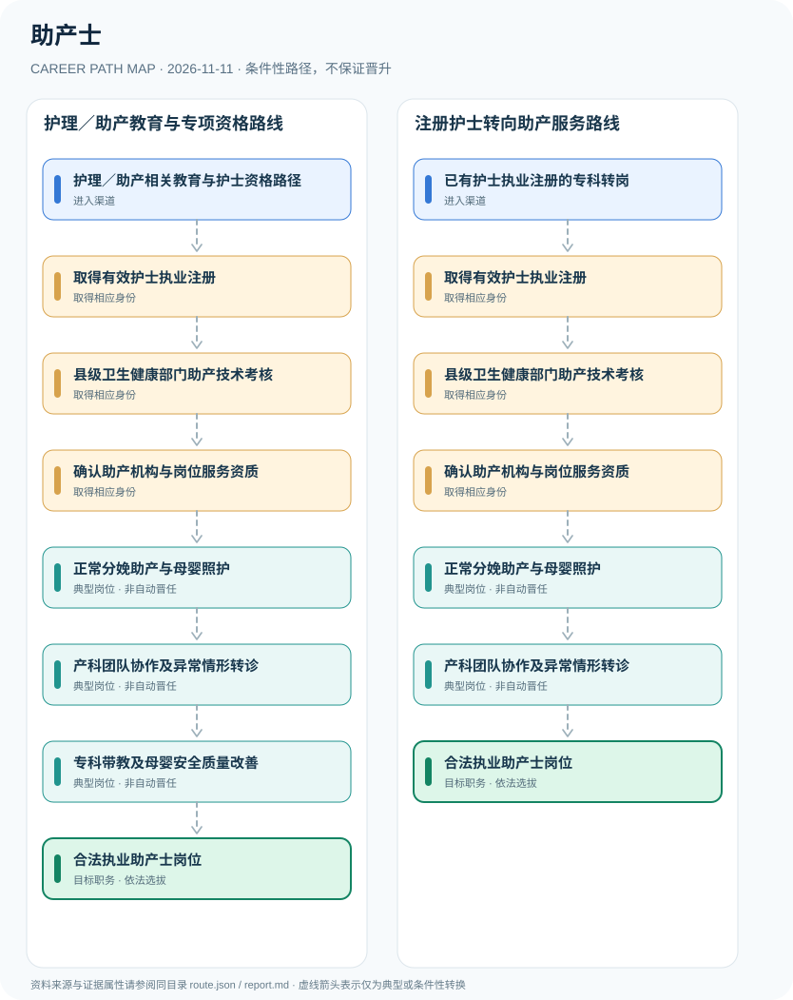

# 助产士

> **B16 深度研究 · JR-159** · 机构与地域：中国大陆开展助产技术的合法医疗机构；依据2025年国家卫健委基本标准及专项考核要求 · **核验日期：2026-11-11**

## 一、职业定义与现行制度

助产士通常是经护士执业注册并取得助产技术类《母婴保健技术考核合格证书》的注册护士，在有开展助产技术资质的医疗机构依技术规范工作。2025年国家卫健委标准明确了助产技术人员的机构配备和证件要求；助产学历、护士执业证与专项母婴技术考核证是不同层次。

**最重要的双层准入**：2025年国家卫健委基本标准明确，助产士为具有助产资质的注册护士；护士取得个人助产专项考核合格证后仍必须在具备开展助产技术资质的医疗机构按照制度履职。2021年专项管理通知明确了其服务范围。此处绝不可用“护士资格证→直接成为助产士”一个自动箭头。

## 二、两类准入与身份确认

- **护理／助产相关教育与护士资格路径**：完成法定认可的护理教育和资格考试，依法办理护士执业注册，再申请助产岗位培训及考核。
- **已有护士执业注册的专科转岗**：具有有效护士执业证的临床护士可按所在机构和卫生行政部门要求申请助产技术培训考核。

## 三、法规、资质和考试的判断

- 2025年国家卫健委《开展助产技术医疗机构基本标准》把助产士界定为取得助产资质的注册护士，并对机构需配备人员提出基本要求。
- 同一标准规定护士从事助产技术服务须经县级卫生健康部门考核合格，并取得助产技术类《母婴保健技术考核合格证书》。
- 2021年国家卫健委专项管理通知对资质人员在正常经阴道分娩等活动中的适用范围作出解释，其他助产技术受能力和医师指导限制。
- 助产医疗机构的专项资质与助产士个人证书不能互相替代；孕产妇安全、知情同意和临床规范必须遵守。

## 四、职业发展路径与条件性节点

### 路线1｜护理／助产教育与专项资格路线

从护理资格和注册出发，参加助产技术考核并匹配已获资质的助产机构，依法开展母婴照护。

**条件性路径**：护理／助产相关教育与护士资格路径 → 取得有效护士执业注册 → 县级卫生健康部门助产技术考核 → 确认助产机构与岗位服务资质 → 正常分娩助产与母婴照护 → 产科团队协作及异常情形转诊 → 专科带教及母婴安全质量改善 → 合法执业助产士岗位

该路线仅表示可能存在的职业经历；下一阶段均须重新核查资格、机构岗位和考核任职制度，不意味着保证录用或晋升。

### 路线2｜注册护士转向助产服务路线

从已注册护士岗位经助产专项技术考核及机构资格确认后，承担助产护理职责。

**条件性路径**：已有护士执业注册的专科转岗 → 取得有效护士执业注册 → 县级卫生健康部门助产技术考核 → 确认助产机构与岗位服务资质 → 正常分娩助产与母婴照护 → 产科团队协作及异常情形转诊 → 合法执业助产士岗位

该路线仅表示可能存在的职业经历；下一阶段均须重新核查资格、机构岗位和考核任职制度，不意味着保证录用或晋升。

## 五、工作能力、项目与成果评价

专业发展关注产妇沟通、出生安全、规范记录、风险识别与产科团队协作，可继续参与医院产科护理质量项目和培训带教。护士长和母婴健康管理负责人属于机构岗位聘任，并非助产技术资格自动升级。

- **取得有效护士执业注册**：符合护士执业资格、注册地点及有效状态要求；护理学历或培训合格不自动替代护士执业证。
- **县级卫生健康部门助产技术考核**：按母婴保健专项技术许可规章及2025标准考核合格，取得助产技术类《母婴保健技术考核合格证书》。
- **确认助产机构与岗位服务资质**：所服务的医疗机构必须符合开展助产技术的机构基本标准，岗位人员条件、执业地点独立核查。
- **正常分娩助产与母婴照护**：在技术资质及能力范围依法提供正常经阴道分娩相关助产、监测、沟通与安全照护。
- **产科团队协作及异常情形转诊**：对能力范围外或异常分娩情况依法及时在具资质妇产科医师指导下处理或转介，遵守临床指南。
- **专科带教及母婴安全质量改善**：依据机构工作安排承担培训与质量改进，护理职称、护士长职务和助产技术资格分别管理。

## 六、适用地区、生效版本及风险

- 取得护士执业证但未经过适用助产专项考核的人员，不得仅凭一般护理资格声称可独立提供法定助产技术。
- 产科执业医师可按规则在《医师执业证书》加注专项考核合格；这与注册护士的助产技术考核证形式不同。
- 本研究不提供分娩操作教程、医学处置步骤或任何代替临床专业人员判断的指导。

## 七、证据与图谱的映射

对每一节点，`route.json` 中的 `source_ids` 指向下文的可核查公开来源；每条转换边均标为 `conditional`，不会冒充有明确法律规定的 `normative` 自动晋升。不同的法定资格、机构选聘、职位级别及劳动关系各自独立。

| 转换前 | 转换后 | 证据属性 | 适用限制 |
|---|---|---|---|
| 护理／助产相关教育与护士资格路径 | 取得有效护士执业注册 | `conditional` | 从「护理／助产相关教育与护士资格路径」至「取得有效护士执业注册」取决于法定资格、岗位条件或独立选聘考核，绝非自动晋升。 |
| 取得有效护士执业注册 | 县级卫生健康部门助产技术考核 | `conditional` | 从「取得有效护士执业注册」至「县级卫生健康部门助产技术考核」取决于法定资格、岗位条件或独立选聘考核，绝非自动晋升。 |
| 县级卫生健康部门助产技术考核 | 确认助产机构与岗位服务资质 | `conditional` | 从「县级卫生健康部门助产技术考核」至「确认助产机构与岗位服务资质」取决于法定资格、岗位条件或独立选聘考核，绝非自动晋升。 |
| 确认助产机构与岗位服务资质 | 正常分娩助产与母婴照护 | `conditional` | 从「确认助产机构与岗位服务资质」至「正常分娩助产与母婴照护」取决于法定资格、岗位条件或独立选聘考核，绝非自动晋升。 |
| 正常分娩助产与母婴照护 | 产科团队协作及异常情形转诊 | `conditional` | 从「正常分娩助产与母婴照护」至「产科团队协作及异常情形转诊」取决于法定资格、岗位条件或独立选聘考核，绝非自动晋升。 |
| 产科团队协作及异常情形转诊 | 专科带教及母婴安全质量改善 | `conditional` | 从「产科团队协作及异常情形转诊」至「专科带教及母婴安全质量改善」取决于法定资格、岗位条件或独立选聘考核，绝非自动晋升。 |
| 专科带教及母婴安全质量改善 | 合法执业助产士岗位 | `conditional` | 从「专科带教及母婴安全质量改善」至「合法执业助产士岗位」取决于法定资格、岗位条件或独立选聘考核，绝非自动晋升。 |
| 已有护士执业注册的专科转岗 | 取得有效护士执业注册 | `conditional` | 从「已有护士执业注册的专科转岗」至「取得有效护士执业注册」取决于法定资格、岗位条件或独立选聘考核，绝非自动晋升。 |
| 产科团队协作及异常情形转诊 | 合法执业助产士岗位 | `conditional` | 从「产科团队协作及异常情形转诊」至「合法执业助产士岗位」取决于法定资格、岗位条件或独立选聘考核，绝非自动晋升。 |

## 八、来源及原始发布日期

1. **国家卫生健康委员会／甘肃省景宁县政府转载**：[国家卫健委关于印发开展助产技术医疗机构基本标准的通知（地方转载全文）](https://www.gsjn.gov.cn/zfxxgk/zfbmxxgk/wjj/zcwj/art/2025/art_caf409de2d63469eb8b2fc93c250e761.html)（原文件或规定日期：2025-01-09）。
2. **国家卫生健康委员会**：[《助产技术服务人员资格考核标准》国家卫健委解读](https://www.nhc.gov.cn/fys/c100077/202501/fb6590b6486447469c9b5699cb915aae.shtml)（原文件或规定日期：2025-01-09）。
3. **国家卫生健康委员会**：[进一步加强母婴保健专项技术服务管理的通知](https://www.nhc.gov.cn/fys/c100078/202110/87b1e5eee81040c09267bef07500d6e6.shtml)（原文件或规定日期：2021-10-22）。
4. **中华人民共和国司法部**：[护士执业注册管理办法（2021年修订）](https://www.moj.gov.cn/pub/sfbgw/flfggz/flfggzbmgz/202104/t20210416_356323.html)（原文件或规定日期：2021-01-08）。

> **研究限制**：法规发布日期和实施日期可能不同；2027招录的专项条件以招聘公告实时版本及具体职位表为准。本研究不作个人晋升概率预测，不公开非公开的军队、警务、医疗或个人数据。
