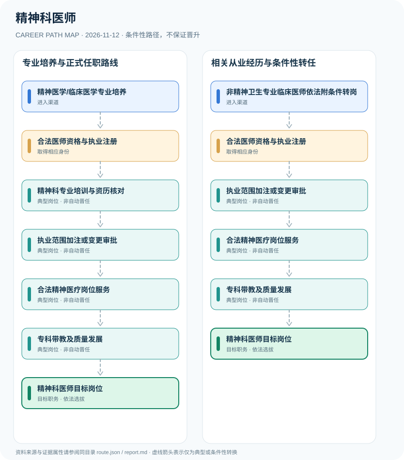

# 精神科医师

> **B18 深度职业研究 · JR-158** · 核验日期：2026-11-12 · 中国大陆依法登记精神科诊疗科目的医疗机构；适用2026医师注册规章与2025精神卫生转岗政策

## 01 现行制度与职业身份

精神科医师必须依法具有适用临床或中医类别医师资格并完成对应执业范围注册，医疗机构亦应有精神科或精神心理相关诊疗科目。除了精神医学专业培养，2025年国家卫健委推出符合条件的既有医师附条件加注精神卫生专业执业范围，2026年湖北、云南、湖南等制定地方实施办法，不能将其误写成任何注册医师可无条件转入精神科。

最重要的2025—2026政策变化是符合条件的其他临床医师可申请附条件加注精神卫生专业。国家通知与湖北2026实施细则显示，这项转岗必须审核现有执业范围、培训、医院科目和实际精神临床工作，不能只凭证书宣称能独立行医。

## 02 两种进入渠道

- **精神医学/临床医学专业培养**：完成相应医学教育和医师资格考试，经合法注册并按医院要求参加精神科专业培养和岗位考核。
- **非精神卫生专业临床医师依法附条件转岗**：已有符合规定的临床或中医类别执业医师，可按2025国家通知及当地2026实施细则申请加注或变更精神卫生执业范围。

## 03 职业路线与决定性环节

### 路径 1：专业培养与正式任职路线

完成相应医学教育和医师资格考试，经合法注册并按医院要求参加精神科专业培养和岗位考核。

**条件性链条**：精神医学/临床医学专业培养 → 合法医师资格与执业注册 → 精神科专业培训与资历核对 → 执业范围加注或变更审批 → 合法精神医疗岗位服务 → 专科带教及质量发展 → 精神科医师目标岗位

各节点转换均需单独满足资格、岗位空缺、考核及组织任命要求。

### 路径 2：相关从业经历与条件性转任

已有符合规定的临床或中医类别执业医师，可按2025国家通知及当地2026实施细则申请加注或变更精神卫生执业范围。

**条件性链条**：非精神卫生专业临床医师依法附条件转岗 → 合法医师资格与执业注册 → 执业范围加注或变更审批 → 合法精神医疗岗位服务 → 专科带教及质量发展 → 精神科医师目标岗位

各节点转换均需单独满足资格、岗位空缺、考核及组织任命要求。

## 04 职业任务及专业能力

能力涵盖精神障碍相关临床评估、医学伦理、隐私保护、多学科协作和患者知情同意；具体诊疗应依实际执业范围与医院规范。

- **合法医师资格与执业注册**：按2026修订《医师执业注册管理办法》确认执业证、地点及范围，未经注册不得独立从事医师诊疗。
- **精神科专业培训与资历核对**：核查精神科住培或政策允许的转岗培训/学历条件，湖北等地方加注还有机构及临床实践要求。
- **执业范围加注或变更审批**：由主管卫生行政机关按适用制度办理精神卫生专业范围注册，医院必须具备相应合法科目。
- **合法精神医疗岗位服务**：在执业范围和医院授权内开展精神卫生评估、诊疗和转诊，尊重患者权利及保密义务。
- **专科带教及质量发展**：通过临床质量、学术训练和医院岗位考核承担专业骨干职责，职称与医院领导职务另行评定。

## 05 法规、规范和真实岗位证据

- 2026年修订《医师执业注册管理办法》规定取得有效医师执业注册证书是执业前提。
- 2025年国家卫健委国卫办医政发〔2025〕4号允许符合条件的既有医师附条件加注精神卫生专业执业范围，需单位同意和主管机关注册。
- 湖北省2026年实施细则明确已注册范围、医疗机构科目与专业培训等条件；不能套用至其他省份。

## 06 适用边界与不确定性

- 附条件加注不是对所有医师自动开放的第二执业范围，部分地区另有时限或培训规定。
- 精神科医生、心理咨询师、精神科护士及临床心理治疗人员是不同身份。
- 本报告是职业研究，不提供患者诊断、精神药物用法或医疗处置建议。

## 07 全路径证据台账

每个节点的 `source_ids` 由 `route.json` 中可核查的法律、部门文件或岗位招聘支持，转换边统一采用 `conditional`，不创造自动晋升。发布日期与施行日期独立核验。

| 前置节点 | 后续节点 | 证据属性 | 适用限制 |
|---|---|---|---|
| 精神医学/临床医学专业培养 | 合法医师资格与执业注册 | `conditional` | 从「精神医学/临床医学专业培养」到「合法医师资格与执业注册」须独立满足招聘、资格、合规及组织任职要求，不能视为自动晋升。 |
| 合法医师资格与执业注册 | 精神科专业培训与资历核对 | `conditional` | 从「合法医师资格与执业注册」到「精神科专业培训与资历核对」须独立满足招聘、资格、合规及组织任职要求，不能视为自动晋升。 |
| 精神科专业培训与资历核对 | 执业范围加注或变更审批 | `conditional` | 从「精神科专业培训与资历核对」到「执业范围加注或变更审批」须独立满足招聘、资格、合规及组织任职要求，不能视为自动晋升。 |
| 执业范围加注或变更审批 | 合法精神医疗岗位服务 | `conditional` | 从「执业范围加注或变更审批」到「合法精神医疗岗位服务」须独立满足招聘、资格、合规及组织任职要求，不能视为自动晋升。 |
| 合法精神医疗岗位服务 | 专科带教及质量发展 | `conditional` | 从「合法精神医疗岗位服务」到「专科带教及质量发展」须独立满足招聘、资格、合规及组织任职要求，不能视为自动晋升。 |
| 专科带教及质量发展 | 精神科医师目标岗位 | `conditional` | 从「专科带教及质量发展」到「精神科医师目标岗位」须独立满足招聘、资格、合规及组织任职要求，不能视为自动晋升。 |
| 非精神卫生专业临床医师依法附条件转岗 | 合法医师资格与执业注册 | `conditional` | 从「非精神卫生专业临床医师依法附条件转岗」到「合法医师资格与执业注册」须独立满足招聘、资格、合规及组织任职要求，不能视为自动晋升。 |
| 合法医师资格与执业注册 | 执业范围加注或变更审批 | `conditional` | 从「合法医师资格与执业注册」到「执业范围加注或变更审批」须独立满足招聘、资格、合规及组织任职要求，不能视为自动晋升。 |

## 08 来源原文、发布机构及日期

1. **中华人民共和国司法部**：[医师执业注册管理办法（2026年修订）](https://www.moj.gov.cn/pub/sfbgw/flfggz/flfggzbmgz/202608/t20260819_538650.html)，文件日期 2026-06-05。
2. **山西省卫生健康委员会（转载国家卫健委）**：[关于开展医疗机构医师附条件注册精神卫生专业执业范围有关工作的通知](https://wjw.shanxi.gov.cn/tzgg/sjzcwj/202504/t20250407_9803751.shtml)，文件日期 2025-03-25。
3. **湖北省卫生健康委员会**：[湖北省医疗机构医师附条件注册精神卫生专业执业范围实施方案（试行）](https://wjw.hubei.gov.cn/norms/202606/t20260616_5959278.shtml)，文件日期 2026-04-20。
4. **北京市卫生健康委员会**：[中华人民共和国医师法](https://wjw.beijing.gov.cn/zwgk_20040/zcwj2022/flfg/202304/t20230407_2992842.html)，文件日期 2021-08-20。

> 不把学历或职称证书等同于行政任职，也不将单位或产品标准说成个人执业许可；具体招聘必须再查当年最新公告。
