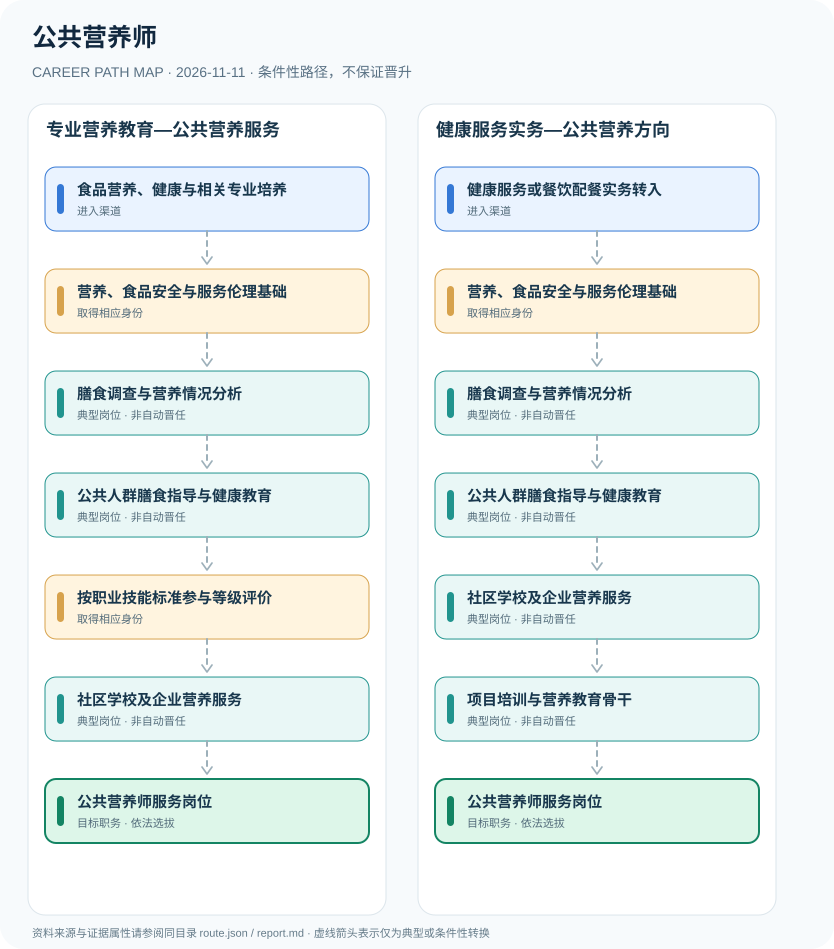

# 公共营养师

> **B15 深度研究 · JR-162**　｜　**地域与机构**：中国大陆·公共营养与健康管理服务岗位；不等同于医院临床营养医师　｜　**核验日期**：2026-11-11

## 01 职业定位与现行制度版本

公共营养师为职业分类体系中的营养指导与健康服务职业，2021年国家职业技能标准将职业活动和等级能力分为四级/中级工至一级/高级技师。职业技能等级评价并非医生执业许可；不能依公共营养师证独立实施医疗诊断、开具医疗处方或冒用注册医师身份。

**与旧资料区分**：公共营养师有2021年国家职业技能标准，但不代表所有“公共营养师培训证”都属于国家统一准入类职业资格。需查具体评价机构资质及技能等级信息；2026年仍应以现行官方目录核实职业资格类别。

## 02 两类准入及真实制度门槛

- **食品营养、健康与相关专业培养**：从营养学、食品科学、公共卫生或健康管理等专业学习人体营养、膳食指导和食品卫生基础。
- **健康服务或餐饮配餐实务转入**：已有公共健康、餐饮配餐、社会服务与食育经验者可按职业标准核查相应培训和评价条件。

- 公共营养师国家职业技能标准（2021年版）职业编码4-14-02-01，将本职业分为四级（中级工）、三级（高级工）、二级（技师）、一级（高级技师）。
- 国家职业技能标准是能力与培训评价依据，不等于卫生健康行政部门的医师执业许可。
- 《中华人民共和国医师法》对诊疗活动从业资格有明确要求；公共营养师不是临床医师或具独立诊疗权的医护职业。
- 中国居民膳食指南可作为公共营养健康教育的科学参考，但个体疾病营养治疗应遵医嘱或转诊。

## 03 典型发展路线及任职决定点

### 路线1：专业营养教育—公共营养服务

通过营养专业培养掌握调查和一般膳食指导知识，参与等级评价与公共服务项目。

**条件性节点**：食品营养、健康与相关专业培养 → 营养、食品安全与服务伦理基础 → 膳食调查与营养情况分析 → 公共人群膳食指导与健康教育 → 按职业技能标准参与等级评价 → 社区学校及企业营养服务 → 公共营养师服务岗位

应在每次考试、身份取得、聘用、晋升或岗位任命时重新审核条件；不能把这条示意路径当作法律规定的必然晋升链条。

### 路线2：健康服务实务—公共营养方向

从健康服务和餐饮营养实践积累相关能力，再通过合适的技能评价和服务项目承担职业任务。

**条件性节点**：健康服务或餐饮配餐实务转入 → 营养、食品安全与服务伦理基础 → 膳食调查与营养情况分析 → 公共人群膳食指导与健康教育 → 社区学校及企业营养服务 → 项目培训与营养教育骨干 → 公共营养师服务岗位

应在每次考试、身份取得、聘用、晋升或岗位任命时重新审核条件；不能把这条示意路径当作法律规定的必然晋升链条。

## 04 工作职责、核心能力与评价方式

可评估膳食调查数据质量、食育课程完成度、健康教育接受度及合规服务满意度，开发透明可核验的通用营养指导。需要医学诊断或疾病处方时交由具资质的医务人员处理。

- **营养、食品安全与服务伦理基础**：掌握营养学基础、膳食调查、食物成分、饮食安全及个体差异，识别有临床风险的服务边界。
- **膳食调查与营养情况分析**：基于知情同意开展食物摄入与一般营养状况分析，使用可靠信息并合理提示不确定性。
- **公共人群膳食指导与健康教育**：依据适用膳食指南提供一般饮食教育、配餐建议和健康促进活动，不替代临床治疗。
- **按职业技能标准参与等级评价**：如需职业技能等级证明，可按评价机构要求报考相应技能级别；等级证与医疗职业准入分开。
- **社区学校及企业营养服务**：根据雇主岗位在社会健康、校园、养老或企业食育服务中开展合规营养支持。
- **项目培训与营养教育骨干**：在机构招聘和服务质量考核允许时承担课程、项目和团队管理职责，不自动升任医生或卫生行政领导。

## 05 适用边界、时效与容易混淆的身份

- 各技能评价机构的报名条件、证书样式、社会认可度与岗位招聘条件可能不同，不能承诺全国统一考试必然通过或证书直接保证工作。
- 有营养相关专业学位不等于医生执业资格；医院临床营养医师岗位和公共营养师服务有边界。
- 公共健康教育不得以未经验证的治疗承诺、极端饮食或替代医疗方式宣传效果。

## 06 证据台账与图谱解释

规范性文件、机构职责和招聘公告分别记录在 `route.json` 的 `sources` 中，并由岗位节点使用 `source_ids` 引用。所有边标记为 `conditional`（条件性转换），**不得因来源中存在某项资格就推定本人必获后续岗位**。若需要标注法律明确规定的资格，应在研究说明中具体引用相关条款，而不能把一个推测性职位转换伪装成 `normative`。

| 转换前 | 转换后 | 证据类型 | 约束说明 |
|---|---|---|---|
| 食品营养、健康与相关专业培养 | 营养、食品安全与服务伦理基础 | `conditional` | 从「食品营养、健康与相关专业培养」到「营养、食品安全与服务伦理基础」须独立满足资格、岗位要求及考试或组织安排；示意路线不构成保证晋任。 |
| 营养、食品安全与服务伦理基础 | 膳食调查与营养情况分析 | `conditional` | 从「营养、食品安全与服务伦理基础」到「膳食调查与营养情况分析」须独立满足资格、岗位要求及考试或组织安排；示意路线不构成保证晋任。 |
| 膳食调查与营养情况分析 | 公共人群膳食指导与健康教育 | `conditional` | 从「膳食调查与营养情况分析」到「公共人群膳食指导与健康教育」须独立满足资格、岗位要求及考试或组织安排；示意路线不构成保证晋任。 |
| 公共人群膳食指导与健康教育 | 按职业技能标准参与等级评价 | `conditional` | 从「公共人群膳食指导与健康教育」到「按职业技能标准参与等级评价」须独立满足资格、岗位要求及考试或组织安排；示意路线不构成保证晋任。 |
| 按职业技能标准参与等级评价 | 社区学校及企业营养服务 | `conditional` | 从「按职业技能标准参与等级评价」到「社区学校及企业营养服务」须独立满足资格、岗位要求及考试或组织安排；示意路线不构成保证晋任。 |
| 社区学校及企业营养服务 | 公共营养师服务岗位 | `conditional` | 从「社区学校及企业营养服务」到「公共营养师服务岗位」须独立满足资格、岗位要求及考试或组织安排；示意路线不构成保证晋任。 |
| 健康服务或餐饮配餐实务转入 | 营养、食品安全与服务伦理基础 | `conditional` | 从「健康服务或餐饮配餐实务转入」到「营养、食品安全与服务伦理基础」须独立满足资格、岗位要求及考试或组织安排；示意路线不构成保证晋任。 |
| 公共人群膳食指导与健康教育 | 社区学校及企业营养服务 | `conditional` | 从「公共人群膳食指导与健康教育」到「社区学校及企业营养服务」须独立满足资格、岗位要求及考试或组织安排；示意路线不构成保证晋任。 |
| 社区学校及企业营养服务 | 项目培训与营养教育骨干 | `conditional` | 从「社区学校及企业营养服务」到「项目培训与营养教育骨干」须独立满足资格、岗位要求及考试或组织安排；示意路线不构成保证晋任。 |
| 项目培训与营养教育骨干 | 公共营养师服务岗位 | `conditional` | 从「项目培训与营养教育骨干」到「公共营养师服务岗位」须独立满足资格、岗位要求及考试或组织安排；示意路线不构成保证晋任。 |

## 07 官方与公开资料（可追溯）

1. [公共营养师国家职业技能标准（2021年版）](https://www.mohrss.gov.cn/xxgk2020/fdzdgknr/qt/fzcwjxx/202112/W020211227599132291203.pdf) — 人力资源和社会保障部；来源原始日期 2021-12-02。
2. [国家卫健委2022年6月新闻发布会：《中国居民膳食指南（2022）》介绍](https://www.nhc.gov.cn/xcs/c100122/202206/d4941efa5d6544e2abac68127c3238c0.shtml) — 国家卫生健康委员会；来源原始日期 2022-06-27。
3. [中华人民共和国医师法](https://wjw.beijing.gov.cn/zwgk_20040/zcwj2022/flfg/202304/t20230407_2992842.html) — 北京市卫生健康委员会；来源原始日期 2021-08-20。

> **复核协议**：跨年度招生公告、法律修订、专业等级与机构设置可能变化。实际申请和转岗前，须核对当前官方原文、所在地文件及单位职位要求，尤其注意来源发布日期与生效日期未必一致。
