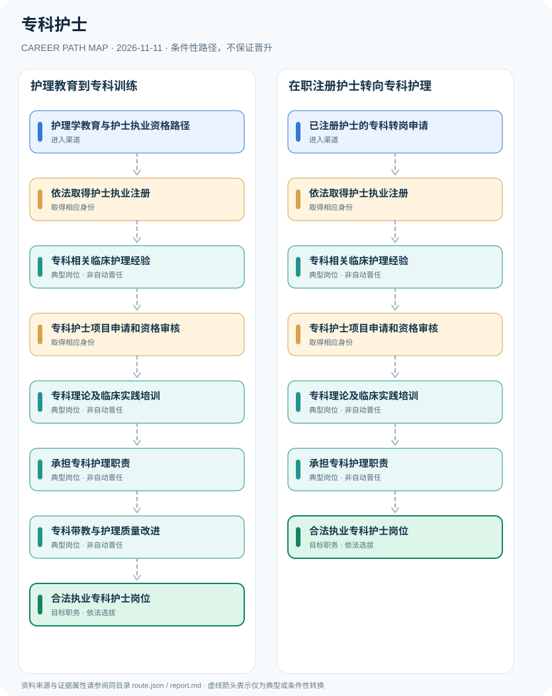

# 专科护士

> **B14 深度研究 · JR-160** · **适用范围**：中国大陆医疗机构；四川及内蒙古2026专科护士培训为地方实例 · **官方资料核验日期**：2026-11-11

## 研究摘要与制度性质

专科护士首先是依法注册的护士，再按医疗机构或护理学会培训计划发展某一专科临床技能。护士执业注册是法定准入，专科护士培训合格证明通常并非全国单一新增的护士执业许可证，职位安排与高级职称另经聘任评审。

护士法定准入和专科继续教育有两种制度基础：前者依行政法规及注册管理办法，后者依据专科培训基地和医院实际管理。不同专科和地区的工作经历门槛不同，不能写成全国统一三年。

## 一、入职渠道与资格核验

- **护理学教育与护士执业资格路径**：完成符合国家规定的护理教育并满足护士执业资格条件的申请人，依法参加资格考核和注册。
- **已注册护士的专科转岗申请**：在临床岗位依法执业的注册护士，经专科经验和机构培训选拔，可以申请专科护士培养项目。

## 二、两种职业发展路线

### 路线 1：护理教育到专科训练

从护理教育及注册取得合法护理身份，积累临床专科实践后接受专科培训和岗位安排。

**节点序列**：护理学教育与护士执业资格路径 → 依法取得护士执业注册 → 专科相关临床护理经验 → 专科护士项目申请和资格审核 → 专科理论及临床实践培训 → 承担专科护理职责 → 专科带教与护理质量改进 → 合法执业专科护士岗位

**任用边界**：本路线是一种合理的条件性发展关系；不因完成上一个岗位或取得某张证书自动获得下一个岗位。

### 路线 2：在职注册护士转向专科护理

已有护士执业资格者经专科经验和培训选拔，进一步发展专科护理能力。

**节点序列**：已注册护士的专科转岗申请 → 依法取得护士执业注册 → 专科相关临床护理经验 → 专科护士项目申请和资格审核 → 专科理论及临床实践培训 → 承担专科护理职责 → 合法执业专科护士岗位

**任用边界**：本路线是一种合理的条件性发展关系；不因完成上一个岗位或取得某张证书自动获得下一个岗位。

## 三、岗位职责与长期成长

护理实践强调围术期安全、重症监护、专科护理评估、沟通和循证质量改进。后续担任专科带教老师或护士长需符合医院实际岗位资格和人员管理程序。

- **依法取得护士执业注册**：注册并领取护士执业证后方可开展依法规定的护理活动；注册地点和有效状态需要核验。
- **专科相关临床护理经验**：根据目标专科积累围术期、重症、老年、康复等实际临床护理与患者安全能力。
- **专科护士项目申请和资格审核**：例如内蒙古2026培训要求已具护士执业资质、护师资格、相关工作经验等；不是全国统一年限。
- **专科理论及临床实践培训**：根据目标护理专业接受理论学习、实践训练、技能评估与考核，培训时长按基地安排。
- **承担专科护理职责**：在所在医疗机构授权和能力范围开展专科护理，依法遵守医疗质量及感染防控。
- **专科带教与护理质量改进**：通过病例管理、质量项目和带教发展专业能力，医院岗位聘任与护理职称另审。

## 四、正式政策、准入门槛及制度区分

- 《护士条例》规定护士是经执业注册取得护士执业证书而依法从事护理活动的卫生技术人员。
- 《护士执业注册管理办法》2021年修订版规定未经注册不得从事诊疗技术规范规定的护理活动。
- 内蒙古2026年专科培训招生对个别项目要求已有护士执业资质、专科以上学历、护师及以上专业技术资格和至少3年相关专科工作经历；这仅为地方培训项目条件。

## 五、时效、地区和身份风险

- 国家并未因某护理培训班而统一增加一张名为“专科护士执业证”的法定医护准入许可证。
- 医疗护理员属于辅助照护岗位，不是护士，不能把医疗护理员培训替代护士执业注册。
- 专科培训证书、医院专科护士岗位及副主任护师职称由不同程序决定。

## 六、证据台账（图谱边）

每个转换都按 `conditional` 处理。法规和官方说明作为**节点依据**记入 `route.json` 的 `source_ids`；条件性箭头不代表法律保证、实际个人履历或确定晋升路径。任何法规变更均应同时更新数据与解释文本。

| 从 | 至 | 证据性质 | 适用限制 |
|---|---|---|---|
| 护理学教育与护士执业资格路径 | 依法取得护士执业注册 | conditional | 从「护理学教育与护士执业资格路径」发展至「依法取得护士执业注册」须独立满足职位、资格、考核及组织聘任要求，不能视为自动升级。 |
| 依法取得护士执业注册 | 专科相关临床护理经验 | conditional | 从「依法取得护士执业注册」发展至「专科相关临床护理经验」须独立满足职位、资格、考核及组织聘任要求，不能视为自动升级。 |
| 专科相关临床护理经验 | 专科护士项目申请和资格审核 | conditional | 从「专科相关临床护理经验」发展至「专科护士项目申请和资格审核」须独立满足职位、资格、考核及组织聘任要求，不能视为自动升级。 |
| 专科护士项目申请和资格审核 | 专科理论及临床实践培训 | conditional | 从「专科护士项目申请和资格审核」发展至「专科理论及临床实践培训」须独立满足职位、资格、考核及组织聘任要求，不能视为自动升级。 |
| 专科理论及临床实践培训 | 承担专科护理职责 | conditional | 从「专科理论及临床实践培训」发展至「承担专科护理职责」须独立满足职位、资格、考核及组织聘任要求，不能视为自动升级。 |
| 承担专科护理职责 | 专科带教与护理质量改进 | conditional | 从「承担专科护理职责」发展至「专科带教与护理质量改进」须独立满足职位、资格、考核及组织聘任要求，不能视为自动升级。 |
| 专科带教与护理质量改进 | 合法执业专科护士岗位 | conditional | 从「专科带教与护理质量改进」发展至「合法执业专科护士岗位」须独立满足职位、资格、考核及组织聘任要求，不能视为自动升级。 |
| 已注册护士的专科转岗申请 | 依法取得护士执业注册 | conditional | 从「已注册护士的专科转岗申请」发展至「依法取得护士执业注册」须独立满足职位、资格、考核及组织聘任要求，不能视为自动升级。 |
| 承担专科护理职责 | 合法执业专科护士岗位 | conditional | 从「承担专科护理职责」发展至「合法执业专科护士岗位」须独立满足职位、资格、考核及组织聘任要求，不能视为自动升级。 |

## 七、可核对来源（含发布日期）

1. **国家行政法规库**：[护士条例（国务院令第517号，含2020年修正）](https://xzfg.moj.gov.cn/front/law/detail?LawID=1054)，原始发布日期 2008-01-31。
2. **中华人民共和国司法部**：[护士执业注册管理办法（2021年修订）](https://www.moj.gov.cn/pub/sfbgw/flfggz/flfggzbmgz/202104/t20210416_356323.html)，原始发布日期 2021-01-08。
3. **国家卫生健康委员会**：[全国护理工作发展情况](https://www.nhc.gov.cn/yzygj/c100067/202605/8aafad1f58fa4f3f8be13ac94be061fa.shtml)，原始发布日期 2026-05-11。
4. **内蒙古自治区人民医院**：[内蒙古自治区护理学会2026年度第二期专科护士培训班招生简章](https://www.nmgyy.cn/info/5552.html)，原始发布日期 2026-08-11。

> **复核提醒**：年度岗位招聘及地方制度变化较快，申请前必须重新核验公告原文、适用人群及有效期。本研究仅公开制度与职业路线，不推断个人晋升概率。
