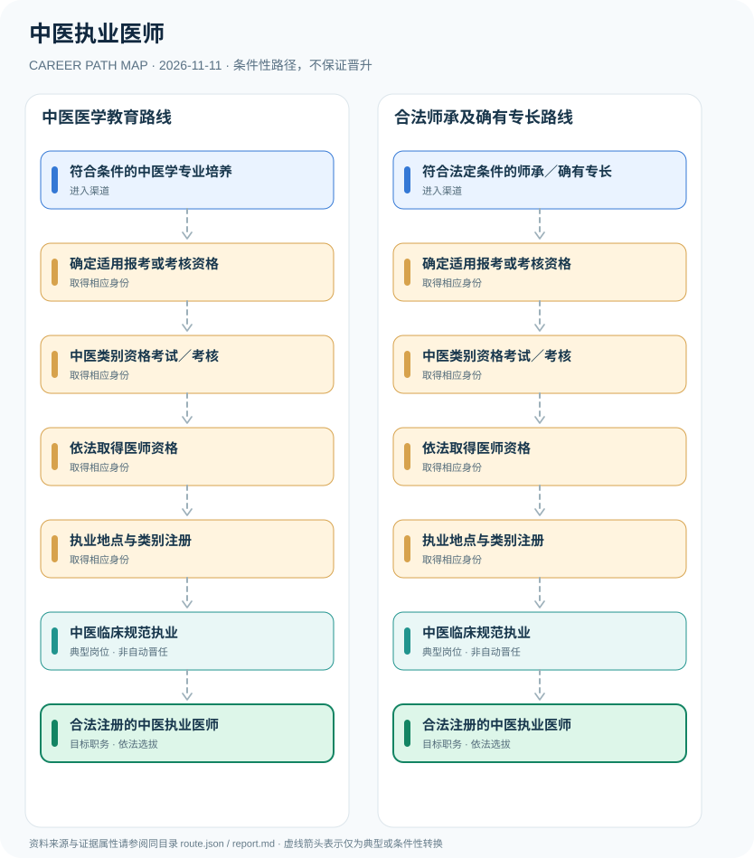

# 中医执业医师

> **批次**：B11 · JR-154 · **适用范围**：中国大陆·中医类别医师执业（含依法允许的师承或确有专长路径） · **核验日期**：2026-11-11

## 执行摘要

中医执业医师须经适用的医师资格取得程序和执业注册后在注册执业类别及范围内执业；医学学历、合法师承途径和一般职业职称不能互相替代。

中医执业医师属于受《医师法》严格准入管理的法定专业身份，与中医相关证书、学位、职称和任职岗位并不等同。

## 一、准入方式及行政／招聘程序

2026年度医师资格考试由国家卫健委发布公告，涉及中医类别规定学历与师承、确有专长等不同群体；各群体准入规则不能由同一泛化年限概括。应以国家医学考试中心与当地考区的正式文件为准。

- **符合条件的中医学专业培养**：经符合条件的相关医学教育及规定的临床实践，核对报考中医类别医师资格条件。
- **符合法定条件的师承／确有专长**：符合中医师承或多年实践确有专长的申请人，应依适用特殊程序和考试／考核规则验证资格。

## 二、常见路线与机构决定点

### 1. 中医医学教育路线

依法完成医学教育与实践后取得适用资格，经注册后成为中医类别执业医师。

**阶段示意**：符合条件的中医学专业培养 → 确定适用报考或考核资格 → 中医类别资格考试／考核 → 依法取得医师资格 → 执业地点与类别注册 → 中医临床规范执业 → 合法注册的中医执业医师

**解释**：上述转换由岗位条件、资格确认、招聘或任用程序控制。即使具有上一阶段经历，也不保证任职下一阶段。

### 2. 合法师承及确有专长路线

特殊路径须满足其独立条件、考试或考核要求以及后续合法注册，不得跳过行政程序。

**阶段示意**：符合法定条件的师承／确有专长 → 确定适用报考或考核资格 → 中医类别资格考试／考核 → 依法取得医师资格 → 执业地点与类别注册 → 中医临床规范执业 → 合法注册的中医执业医师

**解释**：上述转换由岗位条件、资格确认、招聘或任用程序控制。即使具有上一阶段经历，也不保证任职下一阶段。

## 三、关键职责与专业发展

取得资格之后必须完成注册，依法在规定的执业地点、类别和范围内开展医疗活动。继续教育、规范诊疗、医疗安全管理与职称聘任可以是职业发展内容，但不是未注册即可行医的依据。

- **确定适用报考或考核资格**：根据学历、专业、实践或特殊师承类别核实考核方式和有效报考资格。
- **中医类别资格考试／考核**：完成所适用的医师资格考试或法定考核流程，取得相应资格；助理资格与执业医师身份不同。
- **依法取得医师资格**：根据考试或考核结论依法取得规定的医师资格，不可直接以学历证书替代。
- **执业地点与类别注册**：按2026年修订的医师执业注册管理办法办理注册并取得执业证书。
- **中医临床规范执业**：在注册类别及执业范围内从事中医临床活动并遵守医疗质量、诊疗规范与职业伦理。

## 四、关键资格、执业条件与区别

- 《中华人民共和国医师法》要求依法取得医师资格并注册才能执业。中医类别与临床、口腔及公共卫生类别应区分。
- 国家卫生健康委2026年考试公告公开了中医类别考试安排；具体受学历、师承、确有专长等适用政策约束。
- 2026年修订《医师执业注册管理办法》明确未经注册取得执业证书不得开展医师执业活动。

## 五、证据分类和路线关系

本图把制度依据和职业经历分开：`normative` 表示有明确法规支持的规则，`official_description` 表示官方公开职责，`illustrative` 代表示意经历，`conditional` 代表资格、招聘、考核或任用控制的转换。本研究**不会把职业图谱中的箭头写成保证晋升**；全图边均显式标为条件性职业转换。职业身份、岗位层级、职称、行政职级和证书不可互换。

| 转换关系 | 证据分类 | 约束说明 |
|:--|:--|:--|
| 符合条件的中医学专业培养 → 确定适用报考或考核资格 | `conditional` | 从「符合条件的中医学专业培养」转向「确定适用报考或考核资格」须依本岗资格、机构要求和实际程序审核；不是任何人的自动晋升。 |
| 确定适用报考或考核资格 → 中医类别资格考试／考核 | `conditional` | 从「确定适用报考或考核资格」转向「中医类别资格考试／考核」须依本岗资格、机构要求和实际程序审核；不是任何人的自动晋升。 |
| 中医类别资格考试／考核 → 依法取得医师资格 | `conditional` | 从「中医类别资格考试／考核」转向「依法取得医师资格」须依本岗资格、机构要求和实际程序审核；不是任何人的自动晋升。 |
| 依法取得医师资格 → 执业地点与类别注册 | `conditional` | 从「依法取得医师资格」转向「执业地点与类别注册」须依本岗资格、机构要求和实际程序审核；不是任何人的自动晋升。 |
| 执业地点与类别注册 → 中医临床规范执业 | `conditional` | 从「执业地点与类别注册」转向「中医临床规范执业」须依本岗资格、机构要求和实际程序审核；不是任何人的自动晋升。 |
| 中医临床规范执业 → 合法注册的中医执业医师 | `conditional` | 从「中医临床规范执业」转向「合法注册的中医执业医师」须依本岗资格、机构要求和实际程序审核；不是任何人的自动晋升。 |
| 符合法定条件的师承／确有专长 → 确定适用报考或考核资格 | `conditional` | 从「符合法定条件的师承／确有专长」转向「确定适用报考或考核资格」须依本岗资格、机构要求和实际程序审核；不是任何人的自动晋升。 |

## 六、适用边界与更新风险

- 中医执业助理医师、仅取得医学学位者、康复师等均不自动等于执业医师。
- 师承或确有专长资格的不同制度路径可能获得不同类别、范围的资格，须逐项核对；本图不提供绕开考试注册的捷径。
- 医院岗位聘任、职称评审与医师资格注册为不同制度，不得混成一条自动晋升线。

## 七、官方和公开核验来源

1. [中华人民共和国医师法](https://wjw.beijing.gov.cn/zwgk_20040/zcwj2022/flfg/202304/t20230407_2992842.html) — 北京市卫生健康委员会（转载全国人大法律），原文日期 2021-08-20。
2. [国家卫生健康委员会医师资格考试委员会2026年第1号公告](https://www.nhc.gov.cn/yzygj/c100067/202601/134520df641b4e99b8f8db7c64abc7f3.shtml) — 国家卫生健康委员会，原文日期 2026-01-26。
3. [医师执业注册管理办法（2026年修订）](https://www.moj.gov.cn/pub/sfbgw/flfggz/flfggzbmgz/202608/t20260819_538650.html) — 中华人民共和国司法部（国家卫健委规章），原文日期 2026-06-05。

> **下一次更新检查**：实际申请时重新查当年岗位计划、地区特殊限制和新规替代情形。个人发展结果不作预测。
