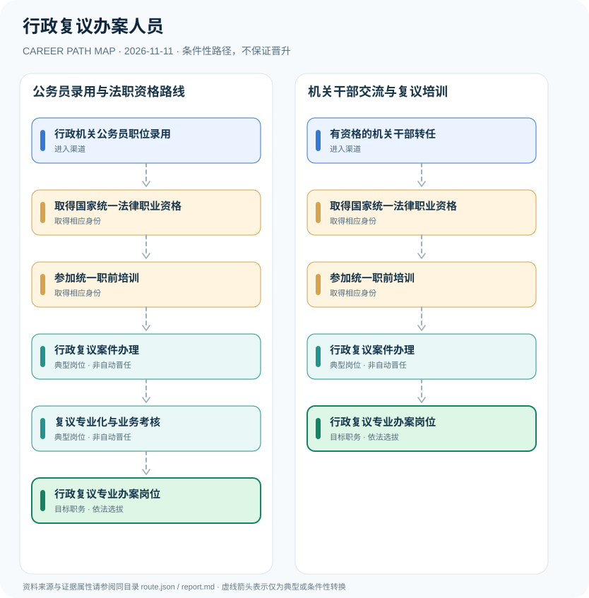

# 行政复议办案人员

> **研究批次** B12 · JR-117　|　**范围**：中国大陆；行政复议机构中首次办理复议工作的人员　|　**核验日期**：2026-11-11

## 摘要与职业定位

2023年修订《行政复议法》第六条明确行政复议机构中初次从事复议工作的人员须取得国家统一法律职业资格并参加统一职前培训；公务员身份、岗位聘任及法律职业资格须区别说明。

**法律关键点**：《行政复议法》第六条不是仅对“建议取得法考资格”，而是对行政复议机构中初次从业人员设置明确的法律职业资格和统一职前培训要求。此前版本的法律文本不能替代2023年修订版。

## 进入职业的合法渠道

- **行政机关公务员职位录用**：按公告报考司法行政或行政复议机构相关公务员职位，资格要求由国家及当地职位表确定。
- **有资格的机关干部转任**：已有合法行政机关任职经历者符合岗位交流规定时可申请交流至复议业务岗位。

## 2 种代表性职业发展路线

### 1. 公务员录用与法职资格路线

通过机关职位录用，按法定要求取得法律职业资格、完成统一职前培训，再参与行政复议办案。

**岗位序列（条件性示意）**：行政机关公务员职位录用 → 取得国家统一法律职业资格 → 参加统一职前培训 → 行政复议案件办理 → 复议专业化与业务考核 → 行政复议专业办案岗位

### 2. 机关干部交流与复议培训

已在机关任职且符合交流条件者依法进入相关岗位，同样不得绕开初次从业人员的法律职业资格和培训要求。

**岗位序列（条件性示意）**：有资格的机关干部转任 → 取得国家统一法律职业资格 → 参加统一职前培训 → 行政复议案件办理 → 行政复议专业办案岗位

## 重要职责、技能和岗位发展

**典型能力方向**：行政法、证据审查、听证、行政争议实质化解、文书写作与行政应诉协调。岗位能否升任科室负责人仍取决于干部管理权限和领导职数，不存在以办案数量自动提任的制度。

- **行政复议案件办理**：在行政复议机构职责范围内办理申请受理、调查取证、听证、文书与决定辅助等工作。
- **复议专业化与业务考核**：持续学习行政争议实质化解、程序保障、行政应诉及业务考核制度。

## 准入门槛与任职规则

- 《中华人民共和国行政复议法》（2023年修订）第六条明确初次从事行政复议工作者须通过国家统一法律职业资格考试取得资格，并参加统一职前培训。
- 复议机构属于依法履行行政复议职责的机关内部机构，不是司法鉴定所或法院。
- 报考公务员、机关内部交流任职和满足复议法专业准入分别审查。

## 证据状态与实际约束

路线图中的箭头均为 `conditional`：即使前一节点的经历成立，后续任用、考试、职业资格、选拔或招聘仍需独立满足制度要求。`normative` 专指法律直接规定的关系，`official_description` 指官方机构说明，`illustrative` 指仅用于理解的示例；具体证据来源链接见下文。

- 2024年前已从业人员、辅助事务人员的具体适用情况不能一概等同首次办案人员，须查其岗位身份和过渡规范。
- 行政复议人员专业化不代表已创设全国统一行政复议员职称晋升等级；各地探索制度应单独标注。
- 行政复议案件审理、调解与行政诉讼具有独立程序，不能把复议办案员描述为法官。

## 可复核原始资料

1. [中华人民共和国行政复议法（2023年修订）](https://www.mee.gov.cn/ywgz/fgbz/fl/202312/t20231205_1058240.shtml)，中华人民共和国生态环境部（转载全国人大法律），2023-09-01。
2. [中华人民共和国公务员法](https://www.stats.gov.cn/gk/tjfg/xgfxfg/202503/t20250310_1958920.html)，国家统计局法规库，2018-12-29。

> **复核提醒**：跨地区、跨机构或新招录年度，必须重新核查原始政策、职位计划及生效状态。此报告不推测晋升概率和个人任职结果。
