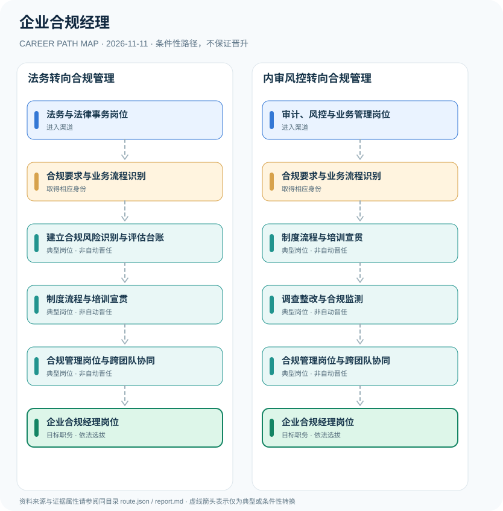

# 企业合规经理

> **批次 B13 · JR-111** · 研究范围：中国大陆·企业内控合规岗位；国资委《中央企业合规管理办法》仅适用于中央企业 · **核验日期 2026-11-11**

## 职业定位与证据边界

企业合规经理是企业内部组织与管理岗位，不是统一的法定执业资格。《中央企业合规管理办法》明确中央企业的合规责任组织体系；GB/T 35770-2022 提供通用合规体系标准，但不能把国资委中央企业规则强加于所有民营企业。

制度核心是**管理体系和责任链**，而不是职业身份自动升级。中央企业的首席合规官等设置属于特定企业监管制度；对于非央企，岗位职责应先检查公司章程、行业监管要求和内部岗位说明。

## 一、两种主要职业进入方向

- **法务与法律事务岗位**：从企业法务、法律研究或相关职业经验转入企业合规业务，了解适用法律与组织职责。
- **审计、风控与业务管理岗位**：从内审、风险管理、财务合规或业务运营工作积累风险识别与控制实践。

## 二、典型发展路线与适用条件

### 1. 法务转向合规管理

法律事务人员熟悉公司监管义务、风险台账与流程内控后进入综合合规管理岗位。

**路线图**：法务与法律事务岗位 → 合规要求与业务流程识别 → 建立合规风险识别与评估台账 → 制度流程与培训宣贯 → 合规管理岗位与跨团队协同 → 企业合规经理岗位

以上各岗位转换均受任用、选拔、执业资格或招聘控制，不构成保证晋升的链条。

### 2. 内审风控转向合规管理

通过内部审计和风险管控背景，积累违规调查、整改及跨部门协调能力。

**路线图**：审计、风控与业务管理岗位 → 合规要求与业务流程识别 → 制度流程与培训宣贯 → 调查整改与合规监测 → 合规管理岗位与跨团队协同 → 企业合规经理岗位

以上各岗位转换均受任用、选拔、执业资格或招聘控制，不构成保证晋升的链条。

## 三、岗位职责与专业发展能力

可量化成果包括合规风险清单更新、风险控制有效性、第三方尽职调查、员工培训覆盖、违规整改闭环。更高层级合规管理岗位仍取决于企业组织结构与聘用。

- **合规要求与业务流程识别**：识别法律、监管、行业准则与公司制度要求；辨别适用中央企业的专门规定和一般企业标准。
- **建立合规风险识别与评估台账**：对业务场景开展合规风险识别、政策冲突分析和责任分工，形成可追溯评估结论。
- **制度流程与培训宣贯**：设置合规审查流程、举报处理、员工培训和定期检查机制，推动合规责任落实。
- **调查整改与合规监测**：对违规线索及控制缺陷进行复盘、整改跟踪并向适当治理层汇报，保持合法保密。
- **合规管理岗位与跨团队协同**：在企业聘用与组织授权下牵头合规体系建设，领导职务须由雇主任命而不是取得标准证书。

## 四、现行法规、任职资格及关键区别

- 国资委令第42号《中央企业合规管理办法》自2022年10月1日起施行，适用范围为国资委监管的中央企业。
- GB/T 35770-2022《合规管理体系 要求及使用指南》属国家推荐性标准，等同采用ISO 37301:2021，不是个人执业许可。
- 具体企业是否设首席合规官、合规经理、总法律顾问等岗位，由其法律适用、企业治理与管理制度决定。

## 五、法律与数据风险提示

- 企业合规经理不等于执业律师、司法鉴定人或监管机关行政人员。
- 中央企业强制规则、上市公司监管要求和民营企业内部合规政策的适用范围不同。
- 不能把企业内部员工职位、专业证书与监管部门的行政执法权混同。

## 六、证据分类和引用对应

**职业路径中所有转换为 `conditional`：满足条件时才可能发生。** `normative` 指法律明确规定的权利或义务；`official_description` 指官方发布的岗位事实；`illustrative` 只代表一种合理的示例经历。本报告不混淆行政领导职务、职级、执业资格、技术等级和雇主自行定义的岗位。

| 图中转换 | 证据属性 | 解释 |
|---|---|---|
| 法务与法律事务岗位 → 合规要求与业务流程识别 | conditional | 从「法务与法律事务岗位」到「合规要求与业务流程识别」取决于对应资格、空缺职位或机构选任，不是必然晋升。 |
| 合规要求与业务流程识别 → 建立合规风险识别与评估台账 | conditional | 从「合规要求与业务流程识别」到「建立合规风险识别与评估台账」取决于对应资格、空缺职位或机构选任，不是必然晋升。 |
| 建立合规风险识别与评估台账 → 制度流程与培训宣贯 | conditional | 从「建立合规风险识别与评估台账」到「制度流程与培训宣贯」取决于对应资格、空缺职位或机构选任，不是必然晋升。 |
| 制度流程与培训宣贯 → 合规管理岗位与跨团队协同 | conditional | 从「制度流程与培训宣贯」到「合规管理岗位与跨团队协同」取决于对应资格、空缺职位或机构选任，不是必然晋升。 |
| 合规管理岗位与跨团队协同 → 企业合规经理岗位 | conditional | 从「合规管理岗位与跨团队协同」到「企业合规经理岗位」取决于对应资格、空缺职位或机构选任，不是必然晋升。 |
| 审计、风控与业务管理岗位 → 合规要求与业务流程识别 | conditional | 从「审计、风控与业务管理岗位」到「合规要求与业务流程识别」取决于对应资格、空缺职位或机构选任，不是必然晋升。 |
| 合规要求与业务流程识别 → 制度流程与培训宣贯 | conditional | 从「合规要求与业务流程识别」到「制度流程与培训宣贯」取决于对应资格、空缺职位或机构选任，不是必然晋升。 |
| 制度流程与培训宣贯 → 调查整改与合规监测 | conditional | 从「制度流程与培训宣贯」到「调查整改与合规监测」取决于对应资格、空缺职位或机构选任，不是必然晋升。 |
| 调查整改与合规监测 → 合规管理岗位与跨团队协同 | conditional | 从「调查整改与合规监测」到「合规管理岗位与跨团队协同」取决于对应资格、空缺职位或机构选任，不是必然晋升。 |

## 七、官方和公开参考资料

1. [中央企业合规管理办法（国资委令第42号）](https://wap.sasac.gov.cn/n2588035/n2588320/n2588335/c26018430/content.html) — 国务院国资委（发布日期 2022-08-23）
2. [GB/T 35770-2022 合规管理体系 要求及使用指南](https://std.samr.gov.cn/gb/search/gbDetailedCNF?id=EB58F4DA9034B2A2E05397BE0A0A7D33) — 全国标准信息公共服务平台（发布日期 2022-10-12）

> 资料只反映所列地域、法规和核验日期的公开信息。报名、岗位计划或法规发生变化时，必须重新核对原文，不能沿用过时条件。
