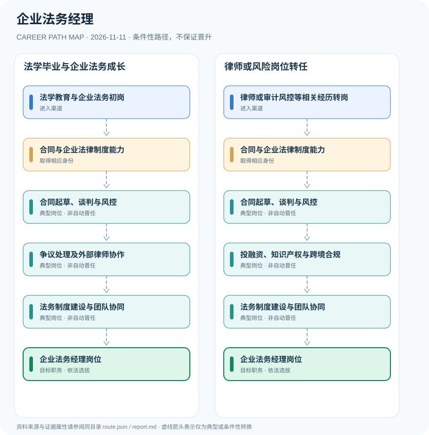

# 企业法务经理

> **B14 深度研究 · JR-110** · **适用范围**：中国大陆各类企业；以海尔2026年11月公开招聘为岗位样例 · **官方资料核验日期**：2026-11-11

## 研究摘要与制度性质

企业法务经理是企业设立的内部法务职位，并非政府统一发证的执业资格；企业法律顾问准入类职业资格已于2014年取消。法学教育、合同法务经验或律师执业经历有助于招聘，但法考证书是否被要求须以具体岗位为准。

从公开职位招聘和三部委通知可见，企业法务经理首先是雇主岗位。海尔新能源平台2026年11月的招聘属于具体个案，其中学历、语言能力、经验要求不能强加给全国同行业企业。

## 一、入职渠道与资格核验

- **法学教育与企业法务初岗**：通过法学教育进入企业法务助理、合同审核、法律事务等初级岗位，积累企业经营法律基础。
- **律师或审计风控等相关经历转岗**：具备执业律师或内控风险相关工作背景者，可依据具体企业招聘要求转向企业内部法务。

## 二、两种职业发展路线

### 路线 1：法学毕业与企业法务成长

从企业法务助理起，通过合同审核、争议管理与组织能力成长应聘法务经理。

**节点序列**：法学教育与企业法务初岗 → 合同与企业法律制度能力 → 合同起草、谈判与风控 → 争议处理及外部律师协作 → 法务制度建设与团队协同 → 企业法务经理岗位

**任用边界**：本路线是一种合理的条件性发展关系；不因完成上一个岗位或取得某张证书自动获得下一个岗位。

### 路线 2：律师或风险岗位转任

具有相关律师及风险管理背景的人士，经雇主招聘开展交易、争议与跨境法律事务再任经理。

**节点序列**：律师或审计风控等相关经历转岗 → 合同与企业法律制度能力 → 合同起草、谈判与风控 → 投融资、知识产权与跨境合规 → 法务制度建设与团队协同 → 企业法务经理岗位

**任用边界**：本路线是一种合理的条件性发展关系；不因完成上一个岗位或取得某张证书自动获得下一个岗位。

## 三、岗位职责与长期成长

可通过合同争议损失、合同审核周期、交易谈判支持、诉讼证据管理和跨境项目合规质量检验工作成果。资深法务向法务负责人发展依赖企业组织结构，不是法考证书自动换取管理岗位。

- **合同与企业法律制度能力**：掌握民商事交易、合同审核与公司治理基本知识，并持续核对当前监管要求。
- **合同起草、谈判与风控**：参与销售采购、投资和技术合同审查及合同模板管理，形成风险提示和业务解决方案。
- **争议处理及外部律师协作**：协调诉讼仲裁、法律顾问资源和证据管理；企业雇员不因此自动具有独立律师执业身份。
- **投融资、知识产权与跨境合规**：根据业务范围参与涉外投融资、知识产权、数据合规和境外法律风险控制。
- **法务制度建设与团队协同**：负责合同与争议流程、外部律师预算及法务团队协作，经理职位由企业依法聘任。

## 四、正式政策、准入门槛及制度区分

- 人社部、国资委和司法部2014年通知确认国务院已取消企业法律顾问准入类职业资格，旧证书不再实行注册管理。
- 海尔2026年11月法务经理公开职位要求法律专业、相关工作经历，司法考试通过者列为优先项，而非岗位绝对法定资格。
- 内部法务岗位、律师执业资格、法律职业资格及公司高管职位四者各自独立。

## 五、时效、地区和身份风险

- 不能将2014年已取消的企业法律顾问准入类职业资格仍描述为2026年统一必考证书。
- 若具体工作涉及依法由执业律师办理的业务，企业法务需要与律师及合规主体分别履行职责。
- 国有企业总法律顾问制度属于特定企业治理安排，不推断所有企业法务经理必然成为总法律顾问。

## 六、证据台账（图谱边）

每个转换都按 `conditional` 处理。法规和官方说明作为**节点依据**记入 `route.json` 的 `source_ids`；条件性箭头不代表法律保证、实际个人履历或确定晋升路径。任何法规变更均应同时更新数据与解释文本。

| 从 | 至 | 证据性质 | 适用限制 |
|---|---|---|---|
| 法学教育与企业法务初岗 | 合同与企业法律制度能力 | conditional | 从「法学教育与企业法务初岗」发展至「合同与企业法律制度能力」须独立满足职位、资格、考核及组织聘任要求，不能视为自动升级。 |
| 合同与企业法律制度能力 | 合同起草、谈判与风控 | conditional | 从「合同与企业法律制度能力」发展至「合同起草、谈判与风控」须独立满足职位、资格、考核及组织聘任要求，不能视为自动升级。 |
| 合同起草、谈判与风控 | 争议处理及外部律师协作 | conditional | 从「合同起草、谈判与风控」发展至「争议处理及外部律师协作」须独立满足职位、资格、考核及组织聘任要求，不能视为自动升级。 |
| 争议处理及外部律师协作 | 法务制度建设与团队协同 | conditional | 从「争议处理及外部律师协作」发展至「法务制度建设与团队协同」须独立满足职位、资格、考核及组织聘任要求，不能视为自动升级。 |
| 法务制度建设与团队协同 | 企业法务经理岗位 | conditional | 从「法务制度建设与团队协同」发展至「企业法务经理岗位」须独立满足职位、资格、考核及组织聘任要求，不能视为自动升级。 |
| 律师或审计风控等相关经历转岗 | 合同与企业法律制度能力 | conditional | 从「律师或审计风控等相关经历转岗」发展至「合同与企业法律制度能力」须独立满足职位、资格、考核及组织聘任要求，不能视为自动升级。 |
| 合同起草、谈判与风控 | 投融资、知识产权与跨境合规 | conditional | 从「合同起草、谈判与风控」发展至「投融资、知识产权与跨境合规」须独立满足职位、资格、考核及组织聘任要求，不能视为自动升级。 |
| 投融资、知识产权与跨境合规 | 法务制度建设与团队协同 | conditional | 从「投融资、知识产权与跨境合规」发展至「法务制度建设与团队协同」须独立满足职位、资格、考核及组织聘任要求，不能视为自动升级。 |

## 七、可核对来源（含发布日期）

1. **北京市人力资源和社会保障局（转载人社部等三部门通知）**：[关于做好取消企业法律顾问职业资格后续工作的通知](https://rsj.beijing.gov.cn/xxgk/2024zcwj/202406/t20240617_3716922.html)，原始发布日期 2014-10-24。
2. **海尔集团招聘官方网站**：[海尔新能源平台法务经理招聘](https://maker.haier.net/client/job/detail/id/10232713)，原始发布日期 2026-11-03。

> **复核提醒**：年度岗位招聘及地方制度变化较快，申请前必须重新核验公告原文、适用人群及有效期。本研究仅公开制度与职业路线，不推断个人晋升概率。
