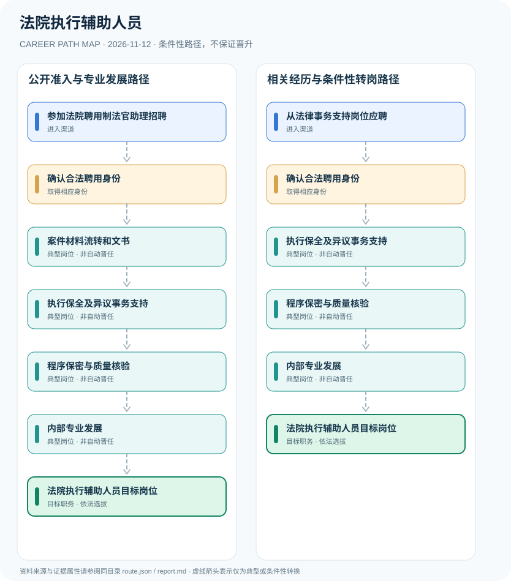

# 法院执行辅助人员

> **B18 Deep Search | JR-113** · 核验 2026-11-12 · 中国大陆人民法院；2026年广州、北京招聘实例

## 一、职业定位与制度效力

法院执行辅助人员受法院正式聘用岗位安排，在执行法官指导下处理材料、保全和执行事务，身份可能为合同制法官助理、政府聘员或书记员。此岗位并非员额法官、司法警察或执行裁判权持有人。

2026年两份法院原始招聘将合同制司法辅助与执行法官的法定职责清楚区分；本图仅列具现实招聘依据的岗位发展，并用条件性箭头标注不同工作阶段。

## 二、两类正式进入渠道

- **参加法院聘用制法官助理招聘**：依具体法院招聘公告参加资格、笔试和面试；职位要求按地区与当年核验。
- **从法律事务支持岗位应聘**：已有书记员、法律服务或档案工作者可重新参加适用招聘，不自动转为法院公务员。

## 三、发展路径与任职关口

### 路径1：公开准入与专业发展路径

依具体法院招聘公告参加资格、笔试和面试；职位要求按地区与当年核验。

**节点序列**：参加法院聘用制法官助理招聘 → 确认合法聘用身份 → 案件材料流转和文书 → 执行保全及异议事务支持 → 程序保密与质量核验 → 内部专业发展 → 法院执行辅助人员目标岗位

> 此路径是条件性职业示意，不是职务晋升承诺，也不赋予法定许可。

### 路径2：相关经历与条件性转岗路径

已有书记员、法律服务或档案工作者可重新参加适用招聘，不自动转为法院公务员。

**节点序列**：从法律事务支持岗位应聘 → 确认合法聘用身份 → 执行保全及异议事务支持 → 程序保密与质量核验 → 内部专业发展 → 法院执行辅助人员目标岗位

> 此路径是条件性职业示意，不是职务晋升承诺，也不赋予法定许可。

## 四、岗位活动与专业能力

岗位成果包括案件材料准确率、庭外事务协调、文书规范、数据保密、诉讼服务质量等。

- **确认合法聘用身份**：识别劳动合同制、政府聘员、法院公务员及司法警察身份差异。
- **案件材料流转和文书**：在法官指导下协助接收、整理、送达及归档执行材料。
- **执行保全及异议事务支持**：辅助执行法官开展保全、异议复议文件准备和执行实施等支持工作。
- **程序保密与质量核验**：规范个人信息保护、文书期限与证据流转，不能独立作出强制执行司法决定。
- **内部专业发展**：依据机构岗位管理承担培训和质量工作，转法官或司法警察须独立履行法定程序。

## 五、法规与可核查准入条件

- 广州中院2026年合同制法官助理职责明确包含配合执行法官办理保全、异议复议和执行实施。
- 广州增城区2026年法院聘员公告同样列有执行相关辅助事务；岗位学历与年龄条件因法院而异。
- 正式员额法官、法院公务员辅助人员、合同制聘员和司法警察并不因工作内容交叉而具有相同身份。

## 六、边界、时效与主要风险

- 各地法院招录条件不能互相套用，2026年已结束的公告不代表当前开放报名。
- 不得以法院合同制职位介绍为依据承诺自动转编或成为法官。
- 不披露涉案隐私及未公开的执行信息。

## 七、逐边证据台账

说明：节点关联 `source_ids` 指向下列公开资料；各边为条件性关系而非法定自动晋升。适用法律与岗位招聘需按年度、地区和用人单位独立审核。

| 前置节点 | 后续节点 | 证据属性 | 条件 |
|---|---|---|---|
| 参加法院聘用制法官助理招聘 | 确认合法聘用身份 | `conditional` | 从「参加法院聘用制法官助理招聘」到「确认合法聘用身份」须独立满足适用招聘、岗位资格、机构授权及组织考核，不保证晋升。 |
| 确认合法聘用身份 | 案件材料流转和文书 | `conditional` | 从「确认合法聘用身份」到「案件材料流转和文书」须独立满足适用招聘、岗位资格、机构授权及组织考核，不保证晋升。 |
| 案件材料流转和文书 | 执行保全及异议事务支持 | `conditional` | 从「案件材料流转和文书」到「执行保全及异议事务支持」须独立满足适用招聘、岗位资格、机构授权及组织考核，不保证晋升。 |
| 执行保全及异议事务支持 | 程序保密与质量核验 | `conditional` | 从「执行保全及异议事务支持」到「程序保密与质量核验」须独立满足适用招聘、岗位资格、机构授权及组织考核，不保证晋升。 |
| 程序保密与质量核验 | 内部专业发展 | `conditional` | 从「程序保密与质量核验」到「内部专业发展」须独立满足适用招聘、岗位资格、机构授权及组织考核，不保证晋升。 |
| 内部专业发展 | 法院执行辅助人员目标岗位 | `conditional` | 从「内部专业发展」到「法院执行辅助人员目标岗位」须独立满足适用招聘、岗位资格、机构授权及组织考核，不保证晋升。 |
| 从法律事务支持岗位应聘 | 确认合法聘用身份 | `conditional` | 从「从法律事务支持岗位应聘」到「确认合法聘用身份」须独立满足适用招聘、岗位资格、机构授权及组织考核，不保证晋升。 |
| 确认合法聘用身份 | 执行保全及异议事务支持 | `conditional` | 从「确认合法聘用身份」到「执行保全及异议事务支持」须独立满足适用招聘、岗位资格、机构授权及组织考核，不保证晋升。 |

## 八、来源与发布机构（原始日期）

1. **广州市中级人民法院**：[广州市中级人民法院2026年公开招聘劳动合同制审判辅助人员公告](https://www.gzcourt.gov.cn/fygg/zpgg/2026/05/29122915894.html)（2026-05-29）
2. **广州市增城区人民政府**：[广州市增城区人民法院2026年公开招聘政府聘员公告](https://www.zc.gov.cn/zx/ztjj/rcfw/zpxx/content/post_11009147.html)（2026-09-17）
3. **北京市人民政府**：[北京市法院系统2026年聘用制审判辅助人员招聘公告](https://www.beijing.gov.cn/fuwu/bmfw/sy/jrts/202604/t20260409_4578302.html)（2026-04-09）

> **复核提醒**：发布日期不等于生效日期；已经结束的招聘不可作为仍开放的报名窗口。岗位身份、职业许可、业务权限和组织任用不可互换。
