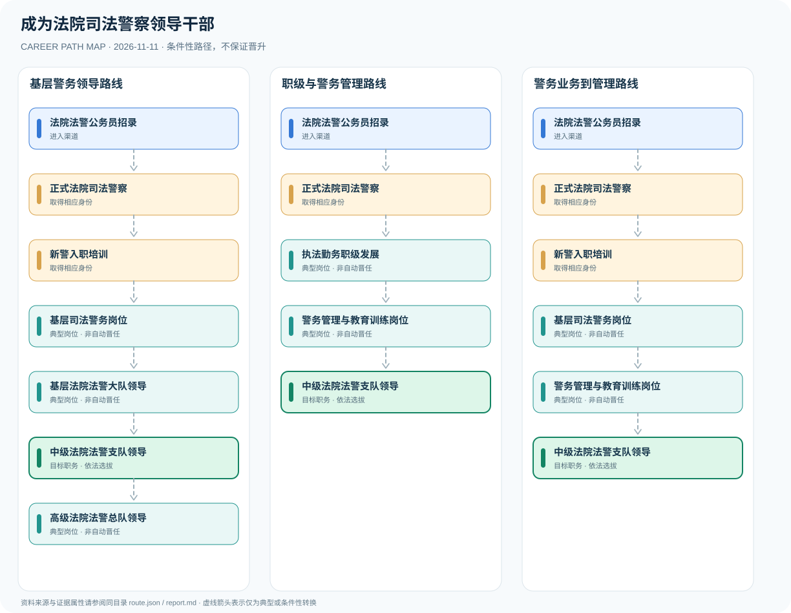

# 成为法院司法警察领导干部

> 中国大陆 · 法院系统 · 资料核验 2026-11-11

## 职业定位

分析正式司法警察入职、基层警务与大队、支队、总队领导岗位之间的区别，强调警衔和领导职务不能混用。

## 常见职业路径

### 基层警务领导路线

由正式法警经基层经验与选拔进入不同层级领导岗位。

公务员职位招录 → 正式司法警察 → 基层警务骨干 → 法警大队领导 → 法警支队领导 → 法警总队领导

### 警务管理路线

经警务管理岗位后争取相应领导岗位。

公务员职位招录 → 正式司法警察 → 警务管理机关岗位 → 法警支队领导

## 岗位说明

- **正式司法警察**：正式法警身份不等于聘用制警务辅助人员。
- **基层警务骨干**：积累警务保障与队伍管理工作经验。
- **法警大队领导**：基层人民法院司法警察大队的领导岗位。
- **警务管理机关岗位**：警务管理岗位可以形成不同职业经历。
- **法警支队领导**：中级人民法院司法警察支队的领导岗位。
- **法警总队领导**：高级人民法院司法警察总队的领导岗位。

## 任职资格与条件

- 关注省级公务员职位表中的法院司法警察正式职位。
- 领导职务和警衔、警员职级属于不同维度。
- 按当年岗位条件完成笔试、面试、体检及考察。

## 注意事项与事实边界

- 大队、支队、总队是机构层级，不是个人必经晋升顺序。
- 引用的公开暂行条例发布时间较早，使用时需核对现行效力。
- 聘用制辅助岗位不能自动转为正式法警。

职业发展路线是制度说明与可能经历的图谱，**不是保证晋升的承诺**。所有跨岗位箭头均须依照职位条件及组织任用程序解释。

## 官方资料

1. [人民法院司法警察暂行条例](https://www.court.gov.cn/jianshe/xiangqing/147.html) — 最高人民法院（1997-05-04）
