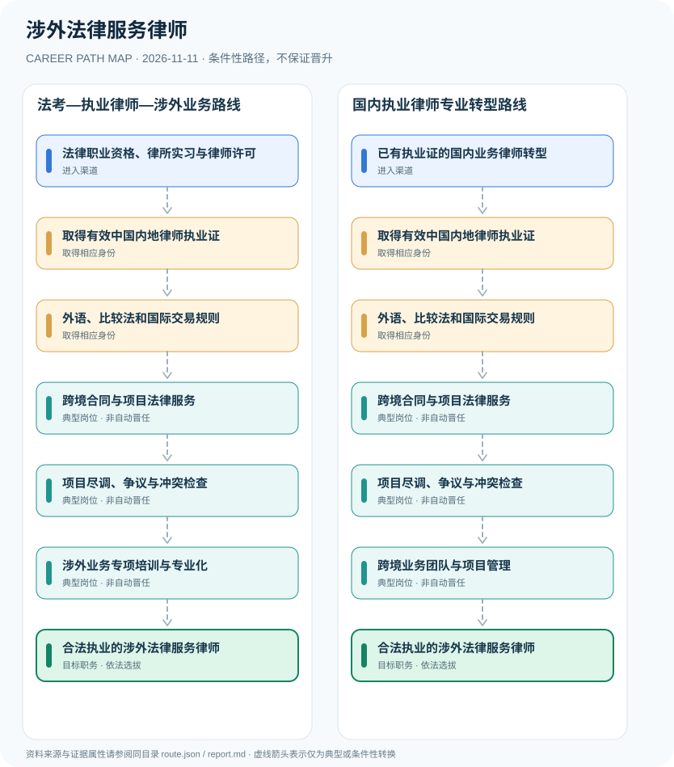

# 涉外法律服务律师

> **B16 深度研究 · JR-108** · 机构与地域：中国大陆执业律师涉外法律事务；海外法域执业许可独立核验 · **核验日期：2026-11-11**

## 一、职业定义与现行制度

涉外法律服务律师首先须依法取得内地律师执业资格及执业证，再依事务所与客户项目积累跨境交易、国际争端、外商投资等能力。2026年修正《律师法》新增第七条明确发展涉外法律服务、加强涉外律师人才培养，但并未创设一个替代律师执业证的统一“涉外律师许可证”。

**2026年新法关键判断**：全国人大常委会2026年8月修正案通过且9月1日生效，增加涉外法律服务事业和人才培养条款。该条是行业发展政策而不是新设涉外律师执业证。律师执业身份必须先满足修正后的第八条与执业许可条件；外语证书、境外学位、国际仲裁培训或律所头衔只能作为能力经历，不能代替法定许可。

## 二、两类准入与身份确认

- **法律职业资格、律所实习与律师许可**：依法满足法律职业资格考试条件，通过考试、完成律所实习并申请司法行政机关执业许可。
- **已有执业证的国内业务律师转型**：合法执业律师可补充涉外法律训练、交易语言和冲突法知识，根据事务所岗位与客户需求参与涉外项目。

## 三、法规、资质和考试的判断

- 2026年8月28日修正《律师法》的决定自2026年9月1日起施行，新增第七条：国家积极发展涉外法律服务业并加强涉外律师人才培养。
- 修正后《律师法》第八条规定律师执业条件包括国家统一法律职业资格和律师事务所实习满一年，须再按规定申请执业许可。
- 司法部2026年法考公告对报名学历、职业经历等有不同适用条件，不能把个别高校学历直接等同于律师执业资格。
- 内地律师执业资格并不当然允许在外国法域以当地律师身份出庭或提供受限制的当地法律意见。

## 四、职业发展路径与条件性节点

### 路线1｜法考—执业律师—涉外业务路线

经法律资格、律师许可、涉外业务学习和事务所实际委托，从基础项目发展到专业领域。

**条件性路径**：法律职业资格、律所实习与律师许可 → 取得有效中国内地律师执业证 → 外语、比较法和国际交易规则 → 跨境合同与项目法律服务 → 项目尽调、争议与冲突检查 → 涉外业务专项培训与专业化 → 合法执业的涉外法律服务律师

该路线仅表示可能存在的职业经历；下一阶段均须重新核查资格、机构岗位和考核任职制度，不意味着保证录用或晋升。

### 路线2｜国内执业律师专业转型路线

已取得律师许可的人员增进涉外法律知识，参与跨境客户项目并可能承担团队协调。

**条件性路径**：已有执业证的国内业务律师转型 → 取得有效中国内地律师执业证 → 外语、比较法和国际交易规则 → 跨境合同与项目法律服务 → 项目尽调、争议与冲突检查 → 跨境业务团队与项目管理 → 合法执业的涉外法律服务律师

该路线仅表示可能存在的职业经历；下一阶段均须重新核查资格、机构岗位和考核任职制度，不意味着保证录用或晋升。

## 五、工作能力、项目与成果评价

专业成果可从双语合同质量、跨法域尽调、法规变动检索、项目风险提示和争端管理中体现。涉外律师在外国法院的出庭资格和本地法律意见权限依该外国法域的法律职业准入另行审查。

- **取得有效中国内地律师执业证**：经司法行政许可在律师事务所执业，法律职业资格证书不等于律师执业证书。
- **外语、比较法和国际交易规则**：熟悉合同语言、冲突法、争议解决、跨境数据及境外法规检索；语言证书本身不是独立执业许可。
- **跨境合同与项目法律服务**：在依法允许的业务范围内参与国际贸易、投资并购、仲裁协助或外资企业法务项目。
- **项目尽调、争议与冲突检查**：对管辖法律、客户身份、利益冲突、合规尽调和委托合同进行核验，必要时与境外执业律师协作。
- **涉外业务专项培训与专业化**：参加律所、律师协会或司法行政部门的涉外法律服务能力培养，不将培训证书宣传为额外法定职业资格。
- **跨境业务团队与项目管理**：符合事务所组织聘任和专业能力要求时可能负责跨境案件或交易团队；合伙人身份另行审核。

## 六、适用地区、生效版本及风险

- 国家政策支持涉外律师培养不等于给所有涉外项目工作者发放额外国家统一职业资格证。
- 广东粤港澳大湾区港澳律师执业试点属于单独制度，不能被当作普通内地律师境外执业的通用许可。
- 国际交易涉及外汇、制裁、竞争、数据跨境等多法域问题时，应识别执业边界并与合格当地法律服务者协作。

## 七、证据与图谱的映射

对每一节点，`route.json` 中的 `source_ids` 指向下文的可核查公开来源；每条转换边均标为 `conditional`，不会冒充有明确法律规定的 `normative` 自动晋升。不同的法定资格、机构选聘、职位级别及劳动关系各自独立。

| 转换前 | 转换后 | 证据属性 | 适用限制 |
|---|---|---|---|
| 法律职业资格、律所实习与律师许可 | 取得有效中国内地律师执业证 | `conditional` | 从「法律职业资格、律所实习与律师许可」至「取得有效中国内地律师执业证」取决于法定资格、岗位条件或独立选聘考核，绝非自动晋升。 |
| 取得有效中国内地律师执业证 | 外语、比较法和国际交易规则 | `conditional` | 从「取得有效中国内地律师执业证」至「外语、比较法和国际交易规则」取决于法定资格、岗位条件或独立选聘考核，绝非自动晋升。 |
| 外语、比较法和国际交易规则 | 跨境合同与项目法律服务 | `conditional` | 从「外语、比较法和国际交易规则」至「跨境合同与项目法律服务」取决于法定资格、岗位条件或独立选聘考核，绝非自动晋升。 |
| 跨境合同与项目法律服务 | 项目尽调、争议与冲突检查 | `conditional` | 从「跨境合同与项目法律服务」至「项目尽调、争议与冲突检查」取决于法定资格、岗位条件或独立选聘考核，绝非自动晋升。 |
| 项目尽调、争议与冲突检查 | 涉外业务专项培训与专业化 | `conditional` | 从「项目尽调、争议与冲突检查」至「涉外业务专项培训与专业化」取决于法定资格、岗位条件或独立选聘考核，绝非自动晋升。 |
| 涉外业务专项培训与专业化 | 合法执业的涉外法律服务律师 | `conditional` | 从「涉外业务专项培训与专业化」至「合法执业的涉外法律服务律师」取决于法定资格、岗位条件或独立选聘考核，绝非自动晋升。 |
| 已有执业证的国内业务律师转型 | 取得有效中国内地律师执业证 | `conditional` | 从「已有执业证的国内业务律师转型」至「取得有效中国内地律师执业证」取决于法定资格、岗位条件或独立选聘考核，绝非自动晋升。 |
| 项目尽调、争议与冲突检查 | 跨境业务团队与项目管理 | `conditional` | 从「项目尽调、争议与冲突检查」至「跨境业务团队与项目管理」取决于法定资格、岗位条件或独立选聘考核，绝非自动晋升。 |
| 跨境业务团队与项目管理 | 合法执业的涉外法律服务律师 | `conditional` | 从「跨境业务团队与项目管理」至「合法执业的涉外法律服务律师」取决于法定资格、岗位条件或独立选聘考核，绝非自动晋升。 |

## 八、来源及原始发布日期

1. **中华人民共和国司法部智慧普法平台**：[全国人大常委会关于修改《中华人民共和国律师法》的决定](https://legalinfo.moj.gov.cn/zhfxfzzx/fzzxyw/202608/t20260829_539051.html)（原文件或规定日期：2026-08-28）。
2. **中华人民共和国司法部**：[2026年国家统一法律职业资格考试公告](https://www.moj.gov.cn/pub/sfbgw/zwxxgk/fdzdgknr/fdzdgknrtzwj/202606/t20260605_536058.html)（原文件或规定日期：2026-06-05）。
3. **中华人民共和国司法部（转载法治日报）**：[新修改的律师法解读：推进律师行业健康有序发展](https://www.moj.gov.cn/pub/sfbgw/zwgkztzl/xxxcgcxjpfzsx/fzsxpljj/202608/t20260831_539087.html)（原文件或规定日期：2026-08-31）。

> **研究限制**：法规发布日期和实施日期可能不同；2027招录的专项条件以招聘公告实时版本及具体职位表为准。本研究不作个人晋升概率预测，不公开非公开的军队、警务、医疗或个人数据。
