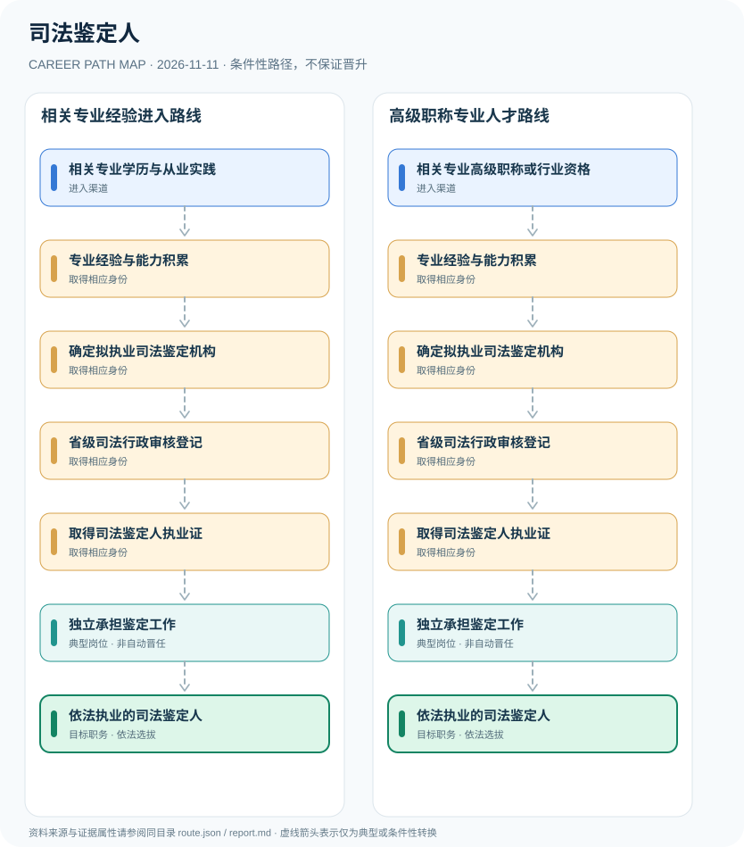

# 司法鉴定人

> **批次**：B11 · JR-112 · **适用范围**：中国大陆·司法行政机关登记管理的司法鉴定业务 · **核验日期**：2026-11-11

## 执行摘要

司法鉴定人必须符合与所申报鉴定类别相关的专业条件，经拟执业机构申请并由省级司法行政机关审核登记，领取司法鉴定人执业证后方能依法执业。

司法鉴定人是通过科学技术或专门知识，对诉讼专门问题作出鉴别、判断并出具意见的人员。它是受登记管理的执业身份，不等同于司法机关工作人员、医师或公安刑事技术岗位。

## 一、准入方式及行政／招聘程序

专业背景是必要前提之一，但不同申请类别的学历、职称、从业经历以及既有行业资格要求并不完全一致。司法行政机关对申请材料作形式及实质审查，而非只看证书名称。

- **相关专业学历与从业实践**：相关专业学历并结合符合规定的工作经历或行业执业资格，按申请鉴定类别核对条件。
- **相关专业高级职称或行业资格**：具有相关高级专业技术职称等法定条件的申请人，仍需满足其他行业与登记条件。

## 二、常见路线与机构决定点

### 1. 相关专业经验进入路线

根据学历或相关执业资格与工作经历，满足登记条件，再由拟执业机构申请审核登记。

**阶段示意**：相关专业学历与从业实践 → 专业经验与能力积累 → 确定拟执业司法鉴定机构 → 省级司法行政审核登记 → 取得司法鉴定人执业证 → 独立承担鉴定工作 → 依法执业的司法鉴定人

**解释**：上述转换由岗位条件、资格确认、招聘或任用程序控制。即使具有上一阶段经历，也不保证任职下一阶段。

### 2. 高级职称专业人才路线

相关高级专业技术人员仍需满足执业机构和登记条件，没有免除审批的快速入职通道。

**阶段示意**：相关专业高级职称或行业资格 → 专业经验与能力积累 → 确定拟执业司法鉴定机构 → 省级司法行政审核登记 → 取得司法鉴定人执业证 → 独立承担鉴定工作 → 依法执业的司法鉴定人

**解释**：上述转换由岗位条件、资格确认、招聘或任用程序控制。即使具有上一阶段经历，也不保证任职下一阶段。

## 三、关键职责与专业发展

取得执业证后，应限于登记的专业类别和机构执业，接受监督与继续教育。未来担任技术负责人或机构管理岗位需要独立的管理条件，不能从执业证推出自动晋升。

- **专业经验与能力积累**：应符合申报鉴定类别的工作年限、专门技术能力与执业机构等条件。
- **确定拟执业司法鉴定机构**：申请须由拟执业机构提交材料，机构应已获得或正在申请相应司法鉴定许可证。
- **省级司法行政审核登记**：省级司法行政机关对执业能力和材料依法审核，符合条件决定准予登记。
- **取得司法鉴定人执业证**：依法取得执业证方可在登记执业类别和执业机构范围内执业。
- **独立承担鉴定工作**：在机构指派下依法出具专业鉴定意见并遵守保密、回避、出庭作证等义务。

## 四、关键资格、执业条件与区别

- 司法部令第96号《司法鉴定人登记管理办法》第12条对相关高级职称、相关行业资格或本科与工作经历作出分类要求；经验型和技能型鉴定还另有条件。
- 拟执业机构应已取得或正在申请司法鉴定许可证；必须经省级司法行政机关登记并取得《司法鉴定人执业证》。
- 2020年司法部对第15条解释要求实质核实申请人的执业能力，可组织专家评审和考核。

## 五、证据分类和路线关系

本图把制度依据和职业经历分开：`normative` 表示有明确法规支持的规则，`official_description` 表示官方公开职责，`illustrative` 代表示意经历，`conditional` 代表资格、招聘、考核或任用控制的转换。本研究**不会把职业图谱中的箭头写成保证晋升**；全图边均显式标为条件性职业转换。职业身份、岗位层级、职称、行政职级和证书不可互换。

| 转换关系 | 证据分类 | 约束说明 |
|:--|:--|:--|
| 相关专业学历与从业实践 → 专业经验与能力积累 | `conditional` | 从「相关专业学历与从业实践」转向「专业经验与能力积累」须依本岗资格、机构要求和实际程序审核；不是任何人的自动晋升。 |
| 专业经验与能力积累 → 确定拟执业司法鉴定机构 | `conditional` | 从「专业经验与能力积累」转向「确定拟执业司法鉴定机构」须依本岗资格、机构要求和实际程序审核；不是任何人的自动晋升。 |
| 确定拟执业司法鉴定机构 → 省级司法行政审核登记 | `conditional` | 从「确定拟执业司法鉴定机构」转向「省级司法行政审核登记」须依本岗资格、机构要求和实际程序审核；不是任何人的自动晋升。 |
| 省级司法行政审核登记 → 取得司法鉴定人执业证 | `conditional` | 从「省级司法行政审核登记」转向「取得司法鉴定人执业证」须依本岗资格、机构要求和实际程序审核；不是任何人的自动晋升。 |
| 取得司法鉴定人执业证 → 独立承担鉴定工作 | `conditional` | 从「取得司法鉴定人执业证」转向「独立承担鉴定工作」须依本岗资格、机构要求和实际程序审核；不是任何人的自动晋升。 |
| 独立承担鉴定工作 → 依法执业的司法鉴定人 | `conditional` | 从「独立承担鉴定工作」转向「依法执业的司法鉴定人」须依本岗资格、机构要求和实际程序审核；不是任何人的自动晋升。 |
| 相关专业高级职称或行业资格 → 专业经验与能力积累 | `conditional` | 从「相关专业高级职称或行业资格」转向「专业经验与能力积累」须依本岗资格、机构要求和实际程序审核；不是任何人的自动晋升。 |

## 六、适用边界与更新风险

- 司法鉴定业务有登记管理范围与类别限制；持医学执业资格、刑事技术警察身份或实验室岗位本身都不自动赋予司法鉴定执业资格。
- 规章于2005年公布，2020年已有解释，后续需要继续核对具体省份的申报指南、业务分类和制度有效性。
- 出具鉴定意见需依法独立、客观，并执行保密、回避和机构执业要求。

## 七、官方和公开核验来源

1. [司法鉴定人登记管理办法（司法部令第96号）](https://sft.ln.gov.cn/sft/ywgz/ggflfw/2025021215543550573/index.shtml) — 辽宁省司法厅（转载司法部规章），原文日期 2005-09-30。
2. [司法部关于司法鉴定人登记审核有关问题的解释](https://www.moj.gov.cn/pub/sfbgw/zwxxgk/fdzdgknr/fdzdgknrtzwj/202103/t20210316_207938.html) — 中华人民共和国司法部，原文日期 2020-06-05。
3. [司法鉴定政务服务办事指南](https://www.moj.gov.cn/zwfw/zwfwbszn/bsznsfjd/) — 中华人民共和国司法部，原文日期 2021-12-28。

> **下一次更新检查**：实际申请时重新查当年岗位计划、地区特殊限制和新规替代情形。个人发展结果不作预测。
