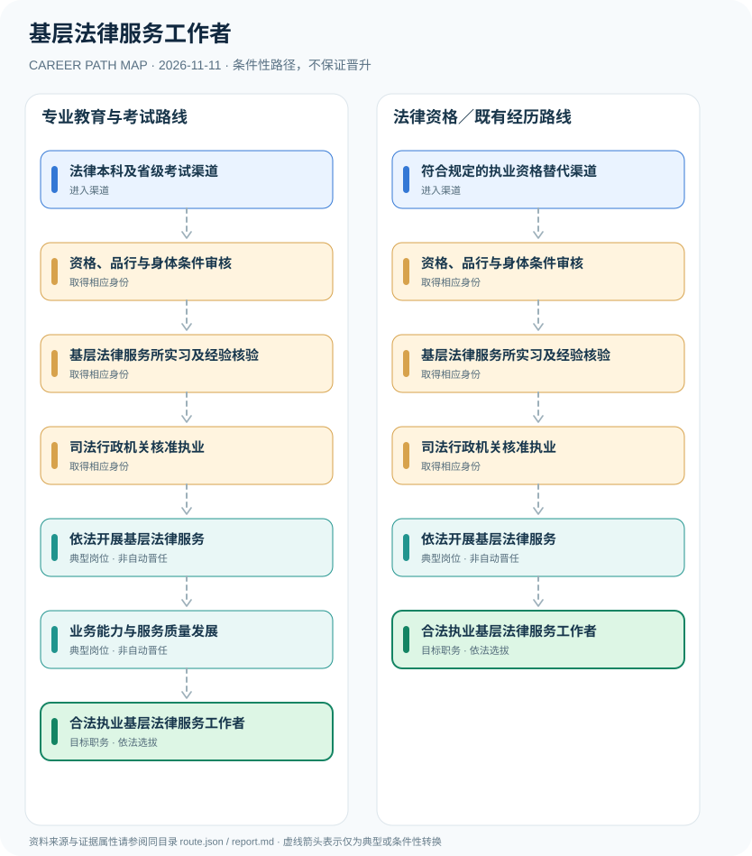

# 基层法律服务工作者

> **研究批次** B12 · JR-116　|　**范围**：中国大陆；司法部令第138号适用的基层法律服务制度　|　**核验日期**：2026-11-11

## 摘要与职业定位

基层法律服务工作者须符合学历考试或法定适用的其他条件、品行健康与实习等规定，由司法行政机关核准取得执业证并在基层法律服务所开展业务，不等同于律师资格。

**准入辨析**：司法部令第138号（2017年修订，2018年2月实施）将基层法律服务工作者定义为由司法行政机关核准取得特定执业证、在基层法律服务所开展业务的人员。符合某种法律职业经历可影响实习要求，但并不意味着免除执业核准。

## 进入职业的合法渠道

- **法律本科及省级考试渠道**：法律专业本科毕业并参加省级司法行政机关组织的相应考试合格，符合所在地区适用规定。
- **符合规定的执业资格替代渠道**：持规定的法律职业资格或其他符合规章规定的适用条件者，仍须核对所属省区具体政策。

## 2 种代表性职业发展路线

### 1. 专业教育与考试路线

经法律专业教育、适用考试及基层所实习后，依法核准执业。

**岗位序列（条件性示意）**：法律本科及省级考试渠道 → 资格、品行与身体条件审核 → 基层法律服务所实习及经验核验 → 司法行政机关核准执业 → 依法开展基层法律服务 → 业务能力与服务质量发展 → 合法执业基层法律服务工作者

### 2. 法律资格／既有经历路线

符合法律规定的其他资格条件或工作经历者，仍须经法定审核、实习要求核验及执业证核准。

**岗位序列（条件性示意）**：符合规定的执业资格替代渠道 → 资格、品行与身体条件审核 → 基层法律服务所实习及经验核验 → 司法行政机关核准执业 → 依法开展基层法律服务 → 合法执业基层法律服务工作者

## 重要职责、技能和岗位发展

**职业发展**：从规范接案、群众咨询和合同事务等基层法律服务中积累专业能力，可能成长为服务所业务骨干。若目标是律师，需要另行满足律师执业资格和许可条件，本图不画不存在的自动转化箭头。

- **依法开展基层法律服务**：在基层法律服务所、核准范围内依法提供民事代理、咨询等规定业务并遵守管理要求。
- **业务能力与服务质量发展**：累积合规执业、文书、群众法治服务与专业学习经验，发展不代表自动获得律师执业证。

## 准入门槛与任职规则

- 《基层法律服务工作者管理办法》（司法部令第138号）第二条明确须经司法行政机关核准领取执业证，且在基层法律服务所执业。
- 第六条规定有关法律专业学历、地方考试、品行健康与实习条件，并对部分地区学历要求、具有其他法律职业经历者设例外规定；须逐条核对。
- 基层法律服务工作者与执业律师是不同法定资格类别，不得以基层执业证自动推断律师身份。

## 证据状态与实际约束

路线图中的箭头均为 `conditional`：即使前一节点的经历成立，后续任用、考试、职业资格、选拔或招聘仍需独立满足制度要求。`normative` 专指法律直接规定的关系，`official_description` 指官方机构说明，`illustrative` 指仅用于理解的示例；具体证据来源链接见下文。

- 地区考试安排和证书办理规则可能存在差异，不得把个别地方简章当作全国统一报考入口。
- 不得把法律职业资格证与基层法律服务工作者执业证混同；两者属于不同证书和行政程序。
- 执业范围、参加诉讼的地域限制及管理规则需按现行规定核对。

## 可复核原始资料

1. [基层法律服务工作者管理办法（司法部令第138号）](https://www.beijing.gov.cn/zhengce/zhengcefagui/201905/t20190522_60770.html)，北京市人民政府（转载司法部），2017-12-25。

> **复核提醒**：跨地区、跨机构或新招录年度，必须重新核查原始政策、职位计划及生效状态。此报告不推测晋升概率和个人任职结果。
