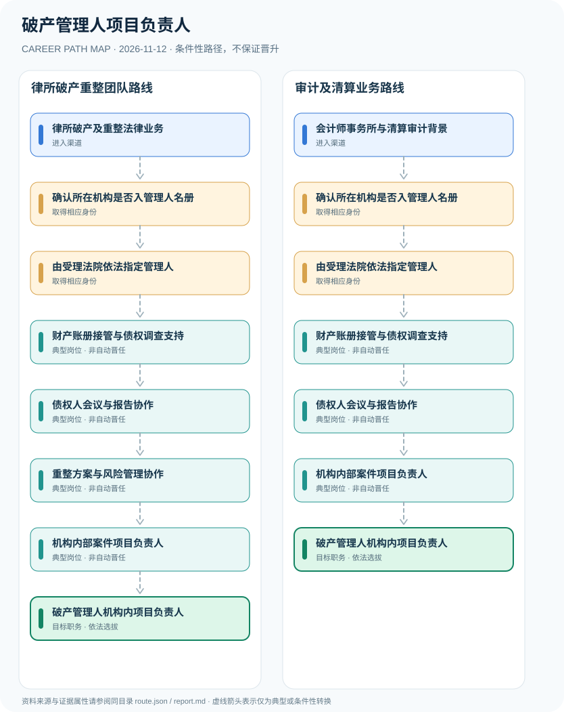

# 破产管理人项目负责人

> **B17 深度调查 · JR-115**　|　**适用地域及机构**：中国大陆企业破产案件；上海市破产管理人名册及考核作为地方实例　|　**核验时间**：2026-11-12

## 摘要：岗位身份、适用制度和效力

破产管理人是人民法院依法指定的清算组、社会中介机构或符合条件的个人；‘破产管理人项目负责人’通常是被指定机构内部负责该案件团队组织的岗位，不能因员工被安排负责项目就推断其个人已被法院指定为法定管理人。司法指定、管理人名册和内部项目经理三条制度必须区分。

**法律责任主体与雇主岗位分离**：最高法2007年规定的管理人名册与指定机制仍是识别入口的重要证据；《企业破产法》第二十四条确认单位或个人可被法院指定。上海破产事务政务服务门户给出地方名册和考核的具体实例，但不构成全国统一‘破产项目经理资格考试’。

## 进入行业的合法渠道

- **律所破产及重整法律业务**：已在依法设立律师事务所从事破产与重整法律业务的人员，可在被指定机构内参与案件管理，个人执业资格依岗位核实。
- **会计师事务所与清算审计背景**：从财务审计、资产清查、会计和清算项目工作进入破产服务，是否担任个人管理人需另外资格认定。

## 两条可比较的职业发展路径

### 路径 1：律所破产重整团队路线

从律师事务所的法律事务人员进入符合条件机构项目，经法院指定后参与法定程序，承担内部案件管理工作。

**条件性节点序列**：律所破产及重整法律业务 → 确认所在机构是否入管理人名册 → 由受理法院依法指定管理人 → 财产账册接管与债权调查支持 → 债权人会议与报告协作 → 重整方案与风险管理协作 → 机构内部案件项目负责人 → 破产管理人机构内项目负责人

路径只说明一种可解释的可能经历，后续岗位须满足新的资质、招聘、考核或任用要求。

### 路径 2：审计及清算业务路线

从会计、清算与审计领域进入已被法院指定的机构项目，经财产调查和债权事务逐步负责项目协同。

**条件性节点序列**：会计师事务所与清算审计背景 → 确认所在机构是否入管理人名册 → 由受理法院依法指定管理人 → 财产账册接管与债权调查支持 → 债权人会议与报告协作 → 机构内部案件项目负责人 → 破产管理人机构内项目负责人

路径只说明一种可解释的可能经历，后续岗位须满足新的资质、招聘、考核或任用要求。

## 关键技能、项目实践与考核

能力证明包括债权资料校核、资产接管流程、利益冲突审查、会议材料质量、重整谈判协作和透明的程序报告。被指定机构对案件负有法定职责，内部负责人应接受合规授权与监督。

- **财产账册接管与债权调查支持**：在机构授权和法律规定下协助财产清点、债权审核、账册信息管理与程序性报告。
- **债权人会议与报告协作**：协助会议组织、管理人报告与债权人沟通，重大决策仍依破产法和法院监督程序。
- **重整方案与风险管理协作**：依据项目成员专业背景协助经营管理、资产处置和重整沟通，保守商业秘密。
- **机构内部案件项目负责人**：依据管理人机构的聘用授权统筹案件工作，机构管理人及个人管理人资格另行核对。

## 法定资格、制度区别与核查条目

- 《企业破产法》第二十二条规定管理人由人民法院指定，第二十四条允许清算组、律师事务所、会计师事务所等担任管理人。
- 最高法《关于审理企业破产案件指定管理人的规定》建立社会中介机构与个人名册制度，法院决定名单并依规则选择。
- 上海市2022年重新编制管理人名册、2024年考核办法等仅是地方管理实例；不能直接推广至所有法院。
- 机构内部项目经理不等于被法院单独指定的个人管理人，个人管理人依法有相应职业资格及执业责任保险要求。

## 风险与地区、年度限制

- 不允许把‘项目负责人’职位绘制为自动具备法院指定管理人资格；法院指定的主体可能是机构或个人。
- 团队工作中的会计、律师、资产评估等专业职责有独立执业边界与回避要求。
- 破产案件涉及商业秘密和当事人隐私，不公开个案非公开资产、债权或职工信息。

## 来源映射及路径证据

`route.json` 记录规范性文件、政策或招聘公告的原文 URL 和发布机构；节点引用 `source_ids`，每条岗位转换保守标为 `conditional`，而非保证升迁的 `normative` 法律权利。涉及真实法定准入的说明见上述条款，避免将机构权责套用到员工个人。

| 前一节点 | 后一节点 | 边属性 | 适用条件 |
|---|---|---|---|
| 律所破产及重整法律业务 | 确认所在机构是否入管理人名册 | `conditional` | 「律所破产及重整法律业务」到「确认所在机构是否入管理人名册」需要独立满足适用职位、资格、权限与机构安排，非自动晋升。 |
| 确认所在机构是否入管理人名册 | 由受理法院依法指定管理人 | `conditional` | 「确认所在机构是否入管理人名册」到「由受理法院依法指定管理人」需要独立满足适用职位、资格、权限与机构安排，非自动晋升。 |
| 由受理法院依法指定管理人 | 财产账册接管与债权调查支持 | `conditional` | 「由受理法院依法指定管理人」到「财产账册接管与债权调查支持」需要独立满足适用职位、资格、权限与机构安排，非自动晋升。 |
| 财产账册接管与债权调查支持 | 债权人会议与报告协作 | `conditional` | 「财产账册接管与债权调查支持」到「债权人会议与报告协作」需要独立满足适用职位、资格、权限与机构安排，非自动晋升。 |
| 债权人会议与报告协作 | 重整方案与风险管理协作 | `conditional` | 「债权人会议与报告协作」到「重整方案与风险管理协作」需要独立满足适用职位、资格、权限与机构安排，非自动晋升。 |
| 重整方案与风险管理协作 | 机构内部案件项目负责人 | `conditional` | 「重整方案与风险管理协作」到「机构内部案件项目负责人」需要独立满足适用职位、资格、权限与机构安排，非自动晋升。 |
| 机构内部案件项目负责人 | 破产管理人机构内项目负责人 | `conditional` | 「机构内部案件项目负责人」到「破产管理人机构内项目负责人」需要独立满足适用职位、资格、权限与机构安排，非自动晋升。 |
| 会计师事务所与清算审计背景 | 确认所在机构是否入管理人名册 | `conditional` | 「会计师事务所与清算审计背景」到「确认所在机构是否入管理人名册」需要独立满足适用职位、资格、权限与机构安排，非自动晋升。 |
| 债权人会议与报告协作 | 机构内部案件项目负责人 | `conditional` | 「债权人会议与报告协作」到「机构内部案件项目负责人」需要独立满足适用职位、资格、权限与机构安排，非自动晋升。 |

## 可复核的公开来源

1. **北京市人民政府（转载法律）**：[中华人民共和国企业破产法](https://www.beijing.gov.cn/zhengce/zhengcefagui/qtwj/202008/t20200804_1973718.html)（原始制度日期 2006-08-27）
2. **最高人民法院**：[最高人民法院关于审理企业破产案件指定管理人的规定](https://www.court.gov.cn/fabu/xiangqing/1085.html)（原始制度日期 2007-04-12）
3. **上海市发展和改革委员会**：[上海破产管理人资格要求与地方名册信息](https://fgw.sh.gov.cn/ys-blpc-1.1.3.1-h5/index.html)（原始制度日期 2024-03-07）

> **研究说明**：来源的发布日期不代表法规施行日期；招聘公告不保证报名窗口仍开放。涉及跨地区或新版本制度时须重新核验。本路线不承诺个人晋升概率。
