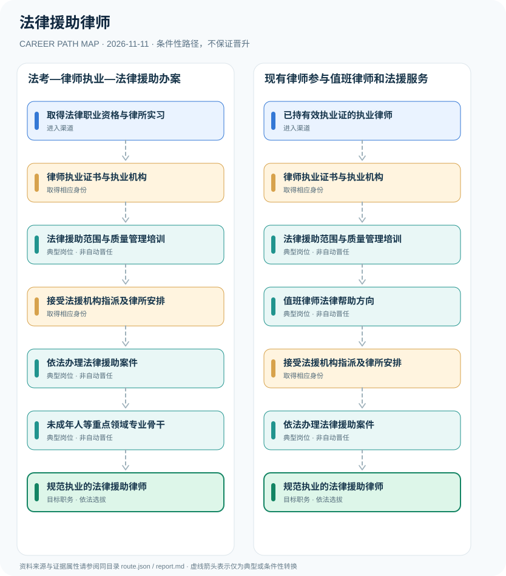

# 法律援助律师

> **B15 深度研究 · JR-109**　｜　**地域与机构**：中国大陆·依法取得律师执业证的法律援助承办律师（区别于法援机构其他法律援助人员）　｜　**核验日期**：2026-11-11

## 01 职业定位与现行制度版本

法律援助律师是依法取得律师执业证并办理法律援助事项的执业律师，不存在一张可替代律师执业证的统一“法律援助律师许可证”。《律师法》2026年8月再次修正，律师执业应满足法律职业资格、实习和司法行政许可；案件由法援机构依法指派、律师事务所安排，值班律师法律帮助又有其独立规则。

**深搜新版本**：北京市司法局公开全文列明《律师法》2026年8月第四次修正，律师身份仍以执业许可和律师执业证为核心。司法部2023年《办理法律援助案件程序规定》明确法援机构的指派和律所安排关系；2026年司法部法援服务页面转载了适用程序，但应以规章原始发布时间作为来源日期。

## 02 两类准入及真实制度门槛

- **取得法律职业资格与律所实习**：按适用法考政策取得法律职业资格，并在律师事务所实习符合规定期限、考核合格。
- **已持有效执业证的执业律师**：已有律师执业证的律师，可通过所在律师事务所接受法律援助机构指派或者参加规范的值班律师服务。

- 《中华人民共和国律师法》于2026年8月28日第四次修正；第八、九条规定法律职业资格、律所实习一年和司法行政许可等律师执业条件。
- 《中华人民共和国法律援助法》规定法律援助机构负责组织实施法律援助，人员包含律师、基层法律服务工作者及其他合法人员。
- 司法部2023年修订《办理法律援助案件程序规定》第24—26条对指派及重大刑事案件律师资历作出规定。
- 值班律师提供的法律帮助与接受指派担任辩护律师存在程序和法律服务范围差异。

## 03 典型发展路线及任职决定点

### 路线1：法考—律师执业—法律援助办案

从取得法律职业资格和律所实习开始，获得律师许可后接受法律援助机构合法指派承办案件。

**条件性节点**：取得法律职业资格与律所实习 → 律师执业证书与执业机构 → 法律援助范围与质量管理培训 → 接受法援机构指派及律所安排 → 依法办理法律援助案件 → 未成年人等重点领域专业骨干 → 规范执业的法律援助律师

应在每次考试、身份取得、聘用、晋升或岗位任命时重新审核条件；不能把这条示意路径当作法律规定的必然晋升链条。

### 路线2：现有律师参与值班律师和法援服务

已有执业证律师通过法援培训与机构安排参与值班服务，再依法承办指派的援助案件。

**条件性节点**：已持有效执业证的执业律师 → 律师执业证书与执业机构 → 法律援助范围与质量管理培训 → 值班律师法律帮助方向 → 接受法援机构指派及律所安排 → 依法办理法律援助案件 → 规范执业的法律援助律师

应在每次考试、身份取得、聘用、晋升或岗位任命时重新审核条件；不能把这条示意路径当作法律规定的必然晋升链条。

## 04 工作职责、核心能力与评价方式

**可核验能力**：诉讼文书、取证合规、程序辩护、未成年人保护、依法会见与受援人沟通。由普通承办律师向复杂案件专业骨干发展不由案件数量自动决定；特别案件指派须满足规章要求和机构安排。

- **律师执业证书与执业机构**：依2026年修正《律师法》申请执业许可，取得有效执业证并在合法执业机构开展业务。
- **法律援助范围与质量管理培训**：理解经济困难或其他法定受援条件、代理辩护规范与回避、保密、质量评价要求。
- **接受法援机构指派及律所安排**：法律援助机构决定提供援助后指派律师事务所，律所及时安排本所律师承办。
- **依法办理法律援助案件**：提供刑事辩护、民事行政代理及其他法定法律服务，依据证据和当事人权益履职。
- **值班律师法律帮助方向**：依法律援助机构安排开展程序选择建议、法律咨询等值班法律帮助；不能将值班律师帮助等同全部刑辩代理。
- **未成年人等重点领域专业骨干**：通过专业培训和复杂案件经验发展，特定重罪及未成年人案件的指派存在法定专业经验要求。

## 05 适用边界、时效与容易混淆的身份

- 法律职业资格证书与律师执业证书不是同一证书；法律援助志愿者、法援机构公务员与律所律师也非同一身份。
- 不能将值班律师帮助表述为已自动接受刑事辩护委托；值班律师另有名册、指派与工作安排。
- 2026年律师法修订应作为现行版本，不应继续以2017年修正文本列举全部执业法律条款而不注明版本。

## 06 证据台账与图谱解释

规范性文件、机构职责和招聘公告分别记录在 `route.json` 的 `sources` 中，并由岗位节点使用 `source_ids` 引用。所有边标记为 `conditional`（条件性转换），**不得因来源中存在某项资格就推定本人必获后续岗位**。若需要标注法律明确规定的资格，应在研究说明中具体引用相关条款，而不能把一个推测性职位转换伪装成 `normative`。

| 转换前 | 转换后 | 证据类型 | 约束说明 |
|---|---|---|---|
| 取得法律职业资格与律所实习 | 律师执业证书与执业机构 | `conditional` | 从「取得法律职业资格与律所实习」到「律师执业证书与执业机构」须独立满足资格、岗位要求及考试或组织安排；示意路线不构成保证晋任。 |
| 律师执业证书与执业机构 | 法律援助范围与质量管理培训 | `conditional` | 从「律师执业证书与执业机构」到「法律援助范围与质量管理培训」须独立满足资格、岗位要求及考试或组织安排；示意路线不构成保证晋任。 |
| 法律援助范围与质量管理培训 | 接受法援机构指派及律所安排 | `conditional` | 从「法律援助范围与质量管理培训」到「接受法援机构指派及律所安排」须独立满足资格、岗位要求及考试或组织安排；示意路线不构成保证晋任。 |
| 接受法援机构指派及律所安排 | 依法办理法律援助案件 | `conditional` | 从「接受法援机构指派及律所安排」到「依法办理法律援助案件」须独立满足资格、岗位要求及考试或组织安排；示意路线不构成保证晋任。 |
| 依法办理法律援助案件 | 未成年人等重点领域专业骨干 | `conditional` | 从「依法办理法律援助案件」到「未成年人等重点领域专业骨干」须独立满足资格、岗位要求及考试或组织安排；示意路线不构成保证晋任。 |
| 未成年人等重点领域专业骨干 | 规范执业的法律援助律师 | `conditional` | 从「未成年人等重点领域专业骨干」到「规范执业的法律援助律师」须独立满足资格、岗位要求及考试或组织安排；示意路线不构成保证晋任。 |
| 已持有效执业证的执业律师 | 律师执业证书与执业机构 | `conditional` | 从「已持有效执业证的执业律师」到「律师执业证书与执业机构」须独立满足资格、岗位要求及考试或组织安排；示意路线不构成保证晋任。 |
| 法律援助范围与质量管理培训 | 值班律师法律帮助方向 | `conditional` | 从「法律援助范围与质量管理培训」到「值班律师法律帮助方向」须独立满足资格、岗位要求及考试或组织安排；示意路线不构成保证晋任。 |
| 值班律师法律帮助方向 | 接受法援机构指派及律所安排 | `conditional` | 从「值班律师法律帮助方向」到「接受法援机构指派及律所安排」须独立满足资格、岗位要求及考试或组织安排；示意路线不构成保证晋任。 |
| 依法办理法律援助案件 | 规范执业的法律援助律师 | `conditional` | 从「依法办理法律援助案件」到「规范执业的法律援助律师」须独立满足资格、岗位要求及考试或组织安排；示意路线不构成保证晋任。 |

## 07 官方与公开资料（可追溯）

1. [中华人民共和国律师法（2026年第四次修正）](https://sfj.beijing.gov.cn/sfj/zwgk/2024zcwj/744120751/fl91/744123073/) — 北京市司法局（转载全国人大常委会修正文本）；来源原始日期 2026-08-28。
2. [中华人民共和国法律援助法](https://www.shanghai.gov.cn/zjfcgj/20250919/55e60eb8ae9a44e9b8ed7d9f71392ce5.html) — 上海市人民政府（转载全国人大法律）；来源原始日期 2021-08-20。
3. [办理法律援助案件程序规定（2023年修订）](https://www.moj.gov.cn/pub/sfbgw/jgsz/jgszjgtj/ggflfwglj/ggflfwgljtjxw/202307/t20230721_483090.html) — 中华人民共和国司法部；来源原始日期 2023-07-11。
4. [司法部法律援助案件及值班律师规定说明](https://www.moj.gov.cn/pub/sfbgw/jgsz/jgszzsdw/zsdwflyzzx/flyzzxzcxx/zcxxzcfg/zcfgdfxfggf/202301/t20230104_470206.html) — 中华人民共和国司法部；来源原始日期 2023-01-04。
5. [2026年国家统一法律职业资格考试公告](https://www.moj.gov.cn/pub/sfbgw/zwxxgk/fdzdgknr/fdzdgknrtzwj/202606/t20260605_536058.html) — 中华人民共和国司法部；来源原始日期 2026-06-05。

> **复核协议**：跨年度招生公告、法律修订、专业等级与机构设置可能变化。实际申请和转岗前，须核对当前官方原文、所在地文件及单位职位要求，尤其注意来源发布日期与生效日期未必一致。
